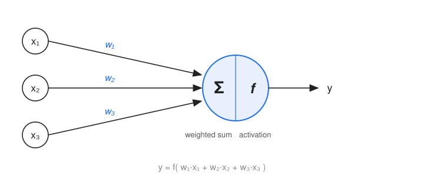
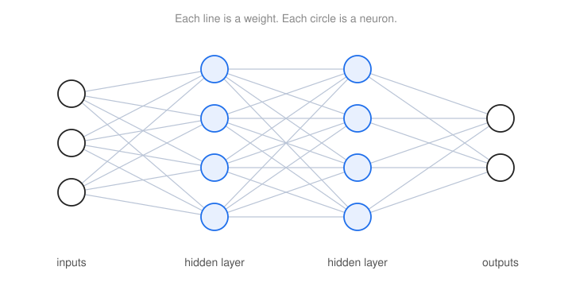
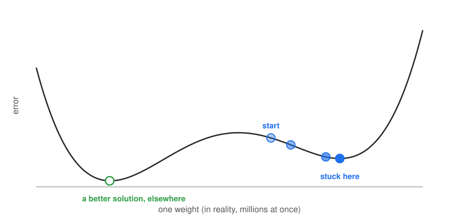
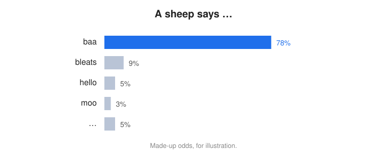

==
AI
==

:Lecture: Lecture 9.3 (slides to come)
:Objectives: Understand, with just enough intuition, how AI differs from the
             algorithms of this course, where it shines, and what it changes
             for a programmer
:Concepts: Specification versus examples, neural network, training, large
           language model, heuristic, checking

.. note::

   This lecture is optional, and it is not part of the exam. It is partly facts,
   and partly opinion, and I will tell you which is which.

Every year, students ask me a fair question: *Do we still need algorithms and data
structures, now that we have AI?* In the previous lectures, we looked at
parallel and quantum computing, which were once the answers to "but we have
better machines now". In 2026, the new answer is AI, and large language models in
particular. Is programming, and so this course, obsolete? To answer, let us first
see what AI is, and what it is not.

A Different Contract
====================

The algorithms of this course answer a *specified* problem, and come with a
guarantee. A sorting algorithm returns a sorted array, always. A linear search
finds the value if it is there. A binary search does it in ``log n`` steps, and we
can prove it. Ask a language model to sort a long list of numbers directly, and it
will probably make a mistake, whereas a merge sort never does, and does it in
``n log n`` steps. AI is *not* an answer to a linear search in ``log n``.

What AI gives is an answer that is *probably good*, with *no guarantee*. In that
sense, it is a **heuristic**, in the family of the hill climbing and simulated
annealing of the optimization module. The difference is in how it is produced.
There are two ways to get a program that does something:

- **We write the rules.** The program consumes data and produces data, by rules
  that we crafted. This is everything we have done so far.
- **We provide data, and an algorithm finds the rules.** We give examples of the
  inputs, and of the outputs we expect, and a *learning* algorithm produces the
  rules. This is machine learning.

So how does an algorithm find the rules?

How Does It Work, at a Glance?
==============================

This is not a course on machine learning. Here are just a few images, so that you
can picture it.

The Artificial Neuron
---------------------

The basic ingredient is the **neuron**. It is a vertex of a graph that stands for a
small calculation (:numref:`beyond/ai/neuron`). It takes a few numbers, as inputs.
Each input has its own **weight**, and the neuron computes the *weighted sum*: It
multiplies each input by its weight, and adds everything up. It then passes the
sum through an **activation function**, a simple function that decides how much of
the sum goes through (for instance, nothing if the sum is negative, and the sum
itself otherwise). The result is the output of the neuron.

   An artificial neuron: A weighted sum of the inputs, then an activation function.

Layers
------

A single neuron does very little. But we can connect many of them, in **layers**,
where the outputs of one layer are the inputs of the next
(:numref:`beyond/ai/network`). It is a *weighted directed graph*, as in the graphs
module, without cycles. To compute the output of the network, we traverse it from
the inputs to the outputs, layer by layer. A whole layer is, in fact, one matrix
computation, as in the quantum lecture, except that it runs on an ordinary
computer.

   Neurons in layers. Each line carries a weight. The weights are the *state* of
   this machine, in the sense of the machines lecture.

The weights are everything this machine remembers. They are its *state*. The
largest networks have billions of them.

Training
--------

How do we set these billions of weights? This is **training**. We have a set of
*examples*: Inputs, and the output we expect for each. We start with random
weights, and we repeat the following:

1. Feed the network with an input of an example.
2. Compare its output with the expected one, to **detect the error**.
3. **Adjust the weights**, a little, so that the error would be smaller.

After millions of examples, the weights have been shaped so that the network gives
the right output for the examples, and, with luck, for new inputs as well.

If this reminds you of something, it should: Training is a **hill climbing**,
where we look for the weights that make the error as low as possible (strictly,
we go *downhill*, since we minimize the error), over millions of parameters at
once. And it has the same traps as in the heuristic search lecture, as in
:numref:`beyond/ai/descent`: We may get stuck in a valley that is not the best one.
There is no guarantee to find the best weights.

   Training goes downhill, and may get stuck in a valley that is not the deepest.

There is one difference with the hill climbing of this course. We do not try the
neighbors one by one: With millions of weights, each of them going up or down,
there would be far too many. Instead, the *slope* of the error, which we can
compute for all the weights at once, tells for each weight in which direction the
error goes down. This is called *gradient descent*.

One Intuition: Universal Approximation
--------------------------------------

Why would such a simple machine be so general? There is a result, which I state
without proof: With *enough neurons*, a network can approximate *any* reasonable
function, with any accuracy we like. This is the *universal approximation
theorem*. So, in principle, a network can represent the rule we are looking for,
whatever it is.

A caution, though. It says that a good network *exists*. It does not say that
training will *find* it, or how many neurons it takes. It is a promise of
possibility, and not a recipe.

Large Language Models
---------------------

A **large language model**, or LLM, is a neural network of this kind, at a giant
scale, with a simple job: Given the text so far, compute how *likely* each possible
next word is (in fact, each next piece of a word). :numref:`beyond/ai/next_word`
illustrates it.

   A language model gives odds for the next word. (The numbers are made up.)

To answer a question, the model takes the question as the beginning of the text. It
picks a likely first word for the answer, with some randomness, so not always the
*most* likely, and that is why the answers vary. It adds this word to the text, and
does it again: A likely second word, then a third, one at a time. The model is
trained on huge amounts of text to predict the next word, and then refined to behave
as an assistant. It does not store the texts: What it has learned is in its weights.

This is a gross simplification, but it is a good picture to keep. And a reason why it
took off is hardware: Graphics cards do matrix computations on many numbers at the
same time, which are the parallel machines of the previous lecture.

Where It Shines
===============

There is no complexity class of the problems where AI shines. It is not about how
hard a problem is to *compute*. But two kinds of problems stand out.

**Problems that nobody can specify.** Is there a cat in this photograph? Is this
e-mail spam? What is a good translation of this sentence? We cannot write the
rules, so there is *no algorithm at all*, in any class. But we have plenty of
examples, and learning from examples is what AI does.

**Problems where a guess is cheap to check.** Remember the two sides of a problem,
in the lecture on complexity classes: Finding is hard, and checking is often easy. An
AI that *proposes*, and an exact checker that *verifies*, make a powerful pair. The
AI is a learned heuristic that guides the search, and the checker keeps it honest.
A game player guides a tree search. A program is checked by tests. A proof is
checked by a proof checker. The correctness comes from the *checker*, and not from
the AI. (It is a faint echo of the machine that always guesses right, except that
the AI guesses *well*, not always right.)

Where we have a specification and an efficient algorithm, such as sorting, shortest
paths or a minimum spanning tree, use the algorithm: The AI would be slower and less
reliable.

Why "Good Enough" Works
-----------------------

AI gives answers that are good enough, and in practice it works. The errors are
not too bad, and not impossible, only unlikely. Whether it works for *you* depends on
the *cost of an error*, and on whether you can *detect* it. For a movie
recommendation, a wrong answer costs nothing. For a medical decision, a wrong answer
that looks right is a disaster.

The world of algorithms has its own version of "good enough": *bounded-error*
algorithms, where the probability of an error is small, and we can make it as small
as we like by repeating (BQP, in the quantum lecture, is of this kind). For AI, there
is no such bound, in general. And the errors are often *systematic*: The same
misunderstanding comes back every time, so repeating the question does not always
fix it.

What It Changes for Engineers
=============================

Up to here, I told you facts. This section is my *take*, as a software engineer, and
it could be wrong. In my company, we have full access to AI, and we are encouraged to
use it. I do not write code anymore. Too bad, I liked it, and I miss it at times. But I
cannot help reviewing it. The AI has injected errors that bit me, and it has also
surprised me with designs I would never have thought of. It is a very fast colleague,
whose work I check. And understanding by *reviewing* feels, as of today, a bit
shallower than understanding by writing. Maybe it is just me, but I suspect it is
one more reason to write code yourself while you learn.

Does it still matter how the code is written? Less than before, because changing code
has become so cheap. Changes that were too risky or too expensive a few years ago are
now real options. But the generated code is far from perfect, and the further we zoom
out, from the function to the components to the whole architecture, the more it shows.

So what matters, when *doing* is cheap? **Understanding what a change will do to the
rest**: How it disturbs the system, and even the ecosystem around it, such as the load
on a third-party API, our business partners, or the way users interact with it. Think
of Amdahl's law: Writing code got fast, understanding the consequences did not, and
that is what now limits us. This is where the tools of this course are precious:
Contracts and clear interfaces, to reason about components (a large, spaghetti-like
system cannot be reasoned about), knowing the cost of what we ask for, and choosing
the right structure.

I do not know where it will stop. But I believe the lens of this course will hold: A
guess is cheap, and a check is what we trust.
