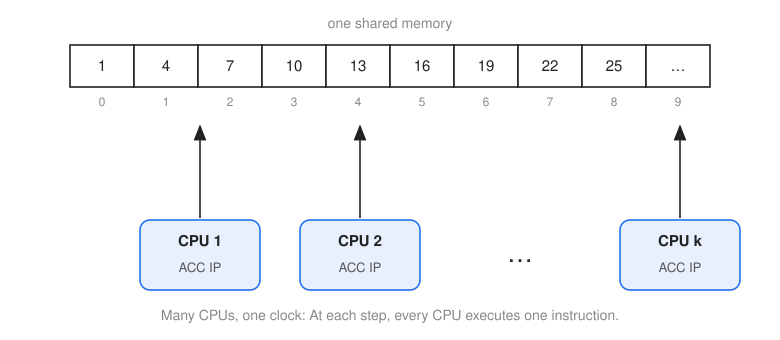
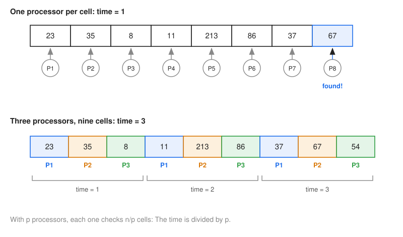
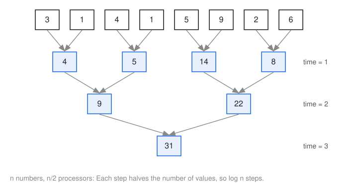
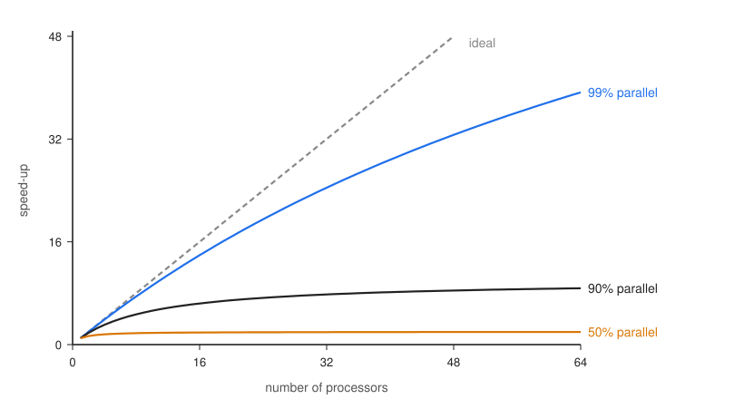
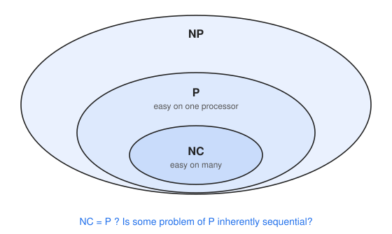

==================
Parallel Computing
==================

:Lecture: Lecture 9.1 :download:`(slides)
          <https://studntnu-my.sharepoint.com/:p:/g/personal/franckc_ntnu_no/ESnPvY0-FapMqUkTLehdnaAB4eBpOCxktihH63Kr84361g?e=dlKlJh>`
:Objectives: Understand the promises and limitations of parallel computing
:Concepts: P-RAM, work, time, cost, speed-up, Amdahl's law, NC

.. note::

   This lecture is optional, and it is not part of the exam. It is here to
   pick your curiosity, with just enough intuition.

The RAM, the machine we used throughout this course, is like a computer from the
1980s: One processor, which executes one instruction after the other. Your
laptop, your phone and the cloud work differently. They have many processors
that work at the same time. What does this change for the algorithms we have
studied?

In the last module, we met a machine that explores all the branches of a search
tree *at the same time*. This one is imaginary. This lecture is about the real
thing: Many processors, but only a finite number of them.

.. margin::

   *Concurrent* is not *parallel*. One person who writes some code, then some
   documentation, then some code again, is *concurrent*: Several tasks make
   progress, by turns. Two people, one writing the code and the other the
   documentation, are *parallel*: Both work at the same moment. We talk about
   parallel here.

A Parallel RAM
==============

To reason about parallel algorithms, we need a machine. The usual choice is the
**P-RAM**, for *parallel RAM*: A RAM with *many* processors that share *the same
memory*, as in :numref:`beyond/parallel/pram`. Each processor is a CPU, with its
own registers (``ACC`` and ``IP``), and each one knows its own number (its
"processor id"). They all follow the same clock: At each time step, every
processor executes one instruction.

   A P-RAM: Many CPUs that share one memory, and one clock.

.. admonition:: Is the P-RAM realistic?
   :class: caution

   Not really. On the P-RAM, every processor reaches any memory cell at the same
   cost, and they all share one perfect clock. On a real machine, the memory is far
   away for some processors, they fight to use it (*contention*), they must wait
   for one another (*synchronization*), and keeping them on one clock is hard. So
   do not trust the numbers of the P-RAM too much. Its value is the other way
   around: If a problem is *not* fast on a P-RAM, no real parallel machine will
   make it fast.

Searching in Parallel
---------------------

Let us see how it helps with the simplest problem: Finding a value in an array of
``n`` cells. Suppose we have *one processor per cell*. Then every processor
looks at its own cell, and the one that finds the value reports it:

.. code-block:: text

   contains(array, expected):          every processor runs this code
       if array[processorId] = expected:
           write processorId in the shared cell "result"

All the processors work at once, so the search takes a *single* time step,
whatever the size of the array (:numref:`beyond/parallel/linear_search`, top).

What if we only have ``p`` processors, with ``p`` smaller than ``n``? Each
processor then takes care of ``n / p`` cells, one after the other, and the time
is ``n / p`` (:numref:`beyond/parallel/linear_search`, bottom). The more
processors, the faster, until we reach one per cell.

   Searching ``67``. Top: One processor per cell, one step. Bottom: Three
   processors for nine cells, three steps.

When Many Processors Touch the Same Cell
----------------------------------------

There is a catch. What if two cells hold the expected value? Two processors then
try to write in the same cell, *at the same time*. What should happen? There is
no single answer, and so the P-RAM comes in several flavours, depending on what
is allowed when several processors use the same memory cell:

- **EREW**: *Exclusive* reads and *exclusive* writes. Never two processors on the
  same cell.
- **CREW**: *Concurrent* reads, *exclusive* writes. Many may read a cell, but only
  one writes.
- **ERCW**, the odd one: Exclusive reads, concurrent writes.
- **CRCW**: Both are concurrent.

For concurrent writes, we must also say who wins. There are three common rules:
**common** (all the processors must write the same value, otherwise it is an
error), **arbitrary** (one of them succeeds, we do not say which), and
**priority** (the processor with the smallest number wins).

Adding Numbers in Parallel
--------------------------

Searching is easy to parallelize, since each cell can be handled alone. What
about adding up ``n`` numbers? Each addition needs the result of the previous
one, it seems. Not so. We can add the numbers *in pairs*, at the same time, then
the sums in pairs, and so on, as in :numref:`beyond/parallel/sum_tree`.

   Adding eight numbers with four processors, in three steps.

At each step, the number of values is halved, so we need only about ``log n``
steps, with ``n / 2`` processors, instead of ``n`` steps with one. It is the same
tree as in the divide-and-conquer algorithms, the other way around. The same
trick works for many other operations that combine all the values of an array,
such as the maximum, a logical "and", or the product.

Other Kinds of Parallel Machines
--------------------------------

The P-RAM is one machine among many. A classical way to sort them is to ask how
many streams of instructions and how many streams of data they handle at the same
time. It gives four families:

=====================  ====================  ====================
\                      One stream of data    Many streams of data
=====================  ====================  ====================
One stream of code     SISD: a uniprocessor  SIMD: vector machines
Many streams of code   MISD: data pipelines  MIMD: multi-computers
=====================  ====================  ====================

Your graphics card is mostly SIMD: The same instruction on many pixels. A cluster
in the cloud is MIMD: Many computers, each with its own program.

How Good Is a Parallel Algorithm?
=================================

With many processors, "how fast" is no longer enough. We use three measures:

- the **time**: The number of time steps, with ``p`` processors;
- the **work**: The total number of instructions executed, across all processors;
- the **cost**: The number of processors times the time, which is what we pay for
  ``p`` processors during ``t`` steps.

Take the parallel sum, with ``n`` numbers. The time is ``log n``. The work is
``n - 1`` additions, as in the sequential algorithm. The cost is ``n / 2`` processors
for ``log n`` steps, which is more than ``n``: We pay for processors that sit idle
in the last steps.

This leads to two notions of *optimal*. A parallel algorithm is **work-optimal**
if it does as much work as the best known sequential algorithm, and
**cost-optimal** if its cost is the same as that of the best known sequential
algorithm. The parallel sum is work-optimal, but, with ``n / 2`` processors, not
cost-optimal.

Speed-Up
--------

The most natural question is how much faster we are. The **speed-up** is the time
of the best sequential algorithm, divided by the time of the parallel algorithm
with ``p`` processors. A speed-up of 8 with 8 processors is perfect. In practice,
it is much lower.

Amdahl's Law
------------

Why is it lower? Because there is almost always a part of the algorithm that
*cannot* be parallelized: Reading the input, a step that needs the result of the
previous one, merging the results at the end. Say a fraction ``f`` of the work can
be parallelized, and the rest, ``1 - f``, cannot. With ``p`` processors, the
speed-up is

.. math::

   \text{speed-up}(p) = \frac{1}{(1 - f) + f / p}

and it can never exceed :math:`1 / (1 - f)`, *however many processors we add*.
:numref:`beyond/parallel/amdahl` shows it. If one tenth of the work is sequential,
the speed-up will never exceed 10, even with a million processors. This is
*Amdahl's law*, and it is a good reason to be careful before buying more
processors.

   Speed-up with ``p`` processors, for programs that are 50%, 90% and 99%
   parallelizable. The dashed line is the ideal.

Which Problems Parallelize Well?
================================

Which problems can be solved *very fast* with many processors? The class **NC**
(for "Nick's Class", after Nick Pippenger) is the set of problems that can be
solved in *polylogarithmic* time on a P-RAM, that is, in a power of ``log n``
steps, with a *polynomial* number of processors. Searching and adding numbers
are in NC.

An NC algorithm is, in particular, an efficient one, so NC is inside P
(:numref:`beyond/parallel/nc`). The question is whether it is *all* of P. Are
there problems that we can solve in polynomial time, but that are *inherently
sequential*, and that no number of processors can speed up much? Most specialists
think so, but nobody has proved it. It is another open question, a cousin of
P = NP.

   NC is inside P, which is inside NP.

Parallel computing is, in the end, not quite the machine that computer scientists
were hoping for. In the last module, we imagined a machine that explores *all* the
branches of a search tree at the same time. To do that for the hardest problems of
NP, we would need one processor per branch, and the number of branches is
*exponential*. With only a polynomial number of processors, the time stays
exponential, unless NP turns out to be inside NC, which would make P equal to NP.
Many processors make us faster, within the limits of Amdahl's law, and they are
essential for big data and for the cloud. But they do not turn a hard problem
into an easy one. The machine that always guesses right is still out of reach.
