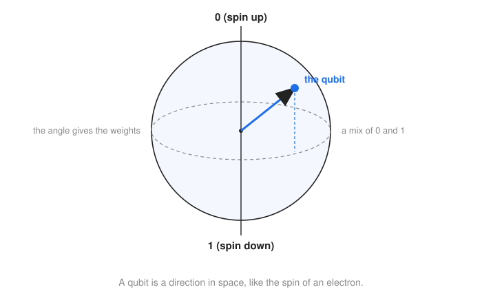
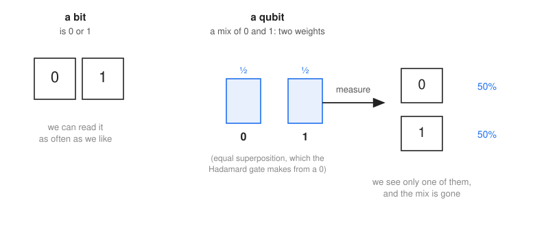
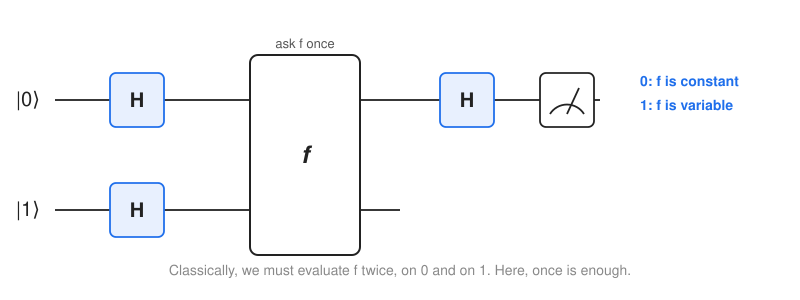
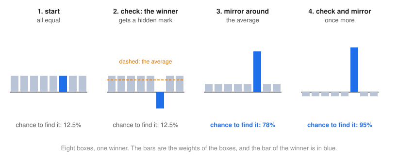
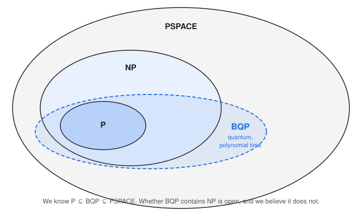

=================
Quantum Computing
=================

:Lecture: Lecture 9.2 :download:`(slides)
          <https://studntnu-my.sharepoint.com/:p:/g/personal/franckc_ntnu_no/EVC9YVse8EZEiSkyLpLUktABdbzWVNhsy1RyfG3BMbrgwQ?e=5hl1dI>`
:Objectives: Understand the promises and limitations of quantum computing
:Concepts: Qubit, superposition, interference, quantum gate, quantum circuit, BQP

.. note::

   This lecture is optional, and it is not part of the exam. It is here to
   pick your curiosity, with just enough intuition. There is very little quantum
   physics in it, and we simplify a lot. The maths is folded away, in boxes you
   can open if you are curious.

.. margin::

   This lecture follows a talk from Microsoft Research.

Quantum computers make the news regularly. In October 2019, Google announced that
its quantum computer had performed, in 200 seconds, a computation that would take
the best supercomputer about 10,000 years. (Other researchers argued that a
supercomputer could do it much faster, so the claim is debated.) Are quantum
computers about to make our algorithms obsolete?

In the last module, we met a machine that always guesses right, and that would
solve the hardest problems of NP in a handful of steps. Is a quantum computer
that machine? Spoiler: No. Let us look at what it *is*, from a distance.

From Bits to Qubits
===================

An ordinary computer works with *bits*, which are 0 or 1. A few simple operations,
the *gates*, such as NOT, AND, OR, XOR or NAND, transform bits into bits. Wire
gates together, and you get a *Boolean circuit*, which is how processors are made.

A quantum computer works with **qubits**, and a qubit is a physical thing: The
spin of an electron, the polarization of a photon, or the state of a tiny
superconducting circuit. Take the spin of an electron. We can measure whether it
points up or down, and we call these two outcomes 0 and 1. But, before we measure
it, the spin may point in *any direction* in space, not just up or down.
:numref:`beyond/quantum/sphere` shows it: A qubit is a direction, a point on a
sphere, and "up" and "down" are only the two poles.

   A qubit is a direction in space. The poles are the 0 and the 1. Anywhere else, it
   is a *superposition*: a mix of 0 and 1.

A direction that is not at a pole is a **superposition**. It is not "either 0 or 1,
we do not know which". It is both, in a way, and the closer to a pole, the more it
weighs on that side.

.. admonition:: How is a direction written down?
   :class: hint, dropdown

   A qubit is written as two *complex numbers*, :math:`a` and :math:`b`, such that
   :math:`|a|^2 + |b|^2 = 1`. They are the *weights* (or *amplitudes*) of 0 and 1:

   .. math::

      \text{qubit} = a \,|0\rangle + b \,|1\rangle

   Why complex numbers? A real number alone cannot describe a direction in
   three-dimensional space. A complex number is a length *and an angle*, called the
   *phase*. The two lengths tell how close to each pole we are, and the angle
   between :math:`a` and :math:`b` tells where we are around the vertical axis (the
   longitude on the sphere). You cannot see the phase by measuring, but, as we will
   see, it matters a lot.

What do we see when we measure? Only a 0 or a 1, chosen at random, with odds given
by the weights (:numref:`beyond/quantum/qubit`). And the superposition is gone: What
we measured is all that remains. So we cannot "read" the direction. A quantum
algorithm must be arranged so that, in the end, the answer we want is the likely
one.

   A bit is 0 or 1. A qubit is a mix of both. When we measure it, we get 0 or 1,
   with odds given by the weights, and the mix is lost.

Where Does the Speed-Up Come From?
==================================

Remember our three questions about a machine: What is its state, what are its rules,
and how does a computation go? For a quantum computer:

- The **state** of ``n`` qubits is a list of *weights*, one for each of the ``2ⁿ``
  possible combinations of 0 and 1. With ``n = 50``, that is a million billion
  weights. (Careful: This is not about how many *values* we can represent.
  ``n`` ordinary bits can also represent ``2ⁿ`` values. The difference is explained
  below.)
- The **rules** are the *gates*, and each gate is a *matrix* that transforms the
  whole list of weights in one go.
- A **computation** applies a sequence of gates, and ends with a measurement.

So the speed-up *does* have to do with matrices, but not because matrices are
magic: Ordinary computers multiply matrices all the time. It comes from three
things:

1. **The state is huge.** 50 ordinary bits can take 2⁵⁰ different values, but, at any
   time, they hold *only one* of them, and we need 50 bits to write it down. 50
   qubits hold a weight for *every one* of the 2⁵⁰ combinations *at the same time*, and
   to write the state down, we need all 2⁵⁰ weights. One gate acts on all of them at
   once. An ordinary computer that wants to *simulate* 50 qubits must store and update
   each of these weights, which takes petabytes of memory, and every extra qubit
   doubles it. A quantum computer does it by *being* the physical system.
2. **Weights can cancel out.** Weights are not odds. They can be negative, or
   complex, and so two paths that lead to the same result can *cancel*, like two
   waves that meet in opposite phase, or *reinforce* each other. This is called
   **interference**, and it is what a coin toss or a random choice, which only
   adds up positive odds, can never do. The art of quantum algorithms is to
   arrange the interference so that the wrong answers cancel, and the right one
   stays.
3. **Gates are reversible.** Every gate is a matrix that can be undone, since the
   laws of physics do not let us throw information away. An ordinary AND is not
   reversible: From a 0 we cannot tell which of the three inputs gave it. This one
   is a *constraint*, not a source of speed. (Ordinary computers can be made
   reversible too, and they are not faster.)

Putting it differently: the speed-up does not come from computing all the answers
at once, because the measurement gives us only one. It comes from the *interference*
that lets us extract a useful property of all of them.

A Few Gates
-----------

Here are the main gates. You do not need the matrices, so they are folded.
Applying a gate means multiplying the list of weights by its matrix.

.. admonition:: X, the quantum NOT
   :class: hint, dropdown

   It swaps the weights of 0 and 1: A ``0`` becomes a ``1`` and the other way
   around.

   .. math::

      X = \begin{pmatrix} 0 & 1 \\ 1 & 0 \end{pmatrix}

.. admonition:: Z, the sign flip
   :class: hint, dropdown

   It keeps the weight of 0, and flips the *sign* of the weight of 1. If we
   measure right away, we notice nothing, since the odds are the squares of the
   weights. But the sign matters for the interference that comes next. It is the
   kind of "hidden mark" that Grover's algorithm uses.

   .. math::

      Z = \begin{pmatrix} 1 & 0 \\ 0 & -1 \end{pmatrix}

.. admonition:: H, the Hadamard gate
   :class: hint, dropdown

   It turns a ``0`` into an equal mix of 0 and 1, and a ``1`` into an equal mix
   with a minus sign. It is the usual way to create a superposition. Applying it
   twice brings us back to where we started, which is a nice example of
   interference: The two paths to the "wrong" result cancel out.

   .. math::

      H = \frac{1}{\sqrt{2}} \begin{pmatrix} 1 & 1 \\ 1 & -1 \end{pmatrix}

.. admonition:: CNOT, the controlled NOT
   :class: hint, dropdown

   It acts on *two* qubits, a *control* and a *target*: It flips the target if the
   control is 1, and leaves it alone otherwise. This is how qubits are made to
   depend on one another. Its matrix has four rows and four columns, one for each
   combination of two bits.

   .. math::

      \text{CNOT} = \begin{pmatrix}
        1 & 0 & 0 & 0 \\
        0 & 1 & 0 & 0 \\
        0 & 0 & 0 & 1 \\
        0 & 0 & 1 & 0
      \end{pmatrix}

As for ordinary circuits, a *quantum circuit* is gates wired together, and it is
how we write quantum algorithms.

Identifying a System
====================

Here is a small problem, where a quantum computer beats an ordinary one, and where
we can see *why* the ordinary one is stuck.

Someone gives us a sealed box, with one input wire and one output wire, that each
carry one bit. We cannot open it. Inside, there is one of four possible circuits:

- **Set-0**: The output is always 0, whatever the input.
- **Set-1**: The output is always 1.
- **Identity**: The output is the input.
- **Not**: The output is the opposite of the input.

The first two are **constant**: The output does not depend on the input. The last
two are **variable**. We want to know which kind of box we have: Is it constant? We
have no way to find out but to *try it out*, by feeding it inputs.

An ordinary computer tries the box once, say with a 0. Is it enough? The table
shows what each box answers:

==========  ==========  ==========
Box         Input 0     Input 1
==========  ==========  ==========
Set-0       0           0
Set-1       1           1
Identity    0           1
Not         1           0
==========  ==========  ==========

If the answer to the input 0 is a 0, the box can be Set-0 (constant) or Identity
(variable). If it is a 1, it can be Set-1 or Not. One trial *never* tells. We must
try both inputs, and compare the two answers. That is the limit of an ordinary
computer: To learn how two answers *relate* to each other, it must obtain both of
them, one after the other.

The quantum computer of :numref:`beyond/quantum/deutsch`, the *Deutsch algorithm*,
tries the box **once**. It does not feed it a 0 or a 1: It feeds it a
*superposition* of both, made with the Hadamard gate, so the box works on both
inputs *at once*. It then lets the two results interfere, with a last Hadamard
gate. If the two answers were the same, the interference reinforces one outcome,
and if they were different, it reinforces the other. We do not learn what the
answers were, only whether they agree. We measure the first qubit: 0 means that the
box is constant, and 1 that it is variable.

   The Deutsch algorithm. The box is ``f``, and it is used only once.

Does it scale? Yes. Take a box with ``n`` input wires, which is promised to be
either constant or *balanced* (it answers 1 for exactly half of the inputs, and 0
for the other half). An ordinary computer that wants to be sure must, in the worst
case, try more than half of the inputs: ``2ⁿ⁻¹ + 1`` trials, which is more than half
a million for ``n = 20``. The quantum computer still needs a single trial. (An
ordinary computer that accepts a tiny risk of error does much better with random
trials, so this is not a fair fight. But it shows the principle.)

This is a toy, but it shows the *trick* of quantum computing: Put the inputs in
superposition, compute on all of them at once, and arrange the interference so that
the property we want comes out, and the rest cancels.

Searching without Opening All the Boxes
=======================================

**Grover's algorithm** searches an unsorted array of ``n`` cells, as in a linear
search. An ordinary computer needs about ``n`` steps, since it has to open the
boxes one after the other, and the winner can be anywhere. Grover's algorithm needs
about the square root of ``n`` steps. This is the question every year: *How can we
search without opening all the boxes?*

The honest answer is: **We do open all the boxes, but all at once.** What we do
*not* do is look at them one by one. Here is the idea, with eight boxes and one
winner (:numref:`beyond/quantum/grover`).

   Grover's algorithm on eight boxes, one of which is the winner (in blue). The bars
   are the weights of the boxes.

1. **Start with an equal superposition** of all the boxes, with the Hadamard gate.
   All the weights are equal, so each box has the same odds of being found:
   one in eight.
2. **Check the boxes, all at once.** We need a *checker*, as in the lecture on
   complexity classes: A circuit that tells whether a given box is the winner. We
   run it on the whole superposition, and it flips the *sign* of the weight of the
   winner, and of that one only. This is a hidden mark. If we measured now, we
   would not notice anything, since the odds are the squares of the weights, and
   they did not change.
3. **Mirror the weights around their average.** Since all the boxes but one have
   the same weight, the average is a little lower than that weight, and the
   winner, whose weight was flipped, is far *below* the average. Mirroring turns
   this around: The winner's weight jumps up, far above the average, and the other
   weights shrink a little. Now the winner has a 78% chance of being found.
4. **Repeat.** Check, mirror, check, mirror. Each round makes the winner's weight
   larger, and the others smaller. After the second round, the chance is 95%.

How many rounds? Roughly three quarters of the square root of ``n``: Two rounds
for our eight boxes, and about 800 for a million. Each round pushes the winner a
small and fixed step up, and we need that many of them to get close to certainty. If we go on for longer, the weight comes back down, like a swing
that we keep pushing at the wrong moment. So we have to stop at the right time.

So there is no magic: The algorithm opens every box in every round, but it only
learns by *tilting the odds*, a little at a time. Two things to remember:

- It needs a **checker**. Grover's algorithm is a brute force, "guess and check"
  made faster, and it is as good as the check we can write.
- The speed-up is *only quadratic*, and we know it cannot be better for a search
  with no structure. For the hardest problems of NP, which take about ``2ⁿ`` steps by
  brute force, it gives about ``2^(n/2)`` steps: Still exponential. So, a quantum
  computer is *not* the machine that guesses right.

Factoring
=========

The other famous algorithm is **Shor's algorithm**. It finds the prime factors of an
integer, such as ``323 = 17 × 19``. The best known ordinary algorithms need a time
that is far from polynomial for large numbers, and a good part of the cryptography
we use on the Internet relies on factoring being hard. Shor's algorithm factors in
polynomial time. It uses the same ingredients as above: A superposition of many
candidates, and interference that makes the right answer stand out. If a large
enough quantum computer was ever built, much of today's cryptography would have to
be replaced.

Skepticism
==========

Quantum computing deserves some skepticism. We would need a large number of
reliable qubits, and today's qubits are fragile: Errors creep in, and it may be that
they accumulate faster than we can correct them as the machine grows. Nobody knows
yet whether large quantum computers can be built.

Where Does It Fit?
------------------

Suppose we can build them. The problems that a quantum computer solves in
polynomial time, with a small probability of error, form a class called **BQP**
(*bounded-error quantum polynomial time*). :numref:`beyond/quantum/bqp` shows where
it stands. Everything an ordinary computer solves in polynomial time, a quantum
one does too, so P is inside BQP. And BQP is inside PSPACE. But whether it
contains NP is open, and most specialists believe it does not. Factoring is in
BQP, and we do not know whether it is in P, but we do not believe it is
NP-complete either.

   Where BQP stands. It contains P, and it is inside PSPACE. Its relation to NP
   is open.

So quantum computers are not magic. They are a different kind of machine, which is
better at some specific problems, such as factoring, and not so good for most
others. Still a pretty good speed-up, where it applies!
