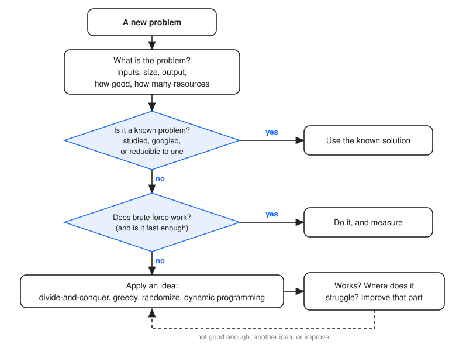

=========================
How to Design Algorithms?
=========================

:Lecture: Lecture 10.1 :download:`(slides)
          <https://studntnu-my.sharepoint.com/:p:/g/personal/franckc_ntnu_no/EcEs__S4Lr5Nhhpwu0oKS4cBhd8RS1W5_DnnWpTpPHS3Og?e=oe8tW2>`
:Objectives: Understand the "methodology" to approach computational problems
:Concepts: Brute force, divide-and-conquer, greedy, randomization, design method

.. note::

   This lecture is optional, and it is not part of the exam. It is about what to do
   *after* the course.

We have covered many algorithms in this course, and yet we have only scratched
the surface. Tomorrow, you will meet a problem that none of us has seen. What will
you do?

The good news is that most algorithms are built from a handful of *ideas*, and
that you have already met all of them. This last lecture names them, and then adds
a few questions to ask yourself when facing a new problem.

Four Ideas
==========

**Brute force: Try everything.** The simplest idea is to try all the possible
solutions, and keep the one that works. It is always correct, it is easy to write,
and it is a baseline to measure everything else against. We used it for the
:doc:`linear search </sequences/searching>`, for the selection sort, and for the
:doc:`combinatorial search </optimization/exhaustive/index>`, where we also saw how
to prune the tree to avoid trying everything. Its weakness is the time, which
explodes with the size of the problem.

**Divide-and-conquer: Split the problem.** Break the problem into smaller problems
that look like the original, solve each one recursively, and merge the results. The
:doc:`binary search </sequences/searching>` splits the array in two and keeps only
one half. The :doc:`merge sort </recursion/merge_sort>` splits the array in two, sorts
each half and merges them. The :doc:`quick sort </recursion/quick_sort>` does the same,
with a different split. Many of the best algorithms of this course are of this kind.

**Greedy: Make the best move now.** At each step, take the choice that looks best at
that point in time, and never go back. :doc:`Prim's algorithm
</graphs/mst/index>` adds the cheapest edge that reaches a new vertex, and
:doc:`Dijkstra's algorithm </graphs/shortest_path/index>` expands the most promising
path so far. A greedy algorithm is fast and simple, but it is *only correct* if the
best move now leads to the best result in the end, which has to be proved for each
problem. In the optimization module, the hill climbing was also greedy, and we saw
where it gets stuck.

**Randomize: Pick a move at random.** Sometimes a random choice is better than a
clever one. The quick sort picks its pivot at random, so that no input is
systematically bad for it. And the random walk and the simulated annealing of the
:doc:`heuristic search </optimization/heuristic/index>` use luck to escape the
traps that a purely greedy strategy falls into.

And of course there is :doc:`dynamic programming </optimization/dp/index>`, which
you can see as a brute force that never solves the same sub-problem twice, or as a
divide-and-conquer that remembers its results.

None of these ideas is a recipe that always works. But when you are stuck, run
through them, and ask which one fits your problem.

Facing a New Problem
====================

Beyond the ideas, there is a method. Here are the questions I ask myself, in this
order (:numref:`farewell/design/flow`).

   A way to approach a new problem.

**What is the problem?** Before anything else, make sure you understand it. What
are the inputs, and how big can they be? What is the expected output, and how good
does it have to be: The *best* solution, or a good one? What type of problem is it?
And how many resources do you have, in time, in memory and in money? A few minutes
spent here save days later.

**Is it a known problem?** Have you studied it? Have you searched for it on the
Web? Can you *reduce* it to a known problem, as we did with the Sudoku and the graph
coloring in the lecture on complexity classes? If so, you may inherit a solution, or
a warning that no efficient solution is known.

**Looking for a solution.** Does the problem have a solution at all? Can you reach
one by brute force, and is it fast enough? If it is, you are done, so measure and
move on. If it is not, which of the four ideas would help? And once you have a
solution that works, there is still the question: Where does it struggle? Can I
improve on this very aspect? Do not improve what is already good enough.

Preparing for a Tech Interview
==============================

Many of you will, soon, apply for an internship or a job, and will go through a
*technical interview*. Here is what to expect.

The process usually starts with a **screening**, often an online test, that checks
your programming fluency, and how fast you are. It is a cheap filter, which removes
the candidates who cannot program. Practice the basics until they are easy: Arrays,
strings, loops, recursion, and the data structures of this course.

Then comes the **technical interview**, with an engineer. *It is not an exam.* They
want to know how you communicate, how you think, and how you solve a problem. They
are not looking for a guru, but for a *professional*, with whom they would like to
work.

So talk. Ask questions about the problem, as in the first step above. Start with
the simplest solution, even a brute force one, and say that it is naive. Check it on
an example. Then say how you would improve it, and try. The questions of the
previous section are your script, and the principle of this course, *clear and
correct before clever*, is what they are hoping to see.
