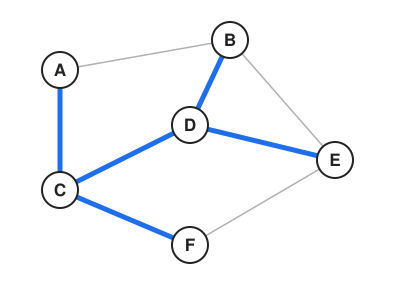
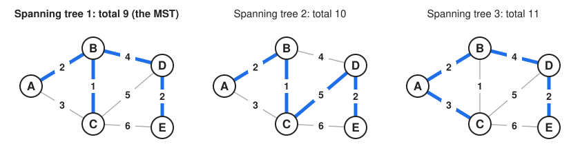
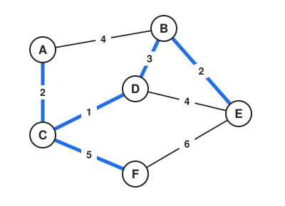
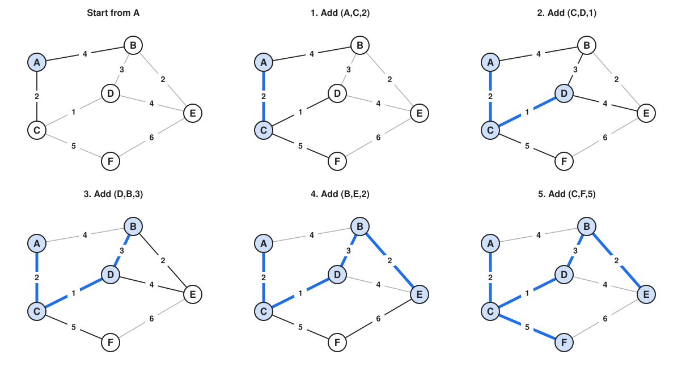
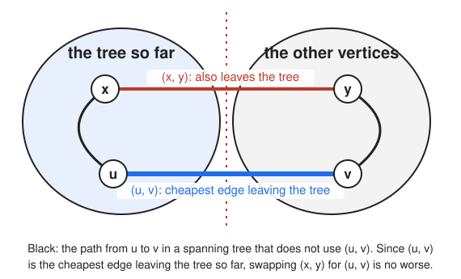
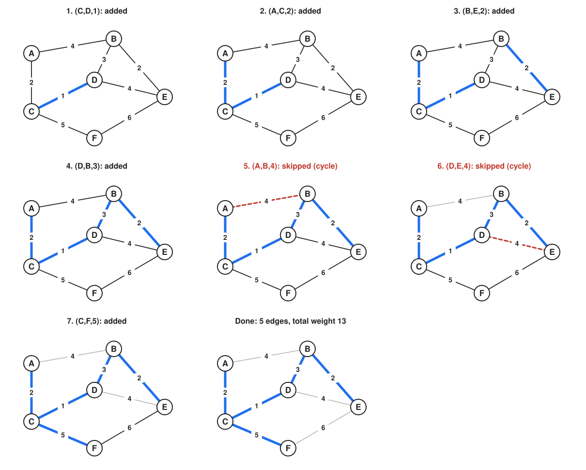
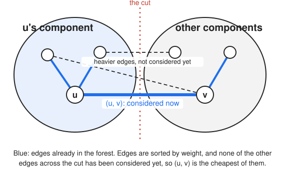

========================
Minimum Spanning Trees
========================

:Lecture: Lecture 6.3 :download:`(slides)
          <https://studntnu-my.sharepoint.com/:p:/g/personal/franckc_ntnu_no/Ec4c5JnIeVVDqq8LLgg-IykBYjZleUxJ6Y9W3fNvx6BBeQ?e=G7kbBL>`
:Objectives: Understand what is a *spanning tree* and how to find the
             minimum spanning tree of a weighted graph
:Concepts: Spanning tree, minimum spanning tree, spanning forest, greedy
           algorithms, Prim's algorithm, Kruskal's algorithm, union-find
:Implementation: Java `Prim, Kruskal and union-find <https://github.com/fchauvel/aldast-examples/tree/main/graphs/minimum-spanning-tree/java>`_

In the previous lecture, we studied shortest paths: finding the best
route from one vertex to another. Now we tackle a different problem:
connecting *all* vertices with the minimum total cost. This is the
**minimum spanning tree** (MST) problem, fundamental to network design,
clustering, and approximation algorithms.

Imagine you're tasked with connecting several cities with fiber optic
cables, or laying water pipes to serve multiple neighborhoods, or
designing a circuit board with minimal wire length. In each case, you
want to connect all locations with the minimum total cost, without
creating unnecessary loops. This is exactly what a minimum spanning tree
provides.

The same idea shows up in many other places. Clustering algorithms use
minimum spanning trees to group similar data points, image segmentation
uses them to separate the regions of a picture, and they give a quick
way to approximate the *Traveling Salesperson Problem*.

What is a Spanning Tree?
=========================

.. index:: spanning tree, tree, forest

Before we can find the *minimum* spanning tree, we need to understand
what a spanning tree is.

Spanning Tree Definition
-------------------------

Recall from the introduction that a **tree** is an undirected graph
with no cycles where every pair of vertices is connected by exactly one
path. A **spanning tree** of a graph :math:`G = (V, E)` is a subgraph
that:

1. Is a **tree** (connected and acyclic)
2. **Spans** all vertices (includes every :math:`v \in V`)
3. Uses only edges from :math:`E`

Formally, a spanning tree :math:`T = (V, E_T)` where :math:`E_T
\subseteq E` is a tree that connects all vertices in :math:`V`.

.. _mst_spanning_tree_example:

   A graph and one of its spanning trees (highlighted in bold). The
   spanning tree connects all vertices without creating cycles.

Key properties of spanning trees:

- A spanning tree of a graph with :math:`|V|` vertices has exactly
  :math:`|V| - 1` edges
- Adding any edge to a spanning tree creates exactly one cycle
- Removing any edge from a spanning tree disconnects it into two
  components
- A connected graph may have many different spanning trees

The Minimum Spanning Tree Problem
==================================

.. index:: minimum spanning tree, MST

When edges have weights representing costs, distances, or times, we
want to find the spanning tree with the **minimum total weight**. This
is the minimum spanning tree problem.

Problem Definition
------------------

.. admonition:: Minimum Spanning Tree Problem

   **Input**: A connected, undirected, weighted graph :math:`G = (V, E,
   \phi)` where :math:`\phi: E \to \mathbb{R}` assigns weights to edges

   **Output**: A spanning tree :math:`T = (V, E_T)` where :math:`E_T
   \subseteq E` that minimizes the total weight:

   .. math::

      \text{weight}(T) = \sum_{e \in E_T} \phi(e)

The MST problem asks: among all possible spanning trees, which one has
the smallest sum of edge weights?

Note that the graph must be *connected*. If it is not, there is no
spanning tree, because no tree can reach all the vertices. The best we
can do then is a *spanning forest*, that is, one spanning tree for each
connected component of the graph. Looking for the cheapest one is a
variation of the same problem, which we will call the *minimum spanning
forest* problem. It is the same as the MST problem when the graph is
connected.

.. _mst_example:

   A weighted graph with three different spanning trees. The MST (in
   bold) has the minimum total weight.

Real-World Example: Network Cabling
------------------------------------

Consider a company building a network to connect 6 offices. The costs
(in thousands) to lay cables between offices are given in
:numref:`mst_network_cabling`.

.. _mst_network_cabling:

   Office network with cable costs. The MST (bold edges) connects all
   offices with the minimum total cost of 13k.

Laying every cable would cost 27k. A poorly chosen spanning tree might
still cost 18k. The MST guarantees the minimum cost of 13k while
keeping all the offices connected.

Properties of Minimum Spanning Trees
-------------------------------------

Before studying algorithms, let's understand key MST properties:

**Uniqueness**
   If all edge weights are distinct, the MST is unique. If some weights
   are equal, multiple MSTs may exist with the same total weight.

**The Cheapest Edge Out of a Group** (Foundation for Prim's and Kruskal's)
   Pick any group of vertices. Among all the edges that leave this group
   (one end inside the group, the other outside), the cheapest one can
   always be part of a minimum spanning tree. This is the key idea
   behind the greedy MST algorithms.

**Cycle Property**
   For any cycle in the graph, the maximum-weight edge in that cycle
   cannot be in the MST (unless there are multiple edges with the same
   maximum weight).

We'll use the cheapest edge out of a group to see why both Prim's and
Kruskal's algorithms work.

The Greedy Approach
-------------------

Both MST algorithms we'll study use a **greedy strategy**: make the
locally optimal choice at each step, trusting it will lead to a
globally optimal solution. For MSTs, this strategy works!

The general greedy template is:

1. Start with an empty tree (or forest)
2. Repeatedly add the "best" edge that doesn't create a cycle
3. Stop when we have :math:`|V| - 1` edges (a spanning tree)

The algorithms differ in how they choose the "best" edge:

- **Prim's algorithm**: Grows a single tree by always adding the
  cheapest edge that connects the tree to a new vertex
- **Kruskal's algorithm**: Builds a forest by always adding the
  globally cheapest edge that doesn't create a cycle

.. seealso::

   - Cormen et al., *Introduction to Algorithms*, 4th ed., Chapter 23:
     Minimum Spanning Trees (Kruskal's, Prim's, and their proofs)

   - Sedgewick & Wayne, *Algorithms*, 4th ed., Section 4.3: Minimum
     Spanning Trees (excellent visualizations)

Prim's Algorithm
================

.. index:: Prim's algorithm, minimum spanning tree, greedy algorithm

Prim's algorithm grows the MST one vertex at a time, similar to how
Dijkstra's algorithm explores shortest paths. It starts with an
arbitrary vertex and repeatedly adds the cheapest edge that connects
the current tree to a new vertex.

.. seealso::

   Prim, R. C. (1957). "Shortest connection networks and some
   generalizations." *Bell System Technical Journal*, 36(6), 1389-1401.

The Intuition
-------------

Imagine building a transportation network starting from your capital
city. You first connect the closest neighboring city (cheapest cable).
Then, from your two-city network, you connect the next closest city
that isn't already connected. You continue expanding your network by
always choosing the cheapest connection to a new city.

This is exactly Prim's algorithm: **grow the tree by always adding the
minimum-weight edge that extends the tree to a new vertex**.

Here's the algorithm in pseudocode:

.. code-block:: text
   :caption: Prim's algorithm (pseudocode)

   function prim(G, start):
       MST ← empty tree
       visited ← {start}
       pending ← priority queue of edges from start, by weight

       while |visited| < |V|:
           edge (u, v) ← extract minimum from pending

           if v not in visited:
               add edge (u, v) to MST
               add v to visited

               for each edge (v, w) where w not in visited:
                   add edge (v, w) to pending

       return MST

A Concrete Example
------------------

Let's trace Prim's algorithm on the network cabling example from
:numref:`mst_network_cabling`. We'll start from office A.

.. _mst_prim_trace:

   Tracing Prim's algorithm starting from vertex A. At each step, we
   add the minimum-weight edge connecting the tree (shaded) to a new
   vertex.

**Step 1**: Start at A

- Visited: {A}
- Edges from A: (A,B,4), (A,C,2)
- Add cheapest: **(A,C,2)**
- MST weight so far: 2

**Step 2**: Tree = {A, C}

- New edges from C: (C,D,1), (C,F,5)
- All edges: (A,B,4), (C,D,1), (C,F,5)
- Add cheapest: **(C,D,1)**
- MST weight so far: 3

**Step 3**: Tree = {A, C, D}

- New edges from D: (D,B,3), (D,E,4)
- All edges: (A,B,4), (D,B,3), (D,E,4), (C,F,5)
- Add cheapest: **(D,B,3)**
- MST weight so far: 6

**Step 4**: Tree = {A, B, C, D}

- New edges from B: (B,E,2)
- All edges: (B,E,2), (D,E,4), (C,F,5)
- Add cheapest: **(B,E,2)**
- MST weight so far: 8

**Step 5**: Tree = {A, B, C, D, E}

- New edges from E: (E,F,6)
- All edges: (E,F,6), (C,F,5)
- Add cheapest: **(C,F,5)**
- MST weight so far: 13

**Final MST**: Edges (A,C,2), (C,D,1), (D,B,3), (B,E,2) and (C,F,5),
for a total weight of 13.

.. admonition:: Implementation in Java
   :class: hint, dropdown

   The pending edges are kept in a priority queue, ordered by weight, so
   that we can always take the cheapest one. The complete code, with its
   tests, is in the `examples repository <https://github.com/fchauvel/aldast-examples/tree/main/graphs/minimum-spanning-tree/java>`_.

   .. code-block:: java
      :linenos:

      // The edges of a minimum spanning tree, grown from the given vertex
      public static Set<Edge> prim(Graph graph, String start) {
          var mst = new HashSet<Edge>();
          var visited = new HashSet<String>();
          var pending = new PriorityQueue<Edge>(Comparator.comparingInt(Edge::weight));

          visited.add(start);
          pending.addAll(graph.edgesFrom(start));

          while (visited.size() < graph.vertices().size()) {
              if (pending.isEmpty()) {
                  throw new IllegalArgumentException("Graph is not connected");
              }

              var edge = pending.poll();
              var vertex = edge.target();

              if (!visited.contains(vertex)) {
                  mst.add(edge);
                  visited.add(vertex);

                  // Add all the edges from this vertex to vertices not yet visited
                  for (var nextEdge : graph.edgesFrom(vertex)) {
                      if (!visited.contains(nextEdge.target())) {
                          pending.add(nextEdge);
                      }
                  }
              }
          }

          return mst;
      }

   This implementation assumes undirected edges, where ``edgesFrom(v)``
   returns the edges connected to :math:`v` regardless of direction.

Why is it Correct?
------------------

Prim's algorithm relies on a simple observation: the cheapest edge
leaving a group of vertices can always be part of a minimum spanning
tree. At each step, the group is the tree built so far, and the cheapest
edge leaving it is exactly the edge that Prim's algorithm picks.

Why is that so? Suppose some minimum spanning tree does *not* use that
cheapest edge :math:`(u, v)`. That tree still connects :math:`u` and
:math:`v` through some path, and this path has to leave the group
somewhere, through another edge :math:`(x, y)`. As :math:`(u, v)` is the
cheapest edge leaving the group, :math:`(x, y)` cannot be cheaper. So we
can remove :math:`(x, y)` and add :math:`(u, v)` instead: we still have a
spanning tree, and it is *no heavier*. Therefore, there is a minimum
spanning tree that uses :math:`(u, v)`.

.. _mst_prim_correctness:

   If the tree does not use (u,v), its path from u to v leaves the group
   through some edge (x,y). Swapping (x,y) for (u,v) does not make the
   tree any heavier.

Each choice of Prim's algorithm is thus "safe", and the algorithm ends
with a minimum spanning tree.

.. note::

   A rigorous proof turns this into an *induction*: after each step, the
   edges chosen so far belong to *some* minimum spanning tree. The
   swap above is the heart of the inductive step. We won't go through
   the details, but this is what a proof requires.

How Efficient is it?
--------------------

Prim's algorithm keeps the candidate edges in a priority queue, which
we implement with a binary heap (see :doc:`/trees/heap/index`). With
a binary heap, finding the cheapest candidate, adding a candidate, or
removing one costs :math:`O(\log E)`.

How many times do we do that? Each edge is added to the heap at most
once, and taken out at most once, so we have at most :math:`2E` heap
operations. In total, Prim's algorithm runs in :math:`O(E \log E)`.
As a graph has at most :math:`V^2` edges, :math:`\log E` is at most
:math:`2 \log V`, so this is the same as :math:`O(E \log V)`.

.. margin::

   With a more sophisticated heap, called a *Fibonacci heap*, Prim's
   algorithm can run in :math:`O(E + V \log V)`. It is complicated, and
   beyond the scope of this course.

As for the memory, we need to store the graph, the set of visited
vertices and the heap, which takes :math:`O(V + E)`.

When the Graph Is Not Connected
-------------------------------

Prim's algorithm has a limitation: it grows a *single* tree from its
starting vertex, so it can only reach the vertices that are connected to
it. If the graph is not connected, the priority queue runs out of edges
before all the vertices are visited, and the algorithm cannot continue.
This is why our implementation throws an exception, "Graph is not
connected". Prim's algorithm solves the MST problem, which is only
defined for connected graphs.

We could run Prim's algorithm again, from a new starting vertex, for each
component. But we would first need to find the components, and pick a
starting vertex in each. Can we do better, with an algorithm that deals
with a disconnected graph naturally? This is what Kruskal's algorithm
does.

Kruskal's Algorithm
===================

.. index:: Kruskal's algorithm, minimum spanning tree, union-find

While Prim's algorithm grows a single tree, Kruskal's algorithm builds
a *forest* of trees that gradually merge. If the graph is connected, they
end up as a single minimum spanning tree. If it is not, they end up as a
minimum spanning forest, one tree per connected component. It's
conceptually even simpler: sort all edges by weight and keep adding the
cheapest edge that doesn't create a cycle.

.. seealso::

   Kruskal, J. B. (1956). "On the shortest spanning subtree of a graph
   and the traveling salesman problem." *Proceedings of the American
   Mathematical Society*, 7(1), 48-50.

The Intuition
-------------

Imagine you're building a road network, and you have a list of all
possible road projects sorted by cost. You go through the list from
cheapest to most expensive:

- If a road connects two towns that aren't already connected (directly
  or indirectly), build it.
- If a road connects two towns that already have a path between them,
  skip it (it would create a loop).
- Stop when all towns are connected.

This greedy strategy is exactly Kruskal's algorithm: **go through the
edges in increasing order of weight, and skip those that would create a
cycle**.

Seen from the vertices, this is a process of *merging trees*. At the
start, every vertex is a tree on its own. Each edge we add joins two
different trees into a bigger one. An edge whose two ends are already in
the same tree would close a loop, so we skip it. When a single tree
remains, we are done. Here's the algorithm in pseudocode:

.. code-block:: text
   :caption: Kruskal's algorithm (pseudocode)

   function kruskal(G):
       MST ← empty set
       sort all edges by weight (ascending)

       for each edge (u, v) in sorted order:
           if u and v are not in the same tree:
               add edge (u, v) to MST
               merge the trees of u and v

       return MST

To check whether two vertices are in the same tree, and to merge two
trees, we use two operations, ``find`` and ``union``. We describe them
at the end of this section.

A Concrete Example
------------------

Let's trace Kruskal's algorithm on the network cabling example.

.. _mst_kruskal_trace:

   Tracing Kruskal's algorithm. We consider edges in order of
   increasing weight, adding those that don't create cycles.

**Sorted edges**:
(C,D,1), (A,C,2), (B,E,2), (D,B,3), (A,B,4), (D,E,4), (C,F,5), (E,F,6)

**Step 1**: Consider (C,D,1)

- C and D in different components? Yes
- Add to MST: **(C,D,1)**
- Components: {A}, {B}, {C,D}, {E}, {F}

**Step 2**: Consider (A,C,2)

- A and C in different components? Yes
- Add to MST: **(A,C,2)**
- Components: {A,C,D}, {B}, {E}, {F}

**Step 3**: Consider (B,E,2)

- B and E in different components? Yes
- Add to MST: **(B,E,2)**
- Components: {A,C,D}, {B,E}, {F}

**Step 4**: Consider (D,B,3)

- D and B in different components? Yes (D in {A,C,D}, B in {B,E})
- Add to MST: **(D,B,3)**
- Components: {A,B,C,D,E}, {F}

**Step 5**: Consider (A,B,4)

- A and B in different components? No (both in {A,B,C,D,E})
- Skip (would create cycle)

**Step 6**: Consider (D,E,4)

- D and E in different components? No
- Skip (would create cycle)

**Step 7**: Consider (C,F,5)

- C and F in different components? Yes (F still isolated)
- Add to MST: **(C,F,5)**
- Components: {A,B,C,D,E,F}

**Step 8**: All vertices connected, we have 5 edges (for 6 vertices)

**Final MST**: Total weight = 1 + 2 + 2 + 3 + 5 = 13

This is the same tree as the one found by Prim's algorithm. When
several edges have the same weight, the two algorithms may pick
different trees, but they always have the same total weight.

.. admonition:: Implementation in Java
   :class: hint, dropdown

   This implementation uses a ``DisjointSets`` class, which provides
   the ``find`` and ``union`` operations described at the end of this
   section: ``find(x)`` identifies the set (the tree) containing
   :math:`x`, and ``union(x, y)`` merges the sets containing :math:`x`
   and :math:`y`. The complete code, with its tests, is in the
   `examples repository <https://github.com/fchauvel/aldast-examples/tree/main/graphs/minimum-spanning-tree/java>`_.

   .. code-block:: java
      :linenos:

      // The edges of a minimum spanning tree, or of a minimum spanning forest
      // if the graph is not connected
      public static Set<Edge> kruskal(Graph graph) {
          var mst = new HashSet<Edge>();
          var trees = new DisjointSets(graph.vertices());

          // Sort all the edges by weight
          var edges = new ArrayList<>(graph.edges());
          edges.sort(Comparator.comparingInt(Edge::weight));

          // Process the edges in order
          for (var edge : edges) {
              if (trees.find(edge.source()) != trees.find(edge.target())) {
                  mst.add(edge);
                  trees.union(edge.source(), edge.target());
              }
          }

          return mst;
      }

Why is it Correct?
------------------

Kruskal's algorithm relies on the same observation as Prim's: the
cheapest edge leaving a group of vertices can safely be part of a
minimum spanning tree. When the algorithm is about to add an edge
:math:`(u, v)`, the vertices :math:`u` and :math:`v` are in different
trees, and the group is the tree that contains :math:`u`.

Is :math:`(u, v)` the cheapest edge leaving that tree? Yes. Any cheaper
edge leaving the tree of :math:`u` would have been looked at earlier. It
would have connected two different trees, so it would have been added,
and it would no longer leave the tree. So :math:`(u, v)` is the cheapest
edge leaving the tree of :math:`u`, and it can safely be part of a
minimum spanning tree.

.. _mst_kruskal_correctness:

   When Kruskal's algorithm considers (u,v), no cheaper edge leaves the
   tree of u, so (u,v) is the cheapest edge leaving it.

Why does the algorithm never create a cycle? It only adds edges between
two *different* trees, and joining two separate trees with a single edge
cannot close a loop.

.. note::

   As for Prim's algorithm, a rigorous proof is an *induction* on the
   number of edges added: the edges chosen so far always belong to
   *some* minimum spanning tree. We won't go through the details.

How Efficient is it?
--------------------

Kruskal's algorithm has two main costs:

1. **Sorting the edges** takes :math:`O(E \log E)`.

2. **Going through the edges** takes :math:`O(E)` steps. At each step,
   we call ``Find`` twice, and possibly ``Union`` once. With the
   union-find structure, these operations are nearly constant time, so
   this part is cheap.

The sorting dominates, so the total is :math:`O(E \log E)`. As a graph
has at most :math:`V^2` edges, :math:`\log E` is at most :math:`2 \log
V`, so this is the same as :math:`O(E \log V)`.

As for the memory, we need :math:`O(V)` for the disjoint sets and
:math:`O(E)` for the list of edges.

Both algorithms therefore run in :math:`O(E \log V)`. They differ in how
they get there: Kruskal's sorts all the edges upfront, whereas Prim's
uses a priority queue as it goes.

The Union-Find ADT
------------------

.. index:: union-find, disjoint sets

Kruskal's algorithm needs to remember which vertices are in the same
tree. This is the job of an abstract data type, usually called
*union-find*, which keeps track of a collection of *disjoint sets*. In
Kruskal's algorithm, each set contains the vertices of one tree.

.. module:: union_find

.. function:: create(n: Integer) -> UnionFind

   Create a collection of :math:`n` sets, each containing a single
   element (the numbers from 0 to :math:`n - 1`). In Kruskal's algorithm,
   each vertex starts in its own tree.

.. function:: find(u: UnionFind, x: Element) -> Element

   Return the *representative* of the set that contains the element
   :math:`x`. Two elements are in the same set if, and only if, they
   have the same representative. Kruskal's algorithm uses this to check
   whether two vertices are in the same tree.

.. function:: union(u: UnionFind, x: Element, y: Element) -> UnionFind

   Merge the set that contains :math:`x` and the set that contains
   :math:`y` into a single set. Afterwards, :math:`x` and :math:`y` have
   the same representative. Kruskal's algorithm uses this to join two
   trees.

These operations are not as easy to implement efficiently as they
look. For instance, if we store, for each element, the number of its
set, then ``find`` is immediate, but a single ``union`` has to relabel
every element of one of the two sets, which is slow for large sets. If
we always relabel the *smaller* set, an element is relabeled at most
:math:`\log n` times (each time, its set at least doubles in size), which
is cheap enough for Kruskal's algorithm. There are cleverer
implementations where *both* operations take almost constant time. They
are beyond the scope of this course, and we simply assume that ``find``
and ``union`` are cheap.

.. seealso::

   Tarjan, R. E. (1975). "Efficiency of a good but not linear set union
   algorithm." *Journal of the ACM*, 22(2), 215-225.

Comparing Prim's and Kruskal's Algorithms
==========================================

Both algorithms always produce a minimum spanning tree, with the same
total weight. They may pick different trees, but only when several edges
have the same weight. They differ in how they build it:

.. _mst_comparison:

.. table:: Comparison of Prim's and Kruskal's algorithms
   :align: center

   +------------------+------------------------+------------------------+
   | Aspect           | Prim's Algorithm       | Kruskal's Algorithm    |
   +==================+========================+========================+
   | **Strategy**     | Grow a single tree,    | Grow a forest, merge   |
   |                  | one vertex at a time   | trees                  |
   +------------------+------------------------+------------------------+
   | **Edge Choice**  | Cheapest edge leaving  | Cheapest edge between  |
   |                  | the tree               | two different trees    |
   +------------------+------------------------+------------------------+
   | **Data           | Priority queue of      | Sorted edges and       |
   | Structure**      | edges                  | union-find             |
   +------------------+------------------------+------------------------+
   | **Time           | O(E log V)             | O(E log V)             |
   | Complexity**     |                        |                        |
   +------------------+------------------------+------------------------+
   | **Graph**        | Connected graphs only  | Any graph (spanning    |
   |                  | (spanning tree)        | forest)                |
   +------------------+------------------------+------------------------+

These are really two flavors of the same problem. Prim's algorithm
finds a minimum spanning tree, and therefore needs a connected graph. It
can start from *any* vertex, as a spanning tree includes all of them
anyway. Kruskal's algorithm finds a minimum spanning forest, which is
the minimum spanning tree when the graph is connected, and still makes
sense when it is not. Since both run in :math:`O(E \log V)`, the choice
otherwise comes down to convenience, such as whether the graph is
easier to access as adjacency lists (Prim's) or as a list of edges
(Kruskal's).

.. exercise:: MST Algorithm Trace

   Given the following weighted graph, trace both Prim's algorithm
   (starting from A) and Kruskal's algorithm. Do they produce the same
   MST? Why or why not?

   .. TO DO: Insert a small weighted graph with 5-6 vertices

.. solution::
   :class: dropdown

   .. TO DO: Show step-by-step trace for both algorithms

.. exercise:: Unique MST

   Prove that if all edge weights in a connected graph are distinct,
   then the MST is unique.

.. solution::
   :class: dropdown

   **Proof by contradiction**:

   Suppose there are two different MSTs, :math:`T_1` and :math:`T_2`.
   Since they're different, there exists an edge :math:`e = (u, v)` in
   :math:`T_1` but not in :math:`T_2`.

   When we add :math:`e` to :math:`T_2`, we create exactly one cycle
   (since :math:`T_2` is a tree). This cycle must contain at least one
   other edge :math:`f \neq e` that connects the same two components as
   :math:`e` does.

   Since all weights are distinct, either :math:`\text{weight}(e) <
   \text{weight}(f)` or :math:`\text{weight}(e) >
   \text{weight}(f)`.

   - If :math:`\text{weight}(e) < \text{weight}(f)`: We could replace
     :math:`f` with :math:`e` in :math:`T_2` to get a spanning tree
     with smaller total weight, contradicting that :math:`T_2` is an
     MST.

   - If :math:`\text{weight}(e) > \text{weight}(f)`: We could replace
     :math:`e` with :math:`f` in :math:`T_1` to get a spanning tree
     with smaller total weight, contradicting that :math:`T_1` is an
     MST.

   Either way, we reach a contradiction. Therefore, the MST must be
   unique when all edge weights are distinct.

.. exercise:: Network Design Problem

   A city wants to connect 8 neighborhoods with fiber optic cables. The
   cost matrix (in millions) is given below. Find the MST using both
   Prim's and Kruskal's algorithms. What is the minimum total cost?

   .. TO DO: Insert cost matrix or graph

.. solution::
   :class: dropdown

   .. TO DO: Show solution with both algorithms
