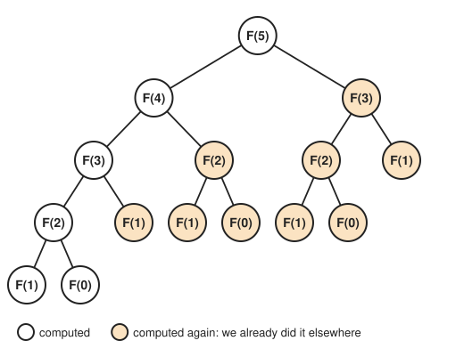
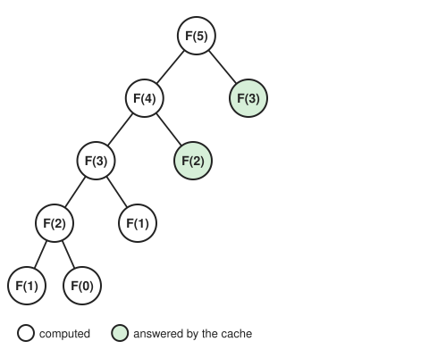
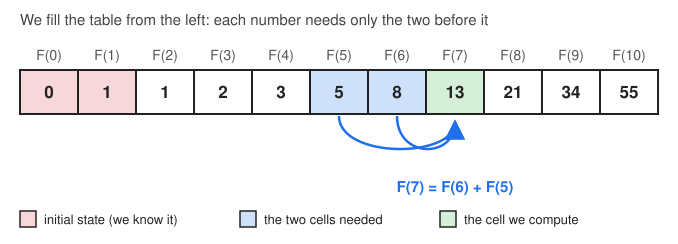
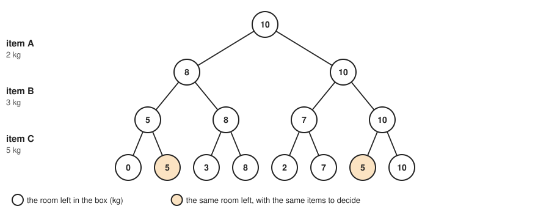
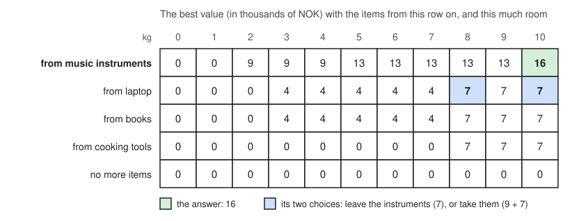

===================
Dynamic Programming
===================

:Lecture: Lecture 7.2 :download:`(slides)
          <https://studntnu-my.sharepoint.com/:p:/g/personal/franckc_ntnu_no/EbZAntUk5rZFn5A2IckfqOEBs-DpOWUUqXxIi7V0oLBXTw?e=ZCaOWv>`
:Objectives: Understand what is a *dynamic programming*, when it
             applies, and how to apply it
:Concepts: Dynamic programming: Memoïzation and bottom-up traversal
:Implementation: Java `Fibonacci and knapsack <https://github.com/fchauvel/aldast-examples/tree/main/optimization/dynamic-programming/java>`_

Branch-and-bound makes a search faster by *not looking* at the hopeless
parts of the tree. Dynamic programming speeds up recursive algorithms in
a different way: By *not solving the same problem twice*. It applies
when a problem breaks down into smaller problems that *overlap*. The
best way to see it is on a famous example.

A Slow Recursion
================

.. index:: Fibonacci

The Fibonacci numbers start with 0 and 1, and every other number is the
sum of the two before it: 0, 1, 1, 2, 3, 5, 8, 13, 21, and so on. The
definition is recursive, and so is the most direct algorithm:

.. code-block:: text
   :caption: The Fibonacci numbers, from the definition (pseudocode)

   function fibonacci(n):
       if n = 0: return 0
       if n = 1: return 1
       return fibonacci(n - 1) + fibonacci(n - 2)

It is short, and correct, but surprisingly slow. Computing the 50th
number, 12 586 269 025, takes tens of seconds on a laptop, and the 60th
would take over an hour. Why? Look at the calls that
``fibonacci(5)`` makes, on :numref:`optimization/dp/fib_tree`.

   The calls made to compute ``fibonacci(5)``. The ones in orange
   compute something that is already computed elsewhere in the tree.

The same numbers are computed again and again: ``fibonacci(3)`` twice,
``fibonacci(2)`` three times, ``fibonacci(1)`` five times. And the
repetition gets worse as the tree grows. Each additional number multiplies
the number of calls by about 1.6: 177 calls for the 10th number, 21 891
for the 20th, and over 40 billion for the 50th. Yet, there are only
51 different numbers to compute, from ``fibonacci(0)`` to
``fibonacci(50)``. How can we avoid doing the same work again?

Memoization
===========

.. index:: memoization, cache

A simple idea: *write down* each result when we compute it, and *look
it up* before computing it again. We keep the results in a *cache*, a
table that associates a number :math:`n` with ``fibonacci(n)``. This
is called *memoization* (from "memo", as in a note to remember).

.. code-block:: text
   :caption: The Fibonacci numbers, with memoization (pseudocode)

   cache ← empty table

   function fibonacci(n):
       if n = 0: return 0
       if n = 1: return 1
       if n is in cache: return cache[n]
       result ← fibonacci(n - 1) + fibonacci(n - 2)
       cache[n] ← result
       return result

:numref:`optimization/dp/fib_memo` shows the calls for
``fibonacci(5)``. The first time we need a number, we compute it. The
next time, the cache answers immediately, and we do not explore that part
of the tree again. Instead of 15 calls, we make 9.

   The calls made to compute ``fibonacci(5)`` with memoization. The
   ones in green are answered by the cache, without any further call.

The gain is spectacular. There are only :math:`n + 1` different numbers to
compute, and each of them is computed *once*. The number of calls
therefore grows in step with :math:`n`, and no longer explodes: 99 calls
for the 50th number, instead of 40 billion. It now runs in microseconds.

.. admonition:: Implementation in Java
   :class: hint, dropdown

   The recursion straight from the definition, and the same with a
   cache. In Java, a ``Map`` associates each number with its result.

   .. code-block:: java
      :linenos:

      // Straight from the definition
      public long recursive(int n) {
          calls++;
          if (n == 0) {
              return 0;
          }
          if (n == 1) {
              return 1;
          }
          return recursive(n - 1) + recursive(n - 2);
      }

      // The same, but we remember the numbers we have already computed (memoization)
      public long memoized(int n) {
          return memoized(n, new HashMap<>());
      }

      private long memoized(int n, Map<Integer, Long> cache) {
          calls++;
          if (n == 0) {
              return 0;
          }
          if (n == 1) {
              return 1;
          }
          if (cache.containsKey(n)) {
              return cache.get(n);
          }
          long result = memoized(n - 1, cache) + memoized(n - 2, cache);
          cache.put(n, result);
          return result;
      }

Bottom-Up
=========

.. index:: dynamic programming, bottom-up

There is another way to look at the problem. To compute
``fibonacci(50)``, we need ``fibonacci(49)`` and ``fibonacci(48)``, which
need the numbers before them, and so on, down to ``fibonacci(0)`` and
``fibonacci(1)``. Why not start from there? We compute the numbers in
*order*, from the smallest to the one we want, and keep them in a table
(:numref:`optimization/dp/fib_table`). When we need a number, it is
already in the table.

   Computing the Fibonacci numbers bottom-up: Each cell only needs the
   two cells before it.

.. code-block:: text
   :caption: The Fibonacci numbers, bottom-up (pseudocode)

   function fibonacci(n):
       table[0] ← 0
       table[1] ← 1
       for i from 2 to n:
           table[i] ← table[i - 1] + table[i - 2]
       return table[n]

There is no recursion anymore, just a loop, and still each number is
computed once. These two approaches, *memoization* (start from the
problem we want to solve, and remember the results) and *bottom-up* (start
from the smallest problems, and build up to the one we want), are called
**dynamic programming**. Both trade memory for time: We keep the
results of the smaller problems to avoid computing them again.

.. admonition:: Implementation in Java
   :class: hint, dropdown

   .. code-block:: java
      :linenos:

      // We compute the numbers in order, from the smallest, and keep them in a
      // table (bottom-up)
      public long bottomUp(int n) {
          var table = new long[Math.max(n + 1, 2)];
          table[0] = 0;
          table[1] = 1;
          for (int i = 2; i <= n; i++) {
              table[i] = table[i - 1] + table[i - 2];
          }
          return table[n];
      }

Back to the Knapsack
====================

.. index:: knapsack

Let us now go back to the knapsack problem of the previous lecture: A
box that carries 10 kg, and items that each have a weight and a value
(the music instruments, the laptop, the books and the cooking tools). What
is the highest value we can put in the box? We have seen that we can
think about the items one after the other: For each of them, we can
*leave* it, or *take* it if it fits. Whichever we choose, what remains to
solve is a smaller problem of the same kind. This is a recursion:

.. code-block:: text
   :caption: The best value in the box, with recursion (pseudocode)

   function best(i, room):
       if there is no item from i on:
           return 0
       leave ← best(i + 1, room)
       if item i weighs more than room:
           return leave
       take ← value of item i + best(i + 1, room - weight of item i)
       return the maximum of leave and take

   best(0, 10)

Notice that ``best`` has only two parameters: *which items remain* to be
decided (from item :math:`i` on), and *how much room* remains in the
box. What we chose for the previous items does not matter anymore,
except through the room it has left. This is what we call a
*subproblem*, and, as for the Fibonacci numbers, different paths may lead
to the same one.

In our example with four items, the tree is small, and no two paths lead
to the same subproblem. But consider three items, of 2, 3 and 5 kg, in a
box of 10 kg (:numref:`optimization/dp/states`). Taking the first two
items, or only the third one, leaves the same room, 5 kg. Whatever we
chose to get there, the problem that remains is exactly the same.

   The room left in the box after each choice. In orange, two different
   sets of choices lead to the same problem: 5 kg of room, and no more
   items to decide.

With more items, the effect is dramatic. For a box of 15 kg and twenty
light items, the recursion makes about 200 000 calls, and solves the
same subproblems again and again. Yet, a subproblem is just a pair
(item, room), so there are at most "number of items" :math:`\times`
"room + 1" different ones: Here, :math:`20 \times 16 = 320`. With
memoization, we make fewer than 500 calls.

The bottom-up version fills a table, with one row per set of remaining
items, and one column per amount of room (:numref:`optimization/dp/table`).
We start from the bottom, where there are no more items and the value is
0, and go up, one row after the other. Each cell is the better of the
two choices: leave the item (the cell right below), or take it (its
value, plus the cell below for the room that remains). The answer is
at the top right.

   The table for the items of the lecture. The answer, 16 000 NOK, is the
   better of leaving the music instruments (7 000, the cell below) and
   taking them (9 000, plus 7 000 for the 8 kg left).

If we want to know *which* items to take, and not only the value, we walk
back from the answer: At each cell, we check which of the two choices gave
its value. The table has one cell per item and per amount of room, so we
solve the problem with about :math:`n \times C` computations, for
:math:`n` items and a capacity of :math:`C`, instead of :math:`2^n`. But
beware: The table grows with the *capacity*. If we measured the weights
in grams instead of kilograms, it would be a thousand times bigger.

.. admonition:: Implementation in Java
   :class: hint, dropdown

   The recursion, and the version with memoization. Here, a subproblem
   is identified by the item and the room that remain, and the cache
   associates them with the best value:

   .. code-block:: java
      :linenos:

      // The best value we can get with the given capacity
      public int recursive(int capacity) {
          return recursive(0, capacity);
      }

      private int recursive(int index, int capacity) {
          calls++;
          if (index == items.size()) {
              return 0;
          }
          var item = items.get(index);
          int leave = recursive(index + 1, capacity);
          if (item.weight() > capacity) {
              return leave;
          }
          int take = item.value() + recursive(index + 1, capacity - item.weight());
          return Math.max(leave, take);
      }

      // The same, but we remember the problems we have already solved (memoization)
      public int memoized(int capacity) {
          return memoized(0, capacity, new HashMap<>());
      }

      private int memoized(int index, int capacity, Map<Subproblem, Integer> cache) {
          calls++;
          if (index == items.size()) {
              return 0;
          }
          var subproblem = new Subproblem(index, capacity);
          if (cache.containsKey(subproblem)) {
              return cache.get(subproblem);
          }
          var item = items.get(index);
          int leave = memoized(index + 1, capacity, cache);
          int best = leave;
          if (item.weight() <= capacity) {
              int take = item.value() + memoized(index + 1, capacity - item.weight(), cache);
              best = Math.max(leave, take);
          }
          cache.put(subproblem, best);
          return best;
      }

   The bottom-up version fills the table row by row, starting from the
   last item:

   .. code-block:: java
      :linenos:

      // The cell table[index][c] is the best value we can get from the items from
      // this index on, with the capacity c. We fill the table from the last item.
      public int[][] table(int capacity) {
          var table = new int[items.size() + 1][capacity + 1];
          for (int index = items.size() - 1; index >= 0; index--) {
              var item = items.get(index);
              for (int c = 0; c <= capacity; c++) {
                  int leave = table[index + 1][c];
                  if (item.weight() > c) {
                      table[index][c] = leave;
                  } else {
                      int take = item.value() + table[index + 1][c - item.weight()];
                      table[index][c] = Math.max(leave, take);
                  }
              }
          }
          return table;
      }

When Does It Work?
==================

Dynamic programming works when a problem breaks down into smaller
problems *of the same kind*, that *overlap*, and that can be described
by a *few numbers*, such as an index in a sequence and an amount of room.
It shines on problems with a natural order, such as texts, arrays or
sequences of points. In the lab, you will apply it to a text problem,
the edit distance between two words (see :doc:`/labs/optimization`). When
the subproblems never repeat, there is nothing to remember, and
memoization does not help.

