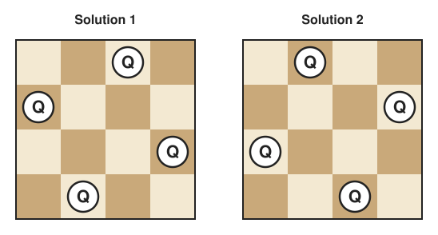
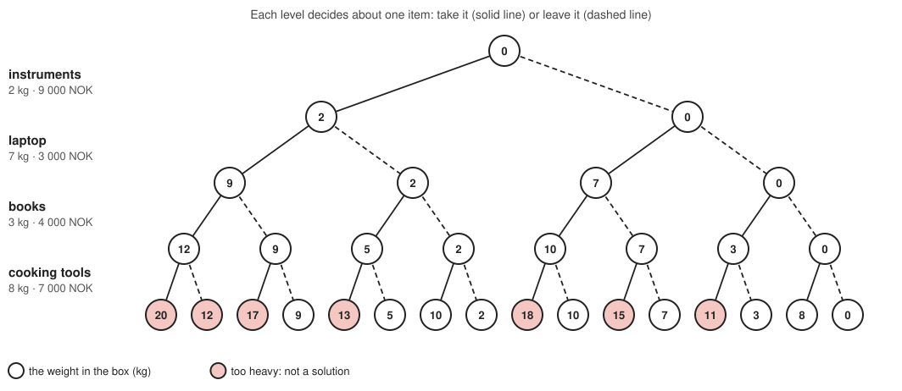
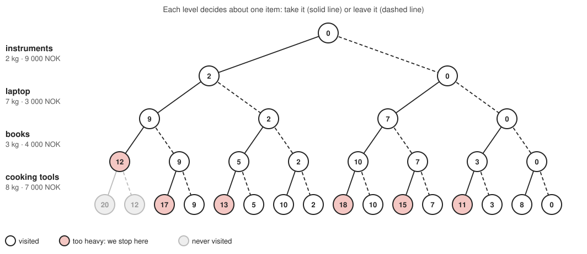
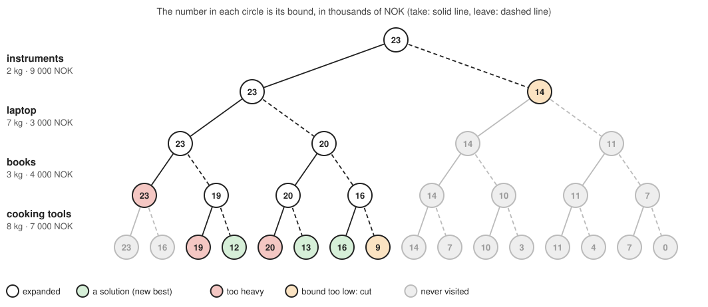

=====================
Combinatorial Search
=====================

:Lecture: Lecture 7.1 :download:`(slides)
          <https://studntnu-my.sharepoint.com/:p:/g/personal/franckc_ntnu_no/ETyREBpmCvBNqJ3imnxIzwMBfAq_rZpfDgXejitSeoXAPA?e=nwhFjy>`
:Objectives: Understand what is combinatorial search, and how to
             approach it
:Concepts: Combinations, pruning, branch-and-bound, Knapsack problem
:Implementation: Java `Backtracking and branch-and-bound <https://github.com/fchauvel/aldast-examples/tree/main/optimization/combinatorial-search/java>`_

So far, we have studied algorithms that compute *the* answer, such as
sorting a sequence or finding a shortest path. Many problems are
different: There are many possible answers, and we want the *best*
one. Which items shall we pack in a box to take the most valuable? How
shall we place queens on a chessboard so that none of them can capture
another? Which route visits all our customers with the least driving?
These are *optimization problems*.

In this lecture, we look at the simplest way to solve them: *trying all
the possibilities*, and then at how to be smart about it, so that we do
not try them all.

Optimization Problems
=====================

.. index:: optimization problem

An optimization problem asks us to find, among a set of possible
*solutions*, one that satisfies some *constraints* and that is the best
according to some *objective*. Sometimes we do not even care about the
best: Any solution that satisfies the constraints will do.

In this lecture, the set of possible solutions is *finite*, or at least
*countable*: We can, in principle, list all the solutions, one after the
other. This is called *discrete* optimization. When the possible
solutions form a continuum, such as all the real numbers between 0 and
1, we speak of *continuous* optimization, which needs other tools (see
the lecture on heuristic search).

Here are a few classic examples:

**The N Queens Problem**
   Place :math:`n` queens on a chessboard with :math:`n` rows and
   :math:`n` columns, so that no queen can capture another one. Here,
   any solution will do.

**Sudoku**
   Fill a grid with digits so that every row, column and block contains
   each digit once.

**Motion Planning**
   Find a path for a robot among obstacles, as short as possible.

**The Traveling Salesperson Problem (TSP)**
   Find the shortest tour that visits a set of cities exactly once and
   comes back to the starting point.

**The Knapsack Problem**
   We have a box that can carry a limited weight, and items that each
   have a weight and a value. Which items shall we put in the box, to
   maximize their total value?

For four queens, there are exactly two solutions, shown on
:numref:`optimization/search/queens`.

   The two ways to place four queens on a four-by-four chessboard so
   that none can capture another.

We will use the knapsack problem as our running example. Say the box can
carry 10 kg, and we can choose among these four items:

.. csv-table:: The items we can put in the box
   :header: "Item", "Weight", "Value"
   :widths: 10, 5, 5

   "Music instruments", "2 kg", "9 000 NOK"
   "Laptop", "7 kg", "3 000 NOK"
   "Books", "3 kg", "4 000 NOK"
   "Cooking tools", "8 kg", "7 000 NOK"

The constraint is that the items we take must not weigh more than 10 kg,
and the objective is to maximize their total value.

Brute Force
===========

.. index:: brute force, exhaustive search

Suppose you are locked out of a vault that opens with a four-digit
code. There is no clever way to find the code: You try 0000, then 0001,
then 0002, and so on, until the vault opens. There are only 10 000 codes
to try, so this *brute force*, also called *exhaustive search*, will
succeed in a few minutes at worst.

Brute force is simple, and always works. The question is whether we can
afford it. Computers perform millions of operations per second, so
a million possibilities is easy, and a billion is manageable. How
quickly do we reach these numbers?

.. csv-table:: How many possibilities?
   :header: "What we enumerate", "How many", "Example"
   :widths: 20, 10, 15

   "Subsets of :math:`n` items", ":math:`2^n`", "20 items: 1 048 576"
   "Orders of :math:`n` items", ":math:`n!`", "10 items: 3 628 800"
   "Words of :math:`k` letters", ":math:`26^k`", "5 letters: 11 881 376"

Brute force works for small problems: With 20 items, we can try all the
subsets in a second. But the numbers grow explosively: Each additional
item *doubles* the number of subsets. With 100 items, there are about
:math:`1.3 \times 10^{30}` subsets, which no computer will ever
enumerate. We need to be smarter.

Enumerating the Solutions
=========================

.. index:: backtracking, configuration

How do we list all the possible solutions of a problem, without missing
any, and without any twice? We build them *step by step*, by making one
*choice* at a time. For the knapsack, we decide, item after item, whether
we *take* it or *leave* it. We call *configuration* a solution under
construction, where some choices have been made, and others have not.

The configurations form a tree, shown on :numref:`optimization/search/tree`.
The root is the *empty* configuration, where nothing is decided. Each
choice leads to a new configuration, a child. The leaves are the
*complete* configurations, where everything is decided. With four
items, the tree has :math:`2^4 = 16` leaves. Enumerating all the
solutions means visiting all these leaves.

   All the ways to fill the box, with the weight carried in each
   configuration. The leaves in red weigh more than 10 kg, so they are
   not solutions.

A search needs only a few things from the problem. We describe them
as an abstract data type, which we call the *Search Problem*. This is
all that the algorithms below know about the problem.

.. module:: problem

.. function:: empty() -> Configuration

   Return the configuration where nothing is decided yet.

   Preconditions:
      None

   Postconditions:
      None

.. function:: extensions(c: Configuration) -> Sequence[Configuration]

   Return the configurations we get by making one more choice. For the
   knapsack, there are two: one where we take the next item, and one
   where we leave it.

   Preconditions:
    - The configuration :math:`c` is not complete.

      .. math::
         \neg \, is\_complete(c)

   Postconditions:
      None

.. function:: is_complete(c: Configuration) -> Boolean

   Tell whether everything is decided in the configuration :math:`c`,
   that is, whether it is a leaf of the tree.

   Preconditions:
      None

   Postconditions:
      None

.. function:: is_valid(c: Configuration) -> Boolean

   Tell whether the configuration :math:`c` respects the constraints of
   the problem. For the knapsack, the items must not weigh more than the
   box can carry. A complete and valid configuration is a *solution*.

   Preconditions:
      None

   Postconditions:
    - Once a configuration breaks a constraint, so do all of its
      extensions. If a configuration is not valid, none of its
      extensions is.

      .. math::
         \neg \, is\_valid(c) \implies \forall c' \in extensions(c), \, \neg \, is\_valid(c')

The simplest search goes down the tree, always making the next choice,
until the configuration is complete. Then it *backs up* to the last
choice, and tries the other possibility. This is called *backtracking*,
and it is a depth-first traversal of the tree of configurations.

.. code-block:: text
   :caption: Enumerating all the solutions (pseudocode)

   function exhaustive(problem, c):
       if problem.is_complete(c):
           if problem.is_valid(c):
               process c
       else:
           for each next in problem.extensions(c):
               exhaustive(problem, next)

   exhaustive(problem, problem.empty())

.. admonition:: Implementation in Java
   :class: hint, dropdown

   A *problem* is anything that offers the operations above. In Java, we
   describe them with an interface, which the problems we want to search
   implement:

   .. code-block:: java
      :linenos:

      public interface Problem<C> {

          C empty();

          List<C> extensions(C configuration);

          boolean isComplete(C configuration);

          boolean isValid(C configuration);
      }

   Here is how the knapsack provides them. A configuration is the list of
   the choices made so far, where ``true`` means that we take the item,
   and ``false`` that we leave it.

   .. code-block:: java
      :linenos:

      public List<Boolean> empty() {
          return List.of();
      }

      // For the next item, we can take it or leave it
      public List<List<Boolean>> extensions(List<Boolean> configuration) {
          return List.of(
              with(configuration, true),
              with(configuration, false)
          );
      }

      public boolean isComplete(List<Boolean> configuration) {
          return configuration.size() == items.size();
      }

      // The items we take must not weigh more than the box can carry
      public boolean isValid(List<Boolean> configuration) {
          return weightOf(configuration) <= capacity;
      }

   Backtracking is then a short recursive method:

   .. code-block:: java
      :linenos:

      // All the solutions, found by trying every possible sequence of choices
      public static <C> List<C> exhaustive(Problem<C> problem) {
          var solutions = new ArrayList<C>();
          exhaustive(problem, problem.empty(), solutions);
          return solutions;
      }

      private static <C> void exhaustive(Problem<C> problem, C configuration, List<C> solutions) {
          if (problem.isComplete(configuration)) {
              if (problem.isValid(configuration)) {
                  solutions.add(configuration);
              }
          } else {
              for (var next : problem.extensions(configuration)) {
                  exhaustive(problem, next, solutions);
              }
          }
      }

Pruning
=======

.. index:: pruning

Look at the tree again. Once the box is too heavy, it does not matter
what we decide for the remaining items: It will stay too heavy. All the
configurations below are invalid, so there is no point in building them.
This is *pruning*: Cutting off a whole branch of the tree as soon as we
know it leads nowhere.

   With pruning, we stop at the first configuration that is too heavy,
   and never visit what is below it.

Pruning only needs a small change: We check the constraints at *every*
configuration, and no longer only at the leaves. This is valid, because
of the property of ``is_valid``: if a configuration is not valid, none
of its extensions is.

.. code-block:: text
   :caption: Enumerating all the solutions, with pruning (pseudocode)

   function with_pruning(problem, c):
       if not problem.is_valid(c):
           return
       if problem.is_complete(c):
           process c
       else:
           for each next in problem.extensions(c):
               with_pruning(problem, next)

In our small example, pruning saves little. But on larger problems, it
makes the difference between hopeless and instantaneous. Take the N
queens problem, which we solve by placing the queens one column after the
other. For six queens, trying everything means looking at 9 331
configurations, whereas pruning looks at only 149. For eight queens,
pruning finds all the 92 solutions by looking at fewer than 2 000
configurations, although there are over 16 million ways to place eight
queens, one per column.

If we only need *one* solution, we can do even better: We stop at the
first complete and valid configuration we find, and do not visit the
rest of the tree.

.. admonition:: Implementation in Java
   :class: hint, dropdown

   The search with pruning is the same as before, with the validity
   check at every configuration:

   .. code-block:: java
      :linenos:

      // All the solutions, but we give up on a configuration as soon as it is
      // invalid: none of its extensions can be valid
      public static <C> List<C> withPruning(Problem<C> problem) {
          var solutions = new ArrayList<C>();
          withPruning(problem, problem.empty(), solutions);
          return solutions;
      }

      private static <C> void withPruning(Problem<C> problem, C configuration, List<C> solutions) {
          if (!problem.isValid(configuration)) {
              return;
          }
          if (problem.isComplete(configuration)) {
              solutions.add(configuration);
          } else {
              for (var next : problem.extensions(configuration)) {
                  withPruning(problem, next, solutions);
              }
          }
      }

   To stop at the first solution, each call returns what it found
   (an ``Optional`` is either a solution, or nothing), and we stop looking
   as soon as there is one:

   .. code-block:: java
      :linenos:

      // Any solution: we stop as soon as we find one
      public static <C> Optional<C> anySolution(Problem<C> problem) {
          return anySolution(problem, problem.empty());
      }

      private static <C> Optional<C> anySolution(Problem<C> problem, C configuration) {
          if (!problem.isValid(configuration)) {
              return Optional.empty();
          }
          if (problem.isComplete(configuration)) {
              return Optional.of(configuration);
          }
          for (var next : problem.extensions(configuration)) {
              var solution = anySolution(problem, next);
              if (solution.isPresent()) {
                  return solution;
              }
          }
          return Optional.empty();
      }

Branch-and-Bound
================

.. index:: branch-and-bound

What if we want the *best* solution, and not just any? We cannot stop at
the first solution we find: A better one may be hiding in another branch.
The obvious approach is to enumerate all the solutions, and to keep the
best one, but that brings us back to trying everything.

Yet, we can use what we have found so far. Suppose we have already found
a solution worth 16 000 NOK. If we can tell that *nothing* below some
configuration can be worth more than 16 000, there is no point in
exploring it. We can prune it, just as we prune the invalid
configurations.

To tell this, we need an *optimistic estimate* of what a configuration
can still lead to, which we call its *bound*. The bound is allowed to be
too optimistic, but it must *never underestimate*: Nothing below the
configuration may be worth more than its bound. For the knapsack, a
simple bound is the value of the items we have already taken, plus the
value of *all* the items we have not decided about, as if the box could
carry everything. Reality can only be worse, so this is a valid
bound.

.. module:: optimization_problem

.. function:: value(c: Configuration) -> Number

   Return how good the choices made in the configuration :math:`c` are.
   For the knapsack, this is the total value of the items we take. The
   higher, the better.

   Preconditions:
      None

   Postconditions:
      None

.. function:: bound(c: Configuration) -> Number

   Return an optimistic estimate of the value of the configuration
   :math:`c`: What we can hope for at best.

   Preconditions:
      None

   Postconditions:
    - The bound never underestimates. No solution below the
      configuration :math:`c` is worth more than its bound.

      .. math::
         is\_valid(c') \, \land \, is\_complete(c') \, \land \, c' \text{ is below } c \implies value(c') \leq bound(c)

This is the *branch-and-bound* algorithm. It goes through the tree as
before, remembering the *best* solution found so far. We *branch*, that
is, we explore the extensions of a configuration, only if its *bound*
shows that it still has a chance to beat the best solution so far.

.. code-block:: text
   :caption: Branch-and-bound (pseudocode)

   function branch_and_bound(problem, c):
       if not problem.is_valid(c):
           return
       if best exists and optimization_problem.bound(c) ≤ value of best:
           return                      # Even at best, c is not better than best
       if problem.is_complete(c):
           if best does not exist or optimization_problem.value(c) > value of best:
               best ← c
       else:
           for each next in problem.extensions(c):
               branch_and_bound(problem, next)

   branch_and_bound(problem, problem.empty())

:numref:`optimization/search/bound` shows the algorithm on our example.
The number in each circle is the bound of the configuration. The search
goes down the tree, taking each item first. It finds a first solution,
worth 12 000, then a second one, worth 13 000, and a third one, worth
16 000. The right half of the tree starts with a bound of 14 000, below
what we already have: We never look at it. The algorithm expands only 7
of the 15 configurations that are not leaves, whereas the search with
pruning alone expands 14.

   Branch-and-bound on the knapsack. Once we have a solution worth
   16 000, the configurations whose bound is not above are cut.

**The order matters.** Branch-and-bound works best when we find a good
solution early, because a high "best so far" lets us cut more. Going
through the choices in a different order can therefore change the work
a lot (although never the result). Instead of simply going deep first, we can
always continue with the *most promising* configuration, that is, the
one with the highest bound. We keep the configurations still to explore
in a priority queue, where the priority is the bound. As we explore the
configurations by decreasing bound, we can stop as soon as the best bound
that remains is not above the best solution found: Nothing left can beat
it. This is called *best-first* search.

The quality of the bound is what makes branch-and-bound effective. The
tighter it is, the more we cut. A bound that is too loose cuts nothing,
and we are back to trying everything. In the worst case, branch-and-bound
is no better than exhaustive search, and takes time exponential in the
number of choices. But on many problems, a good bound makes it practical
far beyond what brute force can do.

.. admonition:: Implementation in Java
   :class: hint, dropdown

   A problem we want to *optimize* offers two more operations, the value
   and the bound:

   .. code-block:: java
      :linenos:

      public interface OptimizationProblem<C> extends Problem<C> {

          int value(C configuration);

          int bound(C configuration);
      }

   For the knapsack, they are:

   .. code-block:: java
      :linenos:

      public int value(List<Boolean> configuration) {
          int total = 0;
          for (int i = 0; i < configuration.size(); i++) {
              if (configuration.get(i)) {
                  total += items.get(i).value();
              }
          }
          return total;
      }

      // At best, we will be able to take all the items we have not decided about
      public int bound(List<Boolean> configuration) {
          int total = value(configuration);
          for (int i = configuration.size(); i < items.size(); i++) {
              total += items.get(i).value();
          }
          return total;
      }

   Branch-and-bound keeps the best configuration found so far, and its
   value, in a small helper, ``Best``:

   .. code-block:: java
      :linenos:

      // The best solution, with branch-and-bound: we give up on a configuration
      // if even its bound is no better than the best solution found so far
      public static <C> Optional<C> branchAndBound(OptimizationProblem<C> problem) {
          var best = new Best<C>();
          branchAndBound(problem, problem.empty(), best);
          return Optional.ofNullable(best.configuration);
      }

      private static <C> void branchAndBound(OptimizationProblem<C> problem, C configuration, Best<C> best) {
          if (!problem.isValid(configuration)) {
              return;
          }
          if (best.configuration != null && problem.bound(configuration) <= best.value) {
              return;
          }
          if (problem.isComplete(configuration)) {
              if (best.configuration == null || problem.value(configuration) > best.value) {
                  best.configuration = configuration;
                  best.value = problem.value(configuration);
              }
          } else {
              for (var next : problem.extensions(configuration)) {
                  branchAndBound(problem, next, best);
              }
          }
      }

      // The best configuration found so far, and its value
      private static class Best<C> {
          C configuration = null;
          int value = 0;
      }

   The best-first variant uses a priority queue, which always gives us the
   configuration with the highest bound:

   .. code-block:: java
      :linenos:

      // The same, but we always continue with the most promising configuration
      // (the one with the highest bound), instead of going deep first
      public static <C> Optional<C> bestFirst(OptimizationProblem<C> problem) {
          var promising = new PriorityQueue<C>(
              (first, second) -> Integer.compare(problem.bound(second), problem.bound(first))
          );
          promising.add(problem.empty());

          var best = new Best<C>();
          while (!promising.isEmpty()) {
              var configuration = promising.poll();
              if (!problem.isValid(configuration)) {
                  continue;
              }
              if (best.configuration != null && problem.bound(configuration) <= best.value) {
                  break; // The most promising one is not promising enough: we are done
              }
              if (problem.isComplete(configuration)) {
                  if (best.configuration == null || problem.value(configuration) > best.value) {
                      best.configuration = configuration;
                      best.value = problem.value(configuration);
                  }
              } else {
                  promising.addAll(problem.extensions(configuration));
              }
          }
          return Optional.ofNullable(best.configuration);
      }
