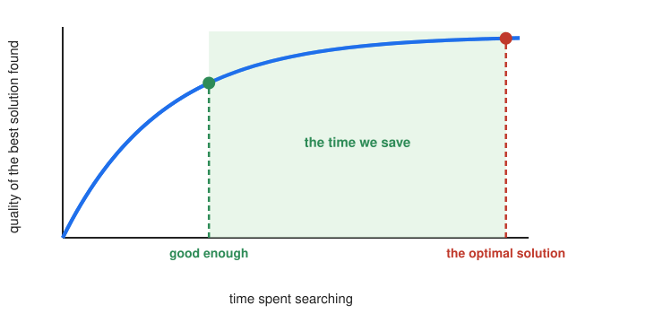
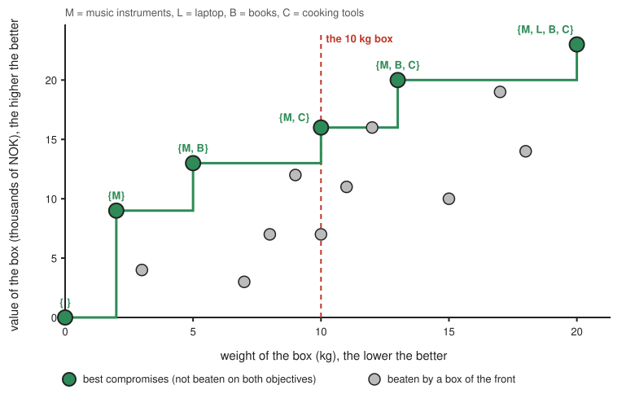
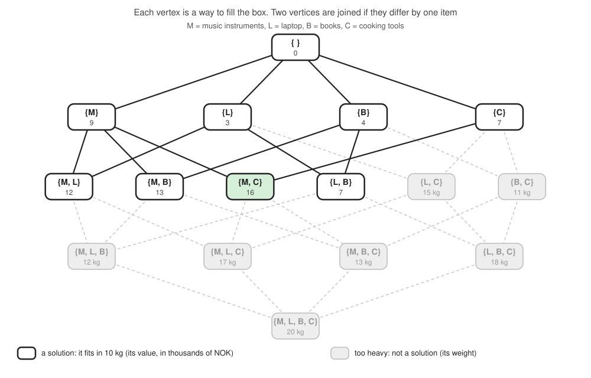
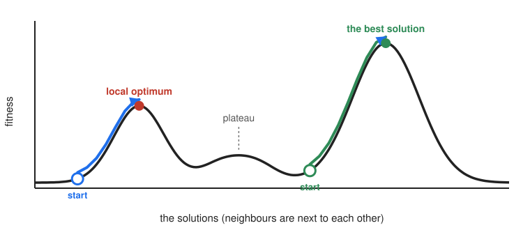
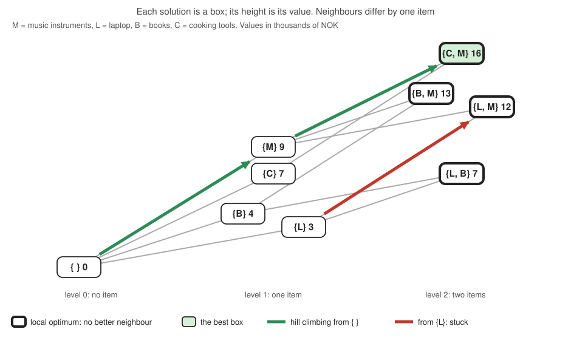
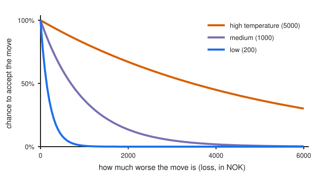

================
Heuristic Search
================

:Lecture: Lecture 7.3 :download:`(slides)
          <https://studntnu-my.sharepoint.com/:p:/g/personal/franckc_ntnu_no/ETLW2IjvO61GqMYkCT95DpsBBHYKuQ5uwDD_aSaSURBTyQ?e=9F0U41>`
:Objectives: Understand what is a *heuristic search*, and how to approach it
:Concepts: Random walk, hill climbing, simulated annealing, tabu search
:Implementation: Java `Random walk, hill climbing and simulated annealing <https://github.com/fchauvel/aldast-examples/tree/main/optimization/heuristic-search/java>`_

Branch-and-bound and dynamic programming both find *the* best solution.
But some problems are too big for them. With 100 items, the knapsack has
about :math:`1.3 \times 10^{30}` possible boxes, and even a good bound
cannot save us from visiting a huge number of them. Other problems have
infinitely many solutions, for instance when they depend on real numbers.
In such cases, we settle for a solution that is *good enough*, which we
find *quickly*. This is the idea of *heuristic search*. A *heuristic* is a
rule of thumb that gives good answers fast, but no guarantee that they are
the best.

Complex Optimization
====================

Some optimization problems are too complex for the exact methods we have
seen. This section explains why we settle for a *good enough* solution, why
"the best" is not always well defined, and what a problem must offer for us
to improve a solution by small changes.

Good Enough
-----------

.. index:: heuristic

The longer we search, the better the solution we find. But the
improvement is often steep at the beginning, and slow after
(:numref:`optimization/heuristic/good_enough`). The best solution may
not be worth the time it takes to find it: A solution that is 95% as good,
found in a second, may be exactly what we need. This is the trade that
heuristic searches make: *speed, in exchange for the guarantee of being
optimal*.

   The quality of the best solution found grows quickly at first. The
   optimal solution may cost a lot more time than a good enough one.

Many famous problems are in this situation: The traveling salesperson
problem, the satisfiability of a logical formula (SAT), finding a
largest group of people who all know one another (clique), and so on. For
these, no algorithm is known that always finds the best solution fast.

Many Objectives
---------------

.. index:: Pareto front, multi-objective optimization

So far, we had a single thing to maximize. Real problems are rarely so
simple. Suppose we do not know yet how much the box can carry, and we want
both a *light* box and a *valuable* one. These two objectives pull in
opposite directions: More items, more value, but more weight. Which box is
the best? There is no single answer.

We can still discard the clearly bad boxes. A box is *dominated* if another
box is at least as good on both objectives, and better on at least one.
For instance, the music instruments and the books (5 kg, 13 000 NOK)
dominate the laptop and the music instruments (9 kg, 12 000 NOK): They
are lighter *and* more valuable. The boxes that no other box dominates are
the best compromises. Together, they form the *Pareto front*, named after
the economist Vilfredo Pareto. For our four items, six of the sixteen
boxes are on the front (:numref:`optimization/heuristic/pareto`).

   The sixteen ways to fill a box, by weight and value. The green boxes
   form the Pareto front: None is beaten by another box on both objectives.
   Our 10 kg limit selects one of them.

Along the front, we trade weight for value, and no point is better than
another: Which one to pick depends on what we want. Our limit of 10 kg
selects the music instruments and the cooking tools, the most valuable
box that fits.

With several objectives, the answer is no longer a single solution, but a
whole *set* of compromises, which is usually much harder to find. And real
problems have more objectives (cost, time, risk, and so on) and more
constraints than what we sketch here. This is one more reason why *good
enough* matters: When even "the best" is not clearly defined, a good
compromise, found quickly, is often what we need.

.. admonition:: Implementation in Java
   :class: hint, dropdown

   A candidate has a name, a cost we want low, and a gain we want high.
   Here are the comparison, and the front:

   .. code-block:: java
      :linenos:

      // Is the first candidate at least as good as the second on both objectives,
      // and better on at least one?
      public static boolean dominates(Candidate first, Candidate second) {
          boolean noWorse = first.cost() <= second.cost() && first.gain() >= second.gain();
          boolean better = first.cost() < second.cost() || first.gain() > second.gain();
          return noWorse && better;
      }

      // The candidates that no other candidate dominates
      public static List<Candidate> front(List<Candidate> candidates) {
          var front = new ArrayList<Candidate>();
          for (var candidate : candidates) {
              boolean dominated = false;
              for (var other : candidates) {
                  dominated = dominated || dominates(other, candidate);
              }
              if (!dominated) {
                  front.add(candidate);
              }
          }
          return front;
      }

Neighbours and Landscapes
-------------------------

.. index:: neighbourhood, fitness landscape

Heuristic searches do not build solutions from scratch, choice after
choice. They start from a *complete* solution and *improve* it by small
changes. For this, they need three things from the problem: a solution to
start from, a way to move from a solution to its *neighbours* (the
solutions that differ by one small change), and a measure of how good a
solution is, which we call its *fitness*.

**A graph of solutions.** There is nothing new here: This is a *graph*, as in
the previous module. Take the knapsack with four items. Each way to fill the
box is a *vertex*, and two vertices are joined by an *edge* when they differ
by one item: We add an item, or we remove one
(:numref:`optimization/heuristic/graph`). Seven of the sixteen vertices break
the 10 kg limit. They are not solutions, so the *graph of solutions* is
made of the nine others.

   The graph of the ways to fill the box with four items. The nine
   solutions are joined by the changes that turn one into another.

In this graph, the *neighbours* of a solution are simply the vertices next
to it, and moving to a neighbour means following an edge. In other words,
``neighbours(s)`` plays the role of ``graph.edges_from(g, s)`` (see the
:doc:`Graph ADT </graphs/intro/index>`). "Neighbours" is only a new name for
a notion we already know, here in a graph of solutions.

There are two differences with the graphs of the previous module. First,
it makes no sense to hold this graph in memory: With 100 items, it has
:math:`2^{100}` vertices. What we hold is just a *cursor*, the solution where
we stand now, and a *rule* that computes its neighbours when we need them. For
the knapsack, the rule is: remove any item from the box, or add any item that
is missing, as long as the box can carry it. Moving the cursor means picking
one of these neighbours. The graph is *implicit*: The rule defines it, and we
never build it. However large the graph, a hill climber, a random walk or an
annealer only holds a handful of solutions: Where it stands, and the best
one so far.

Second, it is not the tree of the previous lecture. The sixteen vertices are
the sixteen leaves of that tree, but, there, we built each solution choice
after choice, whereas here an edge connects two *complete* solutions that
differ by one thing. By following edges, we can come back to a solution we
have already visited.

So, a heuristic search is a cursor walking on an implicit graph of solutions.
What it needs from the problem is exactly this: where to put the cursor at
first, how to compute the neighbours of its position, and how good a
position is.

The edges are implicit, and they depend on what we allow as a *change*.
Suppose we also allow to *swap* an item of the box for one that is missing.
The graph has the same nine
vertices, but 23 edges instead of 12: It is *denser*. There are more ways to
go from any solution to the best one, and fewer traps. The laptop and the
music instruments, a local optimum with the former changes, now lead to the
best box, by swapping the laptop for the cooking tools. In this tiny example,
the best box becomes the only local optimum. The price is that each
solution has more neighbours to look at. Deciding what a change is, that is,
what the neighbours of a solution are, is one of the main design choices of
a heuristic search.

.. module:: search_space

.. function:: initial() -> Solution

   Return a solution to start from, which does not need to be a good
   one.

   Preconditions:
      None

   Postconditions:
      None

.. function:: neighbours(s: Solution) -> Sequence[Solution]

   Return the solutions we reach from the solution :math:`s` by one small
   change: The vertices next to :math:`s` in the graph of solutions. For the
   knapsack, we add one item to the box, or remove one.

   Preconditions:
      None

   Postconditions:
    - Being neighbours is mutual: If :math:`n` is a neighbour of
      :math:`s`, then :math:`s` is a neighbour of :math:`n`.

      .. math::
         n \in neighbours(s) \implies s \in neighbours(n)

.. function:: fitness(s: Solution) -> Number

   Return how good the solution :math:`s` is. The higher, the better. For
   the knapsack, this is the total value of the items in the box.

   Preconditions:
      None

   Postconditions:
      None

Picture the solutions as a *landscape*: Neighbouring solutions are
next to each other, and the fitness is the *height*. Finding the best
solution means finding the highest peak, but, as in a fog, we can only see
our neighbours (:numref:`optimization/heuristic/landscape`). There may be
several peaks. Those that are higher than all their neighbours, but not
the highest of all, are *local optima*.

   A landscape of solutions. Starting from the left, we climb to a local
   optimum, a peak that is not the highest. Starting from the right, we
   reach the best solution.

For the knapsack, the landscape has nine solutions, the boxes that do not
break the 10 kg limit (:numref:`optimization/heuristic/knapsack`). Four of
them are local optima: Their neighbours are all worse, yet only one is the
best.

   The landscape of the knapsack. The height is the value of the box.
   Boxes with a thick border are local optima. Hill climbing from the empty
   box reaches the best box, but from the laptop alone, it stops on a box
   worth 12 000.

.. admonition:: Implementation in Java
   :class: hint, dropdown

   In Java, a search space is anything that offers these three
   operations. We describe them with an interface:

   .. code-block:: java
      :linenos:

      public interface SearchSpace<S> {

          S initial();

          List<S> neighbours(S solution);

          int fitness(S solution);
      }

   For the knapsack, a solution is the set of the items in the box. Its
   neighbours are the sets we get by adding or removing one item, as long as
   the box can carry them, and, if we allow it, by swapping an item:

   .. code-block:: java
      :linenos:

      // The solutions we reach by one change
      public List<Set<String>> neighbours(Set<String> solution) {
          var result = new ArrayList<Set<String>>();
          addOrRemoveOneItem(solution, result);
          if (allowSwaps) {
              swapOneItem(solution, result);
          }
          return result;
      }

      // Add or remove one item, if the box can still carry what is in it
      private void addOrRemoveOneItem(Set<String> solution, List<Set<String>> result) {
          for (var item : items) {
              var changed = new HashSet<>(solution);
              if (solution.contains(item.name())) {
                  changed.remove(item.name());
              } else {
                  changed.add(item.name());
              }
              if (weightOf(changed) <= capacity) {
                  result.add(Set.copyOf(changed));
              }
          }
      }

      // Replace one item of the box with an item that is missing, if the box can
      // carry the result
      private void swapOneItem(Set<String> solution, List<Set<String>> result) {
          for (var inBox : items) {
              for (var missing : items) {
                  if (solution.contains(inBox.name()) && !solution.contains(missing.name())) {
                      var changed = new HashSet<>(solution);
                      changed.remove(inBox.name());
                      changed.add(missing.name());
                      if (weightOf(changed) <= capacity) {
                          result.add(Set.copyOf(changed));
                      }
                  }
              }
          }
      }

      public int fitness(Set<String> solution) {
          int total = 0;
          for (var item : items) {
              if (solution.contains(item.name())) {
                  total += item.value();
              }
          }
          return total;
      }

Random Walk
===========

.. index:: random walk

The simplest heuristic is to wander. We move from the starting solution to
one of its neighbours chosen at random, then to one of *its* neighbours,
and so on, and we *remember the best* solution we have seen. We stop when
we are bored: after a given number of steps.

.. code-block:: text
   :caption: Random walk (pseudocode)

   function random_walk(space, steps):
       current ← search_space.initial()
       best ← current
       repeat steps times:
           current ← a random neighbour of current
           if search_space.fitness(current) > search_space.fitness(best):
               best ← current
       return best

If we walk long enough, we will eventually visit every solution, as long
as we can get from any solution to any other by moving from neighbour to
neighbour. In particular, we will find the best one: **a random walk is
guaranteed to find the best solution of any finite set.** On our nine boxes,
a thousand steps are plenty.

But look at what "long enough" means. A random walk learns nothing from where
it has been, so it needs, roughly, as many steps as there are solutions, which
is :math:`2^n` for :math:`n` items. With 100 items, at a million steps per
second, this is about :math:`4 \times 10^{16}` years, millions of times the
age of the universe. This is a strong result, but an impractical one, from an
engineering perspective.

.. admonition:: Putting theory in perspective

   Theoretical results have to be put in perspective. The guarantee of the
   random walk is strong: It holds for any finite set, whatever the
   problem. But it holds *eventually*, which is of little help when we have
   a deadline. This does not make theory useless, though. Simulated
   annealing, below, comes with a similar guarantee, and it is, in
   practice, a very effective algorithm. When you read that an algorithm is
   "guaranteed to find the best solution", ask yourself *how long* it takes.

.. admonition:: Implementation in Java
   :class: hint, dropdown

   .. code-block:: java
      :linenos:

      // Random walk: we move to a random neighbour, again and again, and we
      // remember the best solution we have seen
      public static <S> S randomWalk(SearchSpace<S> space, int steps, Random random) {
          var current = space.initial();
          var best = current;
          for (int step = 0; step < steps; step++) {
              current = randomNeighbour(space, current, random);
              if (space.fitness(current) > space.fitness(best)) {
                  best = current;
              }
          }
          return best;
      }

      private static <S> S randomNeighbour(SearchSpace<S> space, S solution, Random random) {
          var neighbours = space.neighbours(solution);
          if (neighbours.isEmpty()) {
              return solution;
          }
          return neighbours.get(random.nextInt(neighbours.size()));
      }

Hill Climbing
=============

.. index:: hill climbing

To do better, let us use the fitness. From where we are, we look at all
the neighbours and move to the *best* one, as long as it is better than
where we stand. We stop when no neighbour is better: We have reached the
top of a hill.

.. code-block:: text
   :caption: Hill climbing (pseudocode)

   function hill_climbing(space):
       current ← search_space.initial()
       loop:
           best ← the neighbour of current with the highest fitness
           if best does not exist, or is no better than current:
               return current
           current ← best

On the knapsack (:numref:`optimization/heuristic/knapsack`), starting from
the empty box, hill climbing adds the music instruments (9 000), the best
neighbour, then the cooking tools (16 000), and stops: It has found the best
box. But start from the laptop alone. The best neighbour is the music
instruments (12 000), and from there, all the neighbours are worse: We are
stuck on a local optimum, while the best box is two steps away, behind a
step *down*.

This is the weakness of hill climbing: It follows the slope, and gets
trapped on *local optima*. It can also wander on *plateaus*, where all the
neighbours are as good, and get lost on narrow *ridges*. Hill climbing is
fast and simple, so we often use it as a building block, for instance by
*restarting* from several random solutions and keeping the best result.
For problems where the solutions are numbers, following the slope of the
fitness function is called *gradient descent* (or ascent).

.. admonition:: Implementation in Java
   :class: hint, dropdown

   The method ``climb`` returns the solutions that hill climbing goes
   through, and ``hillClimbing`` is where it ends:

   .. code-block:: java
      :linenos:

      // Hill climbing: from where we are, we move to the best neighbour, as long
      // as it is better than where we are. These are the solutions we go through.
      public static <S> List<S> climb(SearchSpace<S> space) {
          var path = new ArrayList<S>();
          var current = space.initial();
          path.add(current);
          while (true) {
              var best = bestNeighbour(space, current, List.of());
              if (best.isEmpty() || space.fitness(best.get()) <= space.fitness(current)) {
                  return path;
              }
              current = best.get();
              path.add(current);
          }
      }

      // Where hill climbing stops
      public static <S> S hillClimbing(SearchSpace<S> space) {
          var path = climb(space);
          return path.get(path.size() - 1);
      }

      private static <S> Optional<S> bestNeighbour(SearchSpace<S> space, S solution, List<S> excluded) {
          S best = null;
          for (var neighbour : space.neighbours(solution)) {
              if (excluded.contains(neighbour)) {
                  continue;
              }
              if (best == null || space.fitness(neighbour) > space.fitness(best)) {
                  best = neighbour;
              }
          }
          return Optional.ofNullable(best);
      }

Simulated Annealing
===================

.. index:: simulated annealing

How can we escape a local optimum? By accepting, sometimes, to go *down*.
Simulated annealing takes its idea from metallurgy: A metal that is heated
and then cooled *slowly* settles in a strong structure, whereas a metal
cooled too fast stays brittle. In the search, the *temperature* tells how
adventurous we are.

At each step, we pick a random neighbour. If it is better, we always move
there. If it is worse, we move there *anyway*, with a probability that
depends on two things: *how much worse* it is, and the *temperature*. A
little worse is more likely to be accepted than much worse. And, when it
is hot, we accept a lot, whereas, when it is cold, we hardly accept
anything (:numref:`optimization/heuristic/annealing`). We start hot, and we
let the temperature drop, so that we explore at the beginning, and settle
at the end.

   The chance to accept a worse move, according to how much worse it is,
   for three temperatures. The colder, the less likely.

.. code-block:: text
   :caption: Simulated annealing (pseudocode)

   function simulated_annealing(space, temperature, cooling, steps):
       current ← search_space.initial()
       best ← current
       repeat steps times:
           candidate ← a random neighbour of current
           change ← fitness of candidate - fitness of current
           if change ≥ 0, or with probability e^(change / temperature):
               current ← candidate
           if fitness of current > fitness of best:
               best ← current
           temperature ← temperature × cooling
       return best

Here, ``cooling`` is a number a little below 1, such as 0.99, so that the
temperature drops a little at each step. On the knapsack, starting from
the laptop alone, simulated annealing with a good temperature finds the
best box, where hill climbing is stuck. Without any heat, it only goes up,
like hill climbing, and gets stuck too.

In theory, with enough time and a slow enough cooling, simulated annealing
will find the best solution, a guarantee similar to the random walk's. But,
unlike the random walk, it is very effective in practice, and it has few
parameters to tune: a starting temperature, a cooling rate and a number of
steps. What works depends on the problem, so we try a few values on typical
instances.

.. admonition:: Implementation in Java
   :class: hint, dropdown

   The chance to accept a move, and the search itself. The random numbers
   come from a ``Random``, so that a test can fix the seed and get the
   same results every time.

   .. code-block:: java
      :linenos:

      // Simulated annealing: we move to a random neighbour. We always accept it
      // if it is better, and we sometimes accept it if it is worse, less and less
      // often as the temperature drops. We remember the best solution we have seen.
      public static <S> S simulatedAnnealing(
          SearchSpace<S> space, double temperature, double cooling, int steps, Random random
      ) {
          var current = space.initial();
          var best = current;
          for (int step = 0; step < steps; step++) {
              var candidate = randomNeighbour(space, current, random);
              int change = space.fitness(candidate) - space.fitness(current);
              if (random.nextDouble() < acceptanceProbability(change, temperature)) {
                  current = candidate;
              }
              if (space.fitness(current) > space.fitness(best)) {
                  best = current;
              }
              temperature = temperature * cooling;
          }
          return best;
      }

      // How likely we accept a move that changes the fitness by this much. A better
      // move is always accepted. A worse move is less likely when it loses more,
      // and when the temperature is low.
      public static double acceptanceProbability(int change, double temperature) {
          if (change >= 0) {
              return 1.0;
          }
          return Math.exp(change / temperature);
      }

Tabu Search
===========

.. index:: tabu search

Hill climbing is stuck on a local optimum because it refuses to go down.
Simulated annealing goes down by chance. Tabu search goes down by
*design*: It always moves to the best neighbour, even if it is worse than
where we stand. To avoid going straight back to where it came from, it
*remembers* the solutions it has just visited, and declares them *tabu*,
that is, forbidden.

.. code-block:: text
   :caption: Tabu search (pseudocode)

   function tabu_search(space, steps, tenure):
       current ← search_space.initial()
       best ← current
       tabu ← [current]               # the solutions we remember
       repeat steps times:
           candidates ← the neighbours of current that are not in tabu
           if candidates is empty:
               stop
           current ← the candidate with the highest fitness
                                      # even if it is worse than the current one
           add current to tabu
           if tabu holds more than tenure solutions:
               forget the oldest one
           if search_space.fitness(current) > search_space.fitness(best):
               best ← current
       return best

The *tenure* is how many solutions we remember. A short memory only prevents
going straight back. A long memory pushes the search further away from
where it has been, but a memory that is too long may leave no neighbour to
go to.

Let us follow it on the knapsack, with a tenure of 3, starting from the
laptop alone, where hill climbing was stuck on a box worth 12 000:

#. We start from the laptop (3 000). Its best neighbour is the laptop and the
   music instruments (12 000). We move there, and we remember both boxes.

#. From there, the neighbours are the laptop alone, which is tabu, and the
   music instruments alone (9 000). We have no choice: We move *down*, to the
   music instruments, even if it is worse. We remember it.

#. From the music instruments, the best neighbour is the cooking tools and
   the music instruments (16 000), and it is not tabu. We move there: We have
   found the best box.

Hill climbing stopped at step 1. Tabu search gets out of the local optimum,
because it has no right to go back, and it must take the step down. The
Java code is in the examples repository.

And Many More
=============

There are many other heuristics. Here are a few names to look for:

**Genetic algorithms**
   They mimic evolution: A population of solutions, which are combined
   and mutated, and where the fittest survive.

**Particle swarm and ant colony optimization**
   They mimic how birds flock, or how ants find food: Many simple agents
   that share what they find.

**Linear programming**
   For problems where the constraints and the fitness are linear, there
   are *exact* methods, much faster than a general search.

In practice, when we face a hard problem, a good approach is to:

#. read about the problem, and similar ones, to see what has worked;
#. decide what a neighbour is and what the fitness is;
#. write a simple, naive solution first;
#. collect statistics on a set of typical instances of the problem;
#. improve, and measure again.

Libraries and solvers, such as Google's *OR-Tools* or the *Z3* solver, do
much of this work for common problems, such as vehicle routing or
satisfiability.

.. seealso::

   Russell, S. J., & Norvig, P. (2021). *Artificial Intelligence: A Modern
   Approach*, 4th edition, Pearson. See the chapter on search in complex
   environments (local search, simulated annealing).
