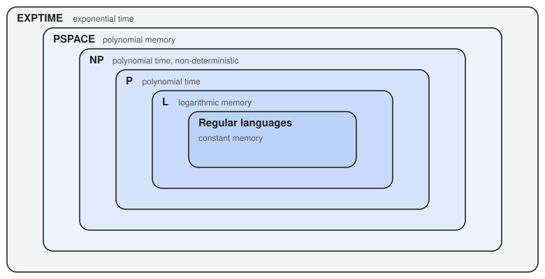
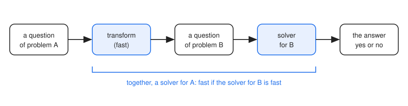
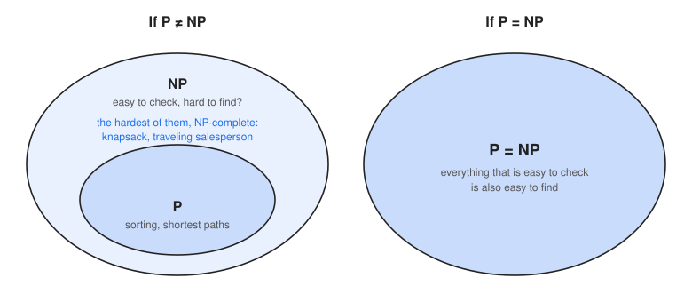

==================
Complexity Classes
==================

:Lecture: Lecture 8.3 :download:`(slides)
          <https://studntnu-my.sharepoint.com/:p:/g/personal/franckc_ntnu_no/IQBXy0ZrCt4QQLqK1pRWaIDTASerWfn7tz_2gkWSA4QyI9U?e=EWa1QU>`
:Objectives: Understand what is a complexity class, what P and NP mean, and
             why the question "P = NP?" matters
:Concepts: Complexity class, machine, resource, bound, P, NP, finding versus
           checking, NP-completeness, P = NP

Let us take a step back. Throughout this course, we have met many problems:
Sorting, searching, shortest paths, spanning trees, knapsacks. For each of
them, we have met many algorithms, with different efficiencies. And in the last
lecture we learned that the efficiency of an algorithm depends on the *machine*
that runs it: What takes ``n log n`` steps on a RAM may take fewer on a parallel
machine, and what takes forever on a RAM may take a handful of steps on a
machine that always guesses right.

That is a bit of a mess! Problems, algorithms, machines, each one changing the
answer to "how hard is it?". In this lecture, we clean it up, with one idea: We
stop looking at algorithms, and we look at the *problems*.

.. note::

   **A disclaimer.** The point of this lecture is *not* to convey the
   technicalities. We skip the formal definitions and the proofs, and we
   simplify here and there. The goal is to give you a good enough *intuition*
   about some of the big ideas of computer science, and maybe to pick your
   curiosity, but no more. If it does, the theory of computation is a whole
   field, with courses of its own, waiting for you.

Complexity Classes
==================

From Algorithms to Problems
---------------------------

A problem usually has many algorithms, and most of them are not good. What
really matters is how much the *best possible* algorithm costs. This is the
*difficulty of the problem*. It does not belong to any particular algorithm: It
is a property of the problem itself.

And for the machine, we look only at the most powerful ones: The Turing machine,
or the RAM, which we know to be equivalent. Weaker machines, such as the
automaton, can only solve some of the problems, which we saw in the first
lecture.

Finding versus Checking
-----------------------

Every problem has two sides. The first is **finding** a solution. This is the
hard side, in general: It is a search in a tree, which may be exponential, as we
did in the combinatorial search lecture. The second is **checking** that a given
solution is correct. This is often much easier. It is the ``is_valid`` of our
Search Problem. A solved Sudoku grid can be checked at a glance, whereas finding
the grid can take hours. It is the same for a jigsaw puzzle, or a lock and its
key.

Checking is a *yes/no question*: "Is this candidate a valid solution of this
instance?". And a yes/no question is a *membership problem*, as in the first
lecture: Is the pair (instance, candidate) in the set of valid pairs? So
checking is a problem about a *language*. From now on, we will mostly speak of
problems in their yes/no form, such as "Is there a path shorter than ``k``?" or
"Is there a spanning tree cheaper than ``k``?". It is no loss: Whenever the
answer is yes, a solution proves it, and checking that proof is the easy side.

Machine, Resource, Bound
------------------------

We can now define the central notion of this lecture. A **complexity class** is
a set of problems, defined by three choices:

- a **machine**: Which one do we use to solve the problem?
- a **resource**: What do we count? The number of steps (*time*), the amount of
  state to remember (*memory*), the number of processors?
- a **bound**: How much of this resource may it use, as a function of the size
  of the input? A constant, ``n``, ``n²``, ``2ⁿ``?

A class is then *the set of problems that can be solved by this machine, using
at most this amount of this resource*. For instance, "the problems that a Turing
machine can solve in a number of steps that is logarithmic in the size of the
input", or "the problems that an automaton solves with a constant amount of
state". The second one should ring a bell: These are the *regular languages* of
the first lecture!

There are countless such triplets, and thus countless classes. A few of them have
names. Here are some, for time and for memory:

==========================================================================  ==============================  ===========  ====================
Class                                                                       Machine                         Resource     Bound
==========================================================================  ==============================  ===========  ====================
Regular languages                                                           Automaton                       Memory       Constant
`L <https://en.wikipedia.org/wiki/L_(complexity)>`_                         Turing machine                  Memory       Logarithmic
`PSPACE <https://en.wikipedia.org/wiki/PSPACE>`_                            Turing machine                  Memory       Polynomial
**P**                                                                       Turing machine (or RAM)         Time         Polynomial
**NP**                                                                      Non-deterministic machine       Time         Polynomial
`EXPTIME <https://en.wikipedia.org/wiki/EXPTIME>`_                          Turing machine                  Time         Exponential
==========================================================================  ==============================  ===========  ====================

These classes are not unrelated. A machine that is allowed more resource can do at
least as much, so the classes are nested, as in
:numref:`theory/complexity_classes/inclusions`.

   How the classes relate: Each one is inside the next.

You can find the intuition behind each step:

- A machine with constant memory is also a machine with logarithmic memory.
- With logarithmic memory, a machine can be in only polynomially many different
  configurations. It cannot go on for longer without repeating one, and so it
  runs in polynomial time: L is inside P.
- The lucky machine does at least what the ordinary one does: P is inside NP.
- We can imitate the lucky machine by trying every branch of its tree, one after
  the other, forgetting each one when done. This uses little memory (as in our
  search lectures, the tree is never stored), but a lot of time: NP is inside
  PSPACE.
- With polynomial memory, a machine has at most exponentially many
  configurations, so it runs in at most exponential time: PSPACE is inside
  EXPTIME.

Here are problems for each class, as yes/no questions, with the ones we met in
this course first. (Several of these problems have their own page on Wikipedia,
for the curious.)

- **Regular languages**: Does this text match a pattern, such as ``ba*!``, an
  identifier or a date? (First lecture of this module.)
- **L**: Is this array sorted? We only need to remember an index, which is
  logarithmic in the size of the array. The language ``aⁿbⁿ`` of the first
  lecture also belongs here: An automaton cannot count, but a counter written in
  binary takes only logarithmically many bits.
- **P**: Is this the sorted version of that list? Is there a path shorter than
  ``k`` between two vertices (shortest paths)? Is there a spanning tree cheaper
  than ``k`` (Prim, Kruskal)? Is this key in the hash table, or in the tree?
- **NP**: The ones for which finding seems hard but checking is easy. The
  `knapsack <https://en.wikipedia.org/wiki/Knapsack_problem>`_ and the
  `traveling salesperson <https://en.wikipedia.org/wiki/Travelling_salesman_problem>`_
  of the Optimization module, the Sudoku, `graph coloring
  <https://en.wikipedia.org/wiki/Graph_coloring>`_, and the `satisfiability
  of a formula <https://en.wikipedia.org/wiki/Boolean_satisfiability_problem>`_.
- **PSPACE**: Problems where, it seems, even *checking* a solution is hard, such as many
  puzzles and games on boards of any size: `Sokoban
  <https://en.wikipedia.org/wiki/Sokoban>`_, `Rush Hour
  <https://en.wikipedia.org/wiki/Rush_Hour_(puzzle)>`_, or deciding whether a
  `quantified formula
  <https://en.wikipedia.org/wiki/Quantified_Boolean_formula>`_ is true.
- **EXPTIME**: Who wins at chess, or checkers, played on a board of any size, with
  both players playing perfectly. See the `complexity of games
  <https://en.wikipedia.org/wiki/Computational_complexity_of_games>`_.

What we do *not* know is which of these steps are strict. We know that P is not
EXPTIME, so at least one step in between is strict, but we cannot tell which one.
In this lecture, we focus on the two most famous classes, P and NP.

P
=

The class **P** is the set of problems that a Turing machine (or a RAM) solves
in *polynomial time*: A number of steps that grows as ``n``, ``n²``, ``n³``, or
any other power of the size ``n`` of the input.

We call these problems *efficient*, or *tractable*. All the problems of this
course that we could solve with a reasonable algorithm are in P: Sorting,
searching, the shortest path, the minimum spanning tree. In their yes/no form,
"is there a path shorter than ``k``?" or "is there a spanning tree cheaper than
``k``?" belong to P.

As in the rest of this course, we take it as a convention that polynomial is
*efficient*, and that anything beyond, such as ``2ⁿ``, is *impractical* on
real-life instances.

So P is the set of problems that are easy to *solve*. But there are many other
problems, which we do not know how to solve fast. Can we say anything about them?

NP
==

The class **NP** is the set of problems that a *non-deterministic* Turing
machine solves in polynomial time. This is our lucky machine of the last
lecture, which always chooses the right rule at each step (or, if you prefer,
which explores all the branches at the same time).

The name stands for *non-deterministic polynomial time*. It does **not** mean
"not polynomial", which is a common mistake!

Here is what NP really contains. Remember what the lucky machine did for the
Sudoku: It *guessed* every cell, then it *checked* the rows, the columns and
the blocks. In general, it *guesses* a candidate solution, which takes a
polynomial number of steps, and then *checks* it, in polynomial time. If the
check is fast, the whole run is fast. So, a problem is in NP *exactly* when a
candidate solution can be **checked in polynomial time**. That is the
description of NP we will keep in mind: *easy to check*, but maybe hard to find.

Some examples, as yes/no questions:

- The **knapsack**: "Is there a set of items that fits in the box and is worth at
  least 15 000?". Given a set, we add up the weights and the values.
- The **traveling salesperson**: "Is there a tour that visits every city and is
  shorter than ``k``?". Given a tour, we add up its length.
- The **satisfiability** of a formula: "Is there a way to set the variables so
  that the formula is true?". Given the values, we evaluate the formula.
- The **Sudoku**: "Can this grid be completed?". Given a completed grid, we check
  every row, column and block.

.. margin::

   Wait, did we not solve the knapsack fast, with dynamic programming? That
   algorithm takes a time proportional to the *capacity* of the box, which is
   a number. A number written with ``k`` digits can be as large as ``10ᵏ``, so
   this is not polynomial in the *size* of the input. This is a story for
   another course.

Every problem of P is also in NP: If we can *find* a solution in polynomial
time, we can certainly *check* one. We just find it again, and compare. So P is
inside NP. The question is whether it is the *whole* of it.

Reductions
----------

Here is a surprising discovery. Problems that look very different at first sight
sometimes turn out to be *the same problem in disguise*. A Sudoku, for instance,
is a *graph coloring* problem. Make a vertex for each cell, and an edge between
two cells that must hold different digits (same row, same column or same block).
Filling the grid with the digits 1 to 9 is then coloring the vertices with nine
colors so that no two neighbors share a color. Scheduling exams, so that no
student has two at the same time, is the same problem again: The exams are the
vertices, the colors are the time slots, and two exams are linked if a student
takes both.

What we did is *transform* an instance of one problem into an instance of another,
with the same answer. This is called a **reduction**. If we can transform
problem A into problem B quickly, then a fast solver for B gives us a fast solver
for A: We transform the question, and we ask the solver for B, as shown in
:numref:`theory/complexity_classes/translation`.

   A reduction. If A transforms quickly into B, a fast solver for B is also a
   fast solver for A.

So B is *at least as hard as* A. We found many such links between the problems of
NP, and they are surprising: Seemingly unrelated problems turn out to be the same
one, over and over.

NP-Complete
-----------

Some problems of NP are so general that *every* problem of NP reduces to them.
The first one that was shown to be of this kind was the satisfiability of a
formula, in the 1970s. Since then, thousands of others have been found, including
the knapsack and the traveling salesperson. We call them **NP-complete**: They
are the *hardest* of NP.

What does that mean? If we found a fast algorithm for *just one* of them, we
would get a fast algorithm for *all* of NP, since all the others reduce to it.
Despite decades of efforts, nobody has found one.

P = NP?
=======

So we have two classes, P and NP, and we know that P is inside NP. Here is the
question that remains. Does the lucky machine *really* help? Can an ordinary
machine solve, in polynomial time, everything that the lucky machine solves, or
is the exponential tree unavoidable? In the words we used above: *Is finding
really harder than checking*, or have we just not been clever enough?

   The two possible worlds. Either P is strictly inside NP, or they are the
   same.

This question is **open**. Most specialists believe that the answer is no, that
finding really is harder than checking, but nobody has proved it. It is one of
the Millennium Prize Problems of the Clay Mathematics Institute, and comes with
a prize of one million dollars.

What is at stake? If P were equal to NP, then every NP-complete problem would
be easy, and so would thousands of problems we consider hard: Planning,
scheduling, routing, the design of circuits. Many things we rely on, such as
cryptography, which counts on some problems being hard to solve and easy to
check, would be in danger. And if P is not equal to NP, then we know that our
intuition is right, and that *some* problems are hopeless in general. Either
way, the answer would tell us a lot about what computers can do.

In Practice
===========

Here is probably the most useful part of this lecture. Sooner or later, you will
read, in a paper, a blog post or a code review, that "this problem is in P", or
"NP-complete", or "EXPTIME". As an engineer, what should you do with it? Here is
a field guide.

- **"This problem is in P."** *Good news: An efficient algorithm exists.* Sorting
  is in P, and so is finding a shortest path. Do not invent something fancy: Look
  for the textbook algorithm, and use it. Keep in mind that polynomial is not
  always fast. A ``n³`` algorithm on a million items is still too slow, so look at
  the exponent and at the size of your data.
- **"This problem is in NP."** *Careful, this says less than you may think.* It
  only says that a solution is easy to *check*, and it includes everything in P.
  The knapsack is in NP, and so is sorting! This is still useful: Write the
  checker (our ``is_valid``). It tests any solver, and it validates the result of
  a heuristic that may have made a mistake.
- **"This problem is NP-complete."** *Warning: The hardest of NP.*
  Nobody knows an efficient algorithm for it, and finding one would be a
  breakthrough. So do not promise an optimal solution on large instances, and do
  not blame yourself if your algorithm is slow: It is the problem. Instead, you
  have a toolbox, which you know from the Optimization module:

  - *Check the size.* If your instances are small, branch-and-bound or even a
    plain search is fine.
  - *Look at the numbers.* If they are small, as with the capacity of a knapsack,
    dynamic programming may do.
  - *Settle for good enough.* A heuristic, such as hill climbing or simulated
    annealing, finds a good solution fast, though not provably the best. Some
    problems even have `approximation algorithms
    <https://en.wikipedia.org/wiki/Approximation_algorithm>`_ that guarantee how
    far from the best they are.
  - *Use a solver.* Tools such as SAT or constraint solvers solve many
    NP-complete problems in practice, even though they cannot beat the worst case.
  - *Talk to the customer.* Is the *best* solution really needed, or a good one?
    This conversation can save months.
- **"This problem is PSPACE-complete" or "EXPTIME-complete".** *Even worse: There
  may be no easy way to even check an answer.* Expect to solve only small
  instances exactly, and to rely on search with a limit, as chess programs do, or
  on approximations.

Two more things to keep in mind. First, a class describes the *worst case*, over
all the instances of a problem. Your own instances may be much easier: Solvers
for satisfiability handle formulas with millions of variables. A hard class is a
warning, not a verdict. Second, when you meet a new problem, ask yourself
whether it is *a known problem in disguise*. If it reduces to, or comes from, an
NP-complete problem, you inherit everything that is known about it, including the
tricks that work.
