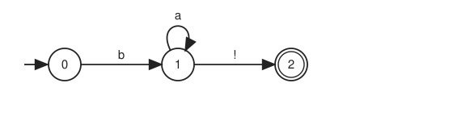
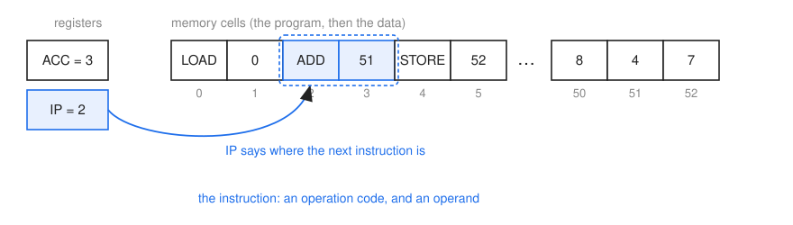
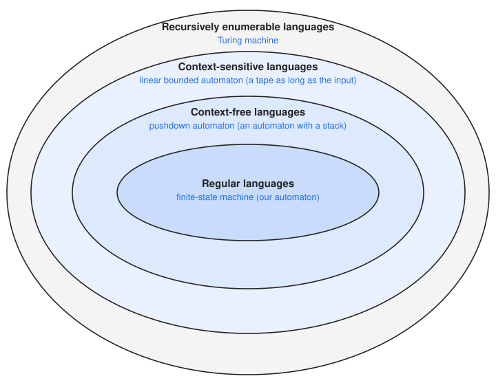
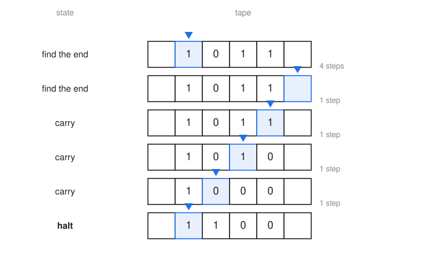
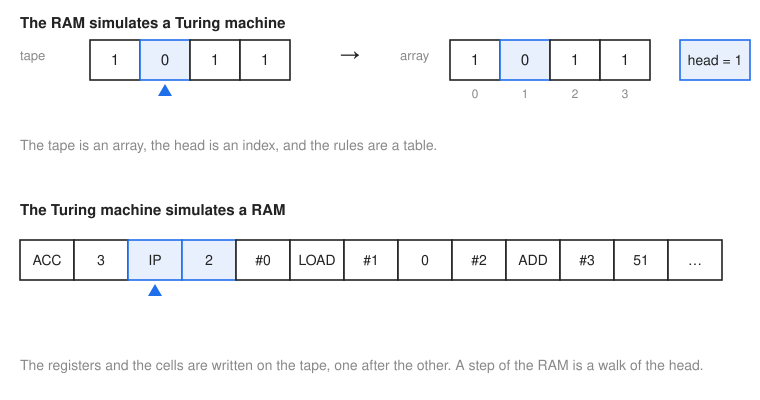
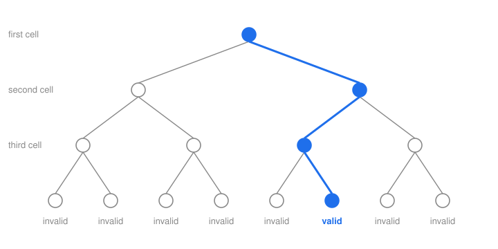

========
Machines
========

:Lecture: Lecture 8.2 :download:`(slides)
          <https://studntnu-my.sharepoint.com/:p:/g/personal/franckc_ntnu_no/IQBYMNcO7K1VS692uByRcjxOAUJJHHHxCeIQbeH75XvNoLg?e=9GJ7eO>`
:Objectives: Understand what is a machine, what is a Turing machine, why the
             RAM and the Turing machine are equivalent, and what a
             non-deterministic machine is
:Concepts: Machine, state, rules, model of computation, Turing machine,
           equivalence by simulation, non-deterministic machine

In fact, the automaton we used in the previous lecture is a *machine*,
just like the RAM at the beginning of the course. We ended the last
lecture on a ladder of languages, each level harder than the one below,
and on a question: Harder, but harder for *what*? Now we can answer: Harder
for the machines that recognize them. So, what is a machine? How many kinds
of machines are there? And is there a machine to rule them all? This is
what we look at in this lecture.

What Is a Machine?
==================

A Working Definition
--------------------

I will not give a formal definition, only a working one. A machine is
made of two things:

- a **state**, which is a means to *remember*: What the machine knows
  right now;
- and **rules**, which say what to do next, given the state and what
  the machine reads.

At any moment, the state is called the *configuration* of the machine. A
step moves the machine from one configuration to the next. A computation
is thus a *walk* from configuration to configuration, which is the cursor
we met in the search lectures, moving on a graph that nobody draws in
full.

If, in each configuration, there is at most one possible next step, the
machine is *deterministic*. If there may be several, it is
*non-deterministic*. These are the same words as for the automata of the
previous lecture.

So, for every machine we meet, we can ask three questions. What is its
state? What are its rules? And how does a computation go?

The Automaton as a Machine
--------------------------

Let us ask these questions of our sheep automaton
(:numref:`theory/machines/sheep`), which accepts ``b``, then any number
of ``a``, then ``!``.

   The sheep automaton of the previous lecture.

- Its **state** is the vertex we are in. This is *all* the automaton
  remembers: what we know about the text so far (nothing read yet, in the
  middle of a sheep, a complete sheep). It keeps nothing else, so the
  state is a very small, bounded way to remember.
- Its **rules** are the transitions, each one a triplet: In this
  *source* state, on reading this *symbol*, go to that *target* state. The
  same triplets apply at every step.

  .. list-table::
     :header-rows: 1
     :align: center

     * - source state
       - symbol read
       - target state
     * - 0
       - ``b``
       - 1
     * - 1
       - ``a``
       - 1
     * - 1
       - ``!``
       - 2

- A **computation** reads the text one symbol at a time, from left to
  right, and follows the table from the initial state. The text is accepted
  if we end in an accepting state.

Remember what we did with this machine on the RAM: We *simulated* it, with
its triplets and a loop. The automaton is a machine simpler than the RAM, but it
is a machine.

The RAM as a Machine
--------------------

What about the RAM, the machine of this course? Does it fit the
definition? Let us ask the same questions.

   A RAM in the middle of a computation. The two registers and the memory
   cells make up its state.

- Its **state** is what it remembers: The two registers, ``ACC`` and
  ``IP``, and the memory cells. The program lives in these cells, too.
- Its **rules** are the same at every step. Read the two cells that start at
  the address held in ``IP``: This is the instruction, made of an operation
  code and an operand. Look at the operation code and, depending on it,
  change ``ACC``, a cell, or ``IP``. Then go on. There is one rule for
  each operation code, picked by what was just read: This is a table, just
  like the transitions of an automaton.
- A **computation** is a walk from one configuration (the value of
  ``ACC``, the value of ``IP``, and the contents of the cells) to the
  next. The RAM is deterministic: Given a configuration, there is only one
  next one.

Registers and memory cells are, conceptually, the same thing: A place to
store a word. The registers are just the two cells the CPU keeps close at
hand.

So the automaton and the RAM are two machines of the same family. They
differ in *what they can remember*, and *how they can touch it*. The
automaton has a state, and that is it. The RAM has registers, and also
an array of cells it can read and write anywhere. In both cases, notice that
what matters is not how the state is stored, but which operations it
offers. That is an ADT, again.

A Zoo of Machines
-----------------

There are many other machines, which we will not study. Here are a few, just
to tickle your curiosity, with a link to read more about each. Each one has its
own state, and its own rules.

- The `finite-state machine <https://en.wikipedia.org/wiki/Finite-state_machine>`_,
  our automaton: A state, and nothing else.
- The `pushdown automaton <https://en.wikipedia.org/wiki/Pushdown_automaton>`_,
  or *stack machine*: An automaton with a stack. It is the machine of the
  context-free level of our ladder, where the stack remembers the open comments
  or the open tags.
- The `counter machine <https://en.wikipedia.org/wiki/Counter_machine>`_:
  An automaton with a few counters, which it can increase, decrease and test
  against zero.
- The `random-access machine <https://en.wikipedia.org/wiki/Random-access_machine>`_,
  the RAM of this course.
- The `Turing machine <https://en.wikipedia.org/wiki/Turing_machine>`_: Next
  section!
- The `lambda calculus <https://en.wikipedia.org/wiki/Lambda_calculus>`_:
  No state to speak of, only functions applied to functions. It is the
  ancestor of functional programming.
- `Parallel machines <https://en.wikipedia.org/wiki/Parallel_RAM>`_ have many
  processors working at the same time. (See the *Beyond* module.)
- `Systolic arrays <https://en.wikipedia.org/wiki/Systolic_array>`_: A grid of
  small processors passing data to their neighbours, as in the chips that
  speed up neural networks.
- `Quantum computers <https://en.wikipedia.org/wiki/Quantum_computing>`_, a
  different kind of machine, which obeys the rules of quantum physics. (See the
  *Beyond* module.)
- `DNA computers <https://en.wikipedia.org/wiki/DNA_computing>`_ compute with
  molecules.
- `Cellular automata <https://en.wikipedia.org/wiki/Cellular_automaton>`_, such
  as the `Game of Life <https://en.wikipedia.org/wiki/Conway%27s_Game_of_Life>`_,
  where cells on a grid live and die by simple rules, and which can compute too.
- `Analog computers <https://en.wikipedia.org/wiki/Analog_computer>`_ compute
  with continuous quantities, such as voltages, instead of symbols.

The general name for such a machine is a *model of computation*. How do we
compare them? One machine is *more powerful* than another if it can
*simulate* it, or if it solves more problems.

The Ladder, with Its Machines
-----------------------------

Remember the ladder of languages at the end of the previous lecture. Now that
we know about machines, we can complete the picture. For each level, here is
the *least powerful machine* that can recognize all the languages of that level
(:numref:`theory/machines/ladder`).

   The ladder of languages, with the least powerful machine that recognizes
   each level.

- **Regular languages**: The finite-state machine, our automaton.
- **Context-free languages**: The pushdown automaton. A stack is just what
  nested comments, tags and brackets ask for.
- **Context-sensitive languages**: The
  `linear bounded automaton <https://en.wikipedia.org/wiki/Linear_bounded_automaton>`_,
  which is a Turing machine allowed to use only as much tape as the input is
  long. We skip it, as it brings no new idea.
- **Recursively enumerable languages**: The Turing machine, which has no limit
  on its tape. This is the topic of the next section.

Each machine does at least what the previous one does: A pushdown automaton
can ignore its stack and behave like an automaton. Harder languages need
machines that remember more, or touch what they remember more freely. Among
all the models of this zoo, the last one is the reference.

Turing Machines
===============

The General Idea
----------------

Alan Turing imagined this machine in 1936, long before computers existed.
It has three parts. A *tape*, as long as needed in both directions, cut in
cells that each hold one symbol. A *head*, which sits on one cell, reads
it, writes it and moves one cell to the left or to the right. And a *control
state*, which is a name, such as "start" or "middle".

Let us ask our three questions.

- Its **state** is the tape, the position of the head, and the control
  state. The tape is the part that makes it different from the automaton:
  It is unbounded, and it can be rewritten anywhere.
- Its **rules** are a table: In this control state, reading this
  symbol, write that symbol, move to the left or to the right, and go to that
  control state.
- A **computation** starts with the input on the tape, and goes on until
  the machine reaches a special *halting* state.

Let us reuse our sheep, ``ba*!``. Here is a Turing machine that
recognizes them. The head starts on the first symbol. It checks a ``b``,
then any number of ``a``, then a ``!``, then a blank (the end of the text), and
it moves to the right after each symbol. If it reaches the state ``accept``,
the text is a sheep. If no rule applies, the machine is stuck, and the text
is not a sheep. The rules are:

.. list-table::
   :header-rows: 1
   :align: center

   * - in state
     - reading
     - write
     - move
     - new state
   * - start
     - ``b``
     - ``b``
     - right
     - middle
   * - middle
     - ``a``
     - ``a``
     - right
     - middle
   * - middle
     - ``!``
     - ``!``
     - right
     - end
   * - end
     - blank
     - blank
     - right
     - accept

:numref:`theory/machines/trace` shows it on ``baa!``. Each row is one
configuration. The head is the blue triangle.

   A Turing machine recognizing ``baa!``. It takes five steps.

Look closely: This machine never changes what it reads, it only moves to the
right, and its rules are our triplets with a few more columns. *It is
our automaton!* So the Turing machine can do everything the automaton does.
What it has in more is that it can *write*, and *go back*. This is what the
previous ladder was missing. To check ``aⁿbⁿ``, for instance, a Turing machine
can cross out the first ``a``, walk to the right to cross out the first ``b``,
come back to the next ``a``, and so on. If, in the end, nothing is left but
crosses, the numbers were equal. It uses the tape as a counter that
nothing consumes, and it can walk it as many times as needed.

The RAM and the Turing Machine Are Equivalent
---------------------------------------------

Is the Turing machine as powerful as the RAM? Both can *simulate* each
other, and this is what "equivalent" means: If a machine A can run any
computation of a machine B, then A is at least as powerful as B. If it
works both ways, they are equivalent.

   Each machine simulates the other.

- **The RAM simulates a Turing machine.** The tape is an array, the head is an
  index in that array, and the rules are a table. A step of the Turing machine
  is a few instructions of the RAM.
- **The Turing machine simulates a RAM.** We write the registers and the memory
  cells on the tape, one after the other. A step of the RAM is a walk of the
  head to find the cell it needs, read it or write it, and come back.

So the RAM and the Turing machine solve exactly the same problems. And we
could say more:

.. important::

   **The Church-Turing thesis.** Every reasonable machine is equivalent to the
   Turing machine: Whatever any machine we could build can compute, a Turing
   machine can compute too.

It cannot be proved, since "reasonable machine" is not a mathematical notion.
But nobody has found a counter-example in almost a century, and every machine
anyone proposed turned out to be equivalent. This is why we are comfortable
using the Turing machine as a reference.

One thing we do not look at here is *how long* the simulation takes. We only
care that it can be done.

The Machine We Search For
=========================

There is one more machine, and it does not exist. It is the
**non-deterministic Turing machine**: At some steps, it has *several* rules
to choose from. There are two ways to picture it, which give the same result.

- **A machine that always guesses right.** It picks the rule that leads to
  the answer, if there is one.
- **A machine with infinite parallelism.** At each choice, it makes as many
  copies of itself as there are rules, and all the copies go on at the same
  time. It answers yes as soon as *one* copy says yes.

Imagine we give it a Sudoku to solve. It writes a digit in the first empty
cell. Which one? The lucky machine *guesses*, and it guesses right. The
parallel machine writes all of them, one in each copy. Then the next cell,
and so on until all the cells are filled, which takes a number of steps
proportional to the number of cells. Finally, it checks that every row, every
column and every block has no repeated digit. If there is a solution, one
sequence of choices leads to it. :numref:`theory/machines/choices` shows the
tree of the choices. The lucky machine goes straight to the leaf that works.
The parallel machine explores every branch at once, and so, *timewise*, it
needs the same: The length of one branch, not the size of the tree.

   The choices of a non-deterministic machine, as a tree. The lucky machine
   follows the blue path. The parallel machine follows them all, and the blue
   one is the one that says yes.

Of course, we cannot build either of them: Nobody has infinitely many
processors, or a lucky streak that never ends. It is a *yardstick*: A way to
say how hard a problem is, by asking how long such a machine would need.

An ordinary machine can imitate it, by trying *all* the choices, one after the
other. You know this tree: It is the search tree of the combinatorial search
lecture, and trying all the leaves is the exhaustive search. It is also
*determinisation* again, as for the automata: Instead of guessing, we keep track
of all the possibilities. The price is the same, an exponential tree.

That leaves us with a question, to which the next lecture is devoted:
Can we do without the exponential tree?
