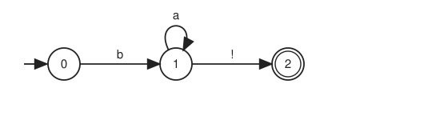
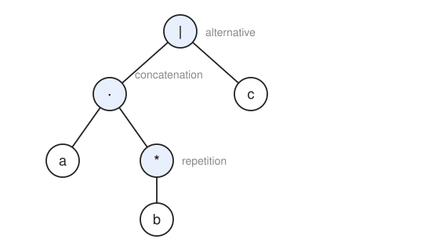
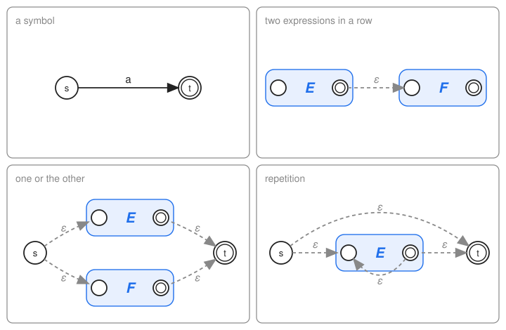
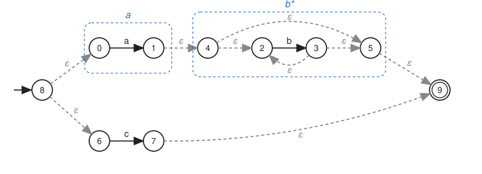
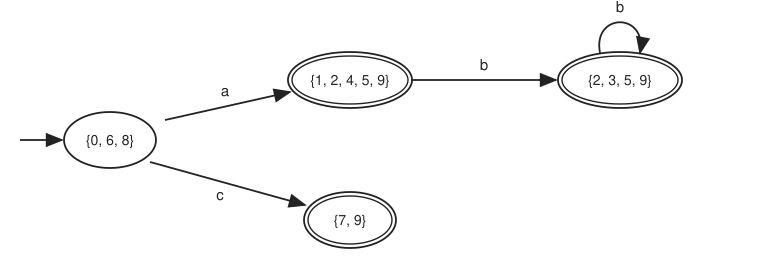
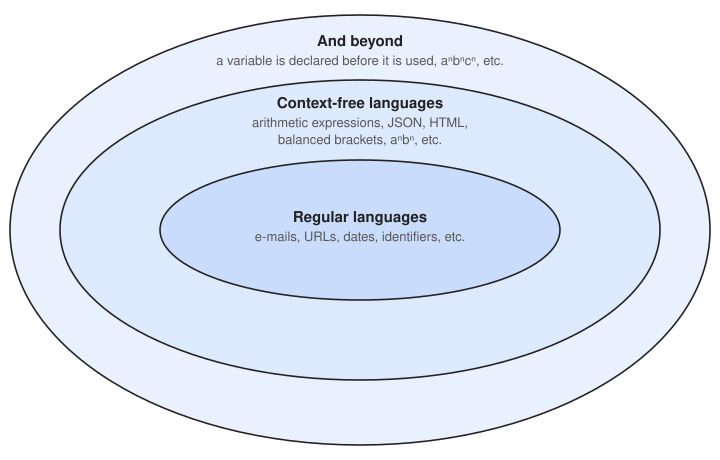

===================
Regular Expressions
===================

:Lecture: Lecture 8.1 :download:`(slides)
          <https://studntnu-my.sharepoint.com/:p:/g/personal/franckc_ntnu_no/ESOpzEspsN5Dk-IdmSry_rwBDfjkWiBK7ToMb6JAnaXldQ?e=y4Wpsk>`
:Objectives: Understand what regular expressions, grammars and automata are, and
             see how trees, recursion and graphs come together to connect them
:Concepts: Regular expression, language, grammar, expression tree, finite
           automaton, non-determinism, determinisation, hierarchy of languages
:Implementation: Java `Regular expressions, automata and determinisation <https://github.com/fchauvel/aldast-examples/tree/main/theory/regular-expressions/java>`_

Introduction
============

Let us be clear from the start: This lecture is **not** a course on
automata theory, and it is **not** a course on compilers. Both are
fascinating, and both deserve a course of their own. What I want to
show you is something different. Advanced topics, such as the
compilation of a programming language, are not built from exotic new
ideas. They are built from the very concepts we have studied together:
*trees*, *recursion*, *graphs* and *hash sets*. Regular expressions are
a small and friendly place to see this happening. Think of this lecture as a
guided tour: You are not expected to reproduce the construction, only to
recognize the pieces you already know.

Patterns Everywhere
-------------------

You type a date, an e-mail address or a phone number in a form, and the
page tells you right away that something is wrong. You search a log with
``grep`` and find every line that looks like an error. Your editor
colours ``x1 = 42`` by recognizing that ``x1`` is a name, ``=`` is a
symbol and ``42`` is a number. In each case, a program checks whether
some text *matches a pattern*.

Patterns are everywhere, and so a question comes up: How do we describe
a pattern, which may match infinitely many texts, with something short
and precise? And how can a machine check it? This is the topic of this
lecture.

Automata and Regular Expressions
================================

A First Example
---------------

Let us start with a small pattern. Sheep say ``b``, then a number of
``a``, then ``!``. So ``b!``, ``ba!`` and ``baaaa!`` are all sheep, but
``baaaa`` (no final ``!``) and ``ab!`` are not.

A way to describe them is to draw a small *automaton*, as shown in
:numref:`theory/regex/sheep`. It is a *graph*: The vertices are the
*states*, and the edges are the *transitions*. If you remember the
prefix trees, this is the same idea: Each edge is labelled with the
symbol it reads. The arrow coming from nowhere marks the *initial
state*, and the double circle marks the *accepting state*.

   An automaton that accepts the sheep: ``b``, then any number of ``a``,
   then ``!``.

What does a state stand for? It is *what we know* about the text at that
point. In state 0, we have not read anything yet. In state 1, we have read
a ``b``, and possibly some ``a`` after it: We are in the middle of a
sheep. In state 2, we have read a complete sheep, ``!`` included. The
automaton has no other memory: When it moves, it forgets everything but
the state it lands in.

To check a text, we start in the initial state, and we follow one
transition per symbol. The text matches if we end in the accepting state.
For ``baaa!``, we go through the states 0, 1, 1, 1, 1 and then 2: It
matches. For ``ba``, we stop in state 1, which is not accepting: It does
not match. And for ``ab!``, there is no transition labelled ``a`` from
state 0: We are stuck, and it does not match either.

In general, a state has transitions only for the symbols that make sense
there. Any other symbol is a *failure*. We could draw an extra *error
state*, where every symbol leads back to itself, and add a transition to
it wherever one is missing. It would clutter every figure, so we leave it
out, and we read a missing transition as "the text does not match".

This is a program we know how to write. The graph is stored as a list of
*transitions*, each one a triplet: The *source* state, the *symbol* read, and
the *target* state.

.. list-table:: The transitions of the sheep automaton
   :header-rows: 1
   :align: center

   * - source state
     - symbol read
     - target state
   * - 0 (initial)
     - ``b``
     - 1
   * - 1
     - ``a``
     - 1
   * - 1
     - ``!``
     - 2

The whole check is then a single loop over the text:

.. code-block:: text

   match(text):
       state ← initial state
       for each symbol in text:
           if there is no transition from state on symbol:
               return false
           state ← target of the transition from state on symbol
       return state is accepting

What does it cost? Each symbol triggers exactly one transition, so the
time is *linear* in the length of the text. And *all we remember is the
current state*: Whether the text is ten symbols or ten million, the
memory is the same. Keep this in mind: The machine is the automaton, the
resource we look at is its memory, and the bound is a *constant*. We will
come back to this.

Words and Languages
-------------------

Let us fix some vocabulary. A *symbol* is a character, and an *alphabet*
is a set of symbols, such as ``{a, b, !}``. A *word* is a sequence of
symbols, such as ``baa!``, possibly empty. And a *language* is a set of
words, possibly infinite, such as all the sheep.

.. note::

   Here, a "word" is a sequence of symbols, as in a sentence. It has
   nothing to do with the *word* of the RAM, the group of bits we
   manipulate in one instruction.

A pattern describes a language, and checking a text is answering a
yes/no question: *Is this word in the language?* That is a *problem*, as
defined in the first lecture, and every language is one: The problem of
deciding whether a word belongs to it. This is one of the most useful
shift of views in this course: **a problem is a language**.

Since a language may be infinite, we cannot list its words. We need a
notation, and *regular expressions* are one. They are built from only
four ingredients:

- a **symbol**, such as ``a``, which matches the word ``a``;
- **two expressions in a row** (concatenation), such as ``ab``, which
  matches whatever the first matches, followed by whatever the second
  matches;
- **one or the other**, written ``|``, such as ``a|b``, which matches
  what either side matches;
- **repetition**, written ``*``, such as ``a*``, which matches the
  empty word, or whatever the inner expression matches, any number of
  times in a row.

The sheep are ``ba*!``, and a run of ``a``, or a single ``b``, is
``a*|b``. Parentheses group things: ``(ab)*`` matches ``ab``, ``abab``,
``ababab``, and so on.

Wildcards
---------

Real tools offer many more operators. A few examples are ``+`` (one or more),
``?`` (optional), ``[a-z]`` (any symbol from a range) and ``.``
(anything). They are handy, but they are *not new*. Each one can be
rewritten with the four ingredients:

- ``E+`` is ``EE*``: The expression, and then any number of it;
- ``E?`` is ``E`` or nothing at all;
- ``[a-c]`` is ``a|b|c``.

So the sheep, who say at least two ``a``, are ``baa+!``, which is just a
shorthand for ``baaa*!``.

.. margin::

   This is a first, tiny taste of *compilation*: A new notation, that
   needs no new machine, since we translate it into the old one.

From now on, we only work with the four ingredients. If we can handle
those, we can handle all the others. The code does exactly this: When it reads
a ``+``, it builds the tree of ``EE*``.

Grammars
========

How can we build an automaton for *any* pattern? We need first to
describe *all the possible patterns*, and see what a pattern really is.

Operator Precedence and the Expression Tree
-------------------------------------------

What does ``ab*|c`` mean? Is it ``(ab)*`` or ``a(b*)``? Is it ``ab`` or
``c``, or ``a`` followed by ``b*|c``? We need rules, just as in
arithmetic where ``1 + 2 * 3`` means ``1 + (2 * 3)``. The rules are that
repetition binds tighter than concatenation, which binds tighter than
the alternative. So ``ab*|c`` means ``(a(b*))|c``.

Do you see a *tree* appearing? Each operator has its operands as children,
and the symbols are the leaves. :numref:`theory/regex/tree` shows the
tree of ``ab*|c``. The pattern is only a way to write the tree down
as a sequence of characters, and the parentheses and the precedence rules
are what let us recover the tree.

   The expression tree of ``ab*|c``. The leaves are symbols, the other
   nodes are operators.

Tree Folding and Grammars
-------------------------

Since a pattern is a tree, we can describe all the possible patterns by
describing all the possible trees. We do it with a *grammar*, which is a
small set of *recursive* rules. Here is one for our four ingredients,
written to also take the precedence into account:

.. code-block:: text

   expression := term ( '|' term )*
   term       := factor factor*
   factor     := atom ( '*' | '+' )*
   atom       := a symbol  |  '(' expression ')'

Read it aloud. An expression is a term, possibly followed by ``|`` and
another term, as many times as needed. A term is one or more factors in
a row. A factor is an atom followed by any number of ``*`` (or ``+``, which we just saw is a shorthand). And an atom
is either a symbol, or an *expression in parentheses*, which sends us
back to the first rule. The rules call each other, and that is exactly how
trees contain trees. The lower a rule, the tighter it binds, which is how
the grammar encodes the precedence.

A grammar is also a *recipe to write the program that reads patterns*:
One method per rule. The method of ``atom`` calls the method of
``expression`` when it meets a parenthesis, and so on. The result is a
tree of Java objects.

.. admonition:: Implementation in Java
   :class: hint, dropdown

   The tree has one class per kind of node. ``Regex.parse`` reads a
   pattern and builds the tree, with one method per rule of the grammar.

   .. code-block:: java

      // A regular expression is a tree. There are only four kinds of nodes.
      public sealed interface Regex {

          record Symbol(char symbol) implements Regex {}

          record Then(Regex first, Regex second) implements Regex {}

          record Or(Regex left, Regex right) implements Regex {}

          record Star(Regex inner) implements Regex {}

          // Can this expression match the empty word? We "fold" the tree: we
          // compute the answer for each child, and combine them.
          static boolean matchesEmptyWord(Regex expression) {
              return switch (expression) {
                  case Symbol s -> false;
                  case Then t -> matchesEmptyWord(t.first()) && matchesEmptyWord(t.second());
                  case Or o -> matchesEmptyWord(o.left()) || matchesEmptyWord(o.right());
                  case Star s -> true;
              };
          }

          // The way we write patterns back, with as few parentheses as possible
          static String show(Regex expression) {
              return switch (expression) {
                  case Symbol s -> String.valueOf(s.symbol());
                  case Then t -> showInside(t.first(), Or.class) + showInside(t.second(), Or.class);
                  case Or o -> show(o.left()) + "|" + show(o.right());
                  case Star s -> showInside(s.inner(), Or.class, Then.class, Star.class) + "*";
              };
          }

          private static String showInside(Regex child, Class<?>... needingParentheses) {
              for (var each : needingParentheses) {
                  if (each.isInstance(child)) {
                      return "(" + show(child) + ")";
                  }
              }
              return show(child);
          }

          static Regex parse(String pattern) {
              return new RegexParser(pattern).parse();
          }
      }

   .. code-block:: java

      // One method per rule of the grammar:
      //
      //   expression := term ( '|' term )*
      //   term       := factor factor*
      //   factor     := atom ( '*' | '+' )*
      //   atom       := a symbol | '(' expression ')'
      //
      // The rules call each other just like the nodes of the tree contain each other.
      // The lower a rule is, the tighter it binds: this is the operator precedence.
      //
      // The wildcard '+' brings no new kind of node: "E+" is read as "EE*".
      class RegexParser {

          private final String pattern;
          private int position = 0;

          RegexParser(String pattern) {
              this.pattern = pattern;
          }

          Regex parse() {
              var result = expression();
              if (position < pattern.length()) {
                  throw new IllegalArgumentException("Unexpected '" + peek() + "' at " + position);
              }
              return result;
          }

          private Regex expression() {
              var result = term();
              while (hasNext() && peek() == '|') {
                  position++;
                  result = new Regex.Or(result, term());
              }
              return result;
          }

          private Regex term() {
              var result = factor();
              while (hasNext() && peek() != '|' && peek() != ')') {
                  result = new Regex.Then(result, factor());
              }
              return result;
          }

          private Regex factor() {
              var result = atom();
              while (hasNext() && (peek() == '*' || peek() == '+')) {
                  if (peek() == '*') {
                      result = new Regex.Star(result);
                  } else {
                      result = new Regex.Then(result, new Regex.Star(result));
                  }
                  position++;
              }
              return result;
          }

          private Regex atom() {
              if (!hasNext()) {
                  throw new IllegalArgumentException("Unexpected end of pattern");
              }
              var next = peek();
              position++;
              if (next == '(') {
                  var result = expression();
                  expect(')');
                  return result;
              }
              if (next == '|' || next == '*' || next == '+' || next == ')') {
                  throw new IllegalArgumentException("Unexpected '" + next + "' at " + (position - 1));
              }
              return new Regex.Symbol(next);
          }

          private void expect(char expected) {
              if (!hasNext() || peek() != expected) {
                  throw new IllegalArgumentException("Expected '" + expected + "' at " + position);
              }
              position++;
          }

          private boolean hasNext() {
              return position < pattern.length();
          }

          private char peek() {
              return pattern.charAt(position);
          }
      }

Now that we have trees, we can do what we do with trees: *fold* them. We
compute a result for each child, and we combine these results at each
node, from the leaves up. Let us warm up with a simple question: Can this
expression match the empty word?

- A symbol cannot.
- ``E*`` always can: We repeat ``E`` zero times.
- Two expressions in a row can if *both* can.
- ``E|F`` can if *either* can.

That is the whole algorithm. It is the function ``matchesEmptyWord`` in
the listing above. It has one case per kind of node, and it calls itself
on the children. It is a plain recursion on a tree.

And now comes the point of this lecture. The *same shape* of recursion,
with a richer result, will build a machine.

Building an Automaton for a Regular Expression
==============================================

One Piece per Rule
------------------

Let us fold the tree into an *automaton*, instead of a boolean. The
result for each node is a small automaton, and each kind of node says how
to assemble the automata of its children. There are four cases, shown in
:numref:`theory/regex/pieces`. In the figure, ``E`` and ``F`` are the
automata we already built for the children, each seen as a box with one
initial state on the left, and one accepting state on the right.

   One way to assemble an automaton for each of the four ingredients. The
   dashed arrows are *silent*: They read nothing.

The pieces are glued with *silent transitions* (they are labelled with
``ε``), which let the machine move from one state to another without
reading any symbol. Just like the wires between the boxes of a
circuit. Check each case with its meaning. For a symbol, we read it. For
two expressions in a row, we run ``E``, then silently continue with
``F``. For one or the other, we silently pick a side. And for a repetition,
we may skip ``E`` altogether, or after each run of ``E``, silently go
back and start another.

The Construction Is a Recursion on the Tree
-------------------------------------------

The code is the fold we have just seen. A base case for the symbol, and
one recursive case per operator, each one assembling the automata the
recursive calls return. :numref:`theory/regex/assembled` shows the result
for ``ab*|c``.

   The automaton for ``ab*|c``, built by folding the tree of
   :numref:`theory/regex/tree`. The boxes show which part comes from which
   subtree.

The result is a graph, and the Java code stores it as a list of
transitions (the edge list from the Graphs module).
This is also what an *algorithm that manipulates machines* looks like: It
reads a tree, and writes a graph. This is, in miniature, what a compiler
does.

.. admonition:: Implementation in Java
   :class: hint, dropdown

   ``Automaton.from`` folds the tree. The ``closure`` and ``step``
   methods, as well as ``accepts``, are explained in the next section.

   .. code-block:: java

      import java.util.ArrayDeque;
      import java.util.HashSet;
      import java.util.List;
      import java.util.Set;
      import java.util.ArrayList;

      // A graph: states are the vertices, moves are the edges. A move may read a
      // symbol, or nothing at all (a "silent" move, whose symbol is null).
      //
      // The automaton may have several moves for the same symbol, or silent moves:
      // it is "non-deterministic". It accepts a word if *some* path reads the word
      // and ends in the accepting state.
      public record Automaton(int start, int accepting, List<Move> moves) {

          public record Move(int from, Character symbol, int to) {
              boolean isSilent() {
                  return symbol == null;
              }
          }

          // The construction is a recursion on the tree: one case per kind of node.
          public static Automaton from(Regex expression) {
              return new Builder().build(expression);
          }

          private static class Builder {
              private int stateCount = 0;

              private int newState() {
                  return stateCount++;
              }

              Automaton build(Regex expression) {
                  return switch (expression) {
                      case Regex.Symbol s -> symbol(s.symbol());
                      case Regex.Then t -> then(build(t.first()), build(t.second()));
                      case Regex.Or o -> or(build(o.left()), build(o.right()));
                      case Regex.Star s -> star(build(s.inner()));
                  };
              }

              private Automaton symbol(char symbol) {
                  var start = newState();
                  var accepting = newState();
                  return new Automaton(start, accepting, List.of(new Move(start, symbol, accepting)));
              }

              private Automaton then(Automaton first, Automaton second) {
                  var moves = union(first.moves, second.moves);
                  moves.add(new Move(first.accepting, null, second.start));
                  return new Automaton(first.start, second.accepting, moves);
              }

              private Automaton or(Automaton left, Automaton right) {
                  var start = newState();
                  var accepting = newState();
                  var moves = union(left.moves, right.moves);
                  moves.add(new Move(start, null, left.start));
                  moves.add(new Move(start, null, right.start));
                  moves.add(new Move(left.accepting, null, accepting));
                  moves.add(new Move(right.accepting, null, accepting));
                  return new Automaton(start, accepting, moves);
              }

              private Automaton star(Automaton inner) {
                  var start = newState();
                  var accepting = newState();
                  var moves = new ArrayList<>(inner.moves);
                  moves.add(new Move(start, null, inner.start));
                  moves.add(new Move(start, null, accepting));
                  moves.add(new Move(inner.accepting, null, inner.start));
                  moves.add(new Move(inner.accepting, null, accepting));
                  return new Automaton(start, accepting, moves);
              }

              private List<Move> union(List<Move> first, List<Move> second) {
                  var result = new ArrayList<>(first);
                  result.addAll(second);
                  return result;
              }
          }

          public int stateCount() {
              var states = new HashSet<Integer>();
              states.add(start);
              states.add(accepting);
              for (var move : moves) {
                  states.add(move.from);
                  states.add(move.to);
              }
              return states.size();
          }

          public Set<Character> alphabet() {
              var result = new HashSet<Character>();
              for (var move : moves) {
                  if (!move.isSilent()) {
                      result.add(move.symbol);
                  }
              }
              return result;
          }

          // All the states we can reach from the given ones, by silent moves only.
          // This is a plain graph traversal, with a work list.
          public Set<Integer> closure(Set<Integer> states) {
              var reached = new HashSet<>(states);
              var toVisit = new ArrayDeque<>(states);
              while (!toVisit.isEmpty()) {
                  var current = toVisit.pop();
                  for (var move : moves) {
                      if (move.from == current && move.isSilent() && reached.add(move.to)) {
                          toVisit.push(move.to);
                      }
                  }
              }
              return reached;
          }

          // The states we reach from the given ones by reading one symbol
          public Set<Integer> step(Set<Integer> states, char symbol) {
              var reached = new HashSet<Integer>();
              for (var move : moves) {
                  if (states.contains(move.from) && !move.isSilent() && move.symbol == symbol) {
                      reached.add(move.to);
                  }
              }
              return closure(reached);
          }

          // Follows all the paths at once: we keep the set of states we may be in.
          public boolean accepts(String word) {
              var current = closure(Set.of(start));
              for (var symbol : word.toCharArray()) {
                  current = step(current, symbol);
              }
              return current.contains(accepting);
          }
      }

The Result Is Non-Deterministic
-------------------------------

Look at the state 8 of :numref:`theory/regex/assembled`. Two silent moves
leave it. Which one should we take? Look at state 4 as well: We may enter
the repetition, or skip it. The automaton makes *choices*.

We say that the automaton is *non-deterministic*. A word is accepted if
*some* sequence of choices leads to the accepting state, as if the
machine could always guess right. This is easy to build, but we cannot run
a machine that guesses. So how could we run it?

Determinisation
===============

The trick is to stop choosing. Instead of following one path, we follow
*all of them at once*. We keep track of the *set* of states in which the
machine could be. Here, the set of states we may be in at the beginning is
the initial state, plus every state we can reach from it by silent
moves (this is called the *closure*, and it is a simple graph
traversal, with a work list, just as in the Graphs module). For ``ab*|c``,
this is ``{0, 6, 8}``. After reading an ``a``, we may be in the state
1, and then everywhere we can go silently: ``{1, 2, 4, 5, 9}``. After a ``c``,
we may be in 7, and then 9: ``{7, 9}``.

Here is the beautiful part. *Each such set can be seen as one state of a new
automaton*. We build it by exploring the sets we can reach, starting from the
initial one, and remembering the sets we have already seen so that we do not
explore any of them twice. That is a graph search with a work list and a hash
set, in a graph we never write down in memory: the vertices are
sets of states, and the edges are discovered as we go. It is the implicit graph we met in the
optimization module, again. :numref:`theory/regex/determinised` shows the
result for ``ab*|c``.

   The deterministic automaton for ``ab*|c``. Each state is a set of the
   states of :numref:`theory/regex/assembled`. A set is accepting when it
   contains the state 9.

There is no choice left: In every state, at most one transition for each
symbol. And the automaton accepts exactly the same words. The ten
states of the non-deterministic automaton collapse into four.

.. admonition:: Implementation in Java
   :class: hint, dropdown

   The constructor explores the sets of states, with a work list, and the
   map of sets we have already seen. ``Automaton.closure`` and
   ``Automaton.step`` are in the listing of the previous section.

   .. code-block:: java

      import java.util.ArrayDeque;
      import java.util.HashMap;
      import java.util.HashSet;
      import java.util.Map;
      import java.util.Set;

      // An automaton where each state has at most one move per symbol: no choice,
      // no guess. Each of its states is a *set* of states of the original automaton:
      // all the places where the original may be, after reading the same symbols.
      public class DeterministicAutomaton {

          private final Set<Integer> start;
          private final Set<Set<Integer>> accepting = new HashSet<>();
          private final Map<Set<Integer>, Map<Character, Set<Integer>>> moves = new HashMap<>();

          // We explore the sets we can reach, starting from the initial one, and
          // remembering those we have already seen. It is a search in a graph.
          public DeterministicAutomaton(Automaton original) {
              start = original.closure(Set.of(original.start()));
              var toVisit = new ArrayDeque<Set<Integer>>();
              moves.put(start, new HashMap<>());
              toVisit.push(start);
              while (!toVisit.isEmpty()) {
                  var current = toVisit.pop();
                  if (current.contains(original.accepting())) {
                      accepting.add(current);
                  }
                  for (var symbol : original.alphabet()) {
                      var next = original.step(current, symbol);
                      if (next.isEmpty()) {
                          continue;
                      }
                      if (!moves.containsKey(next)) {
                          moves.put(next, new HashMap<>());
                          toVisit.push(next);
                      }
                      moves.get(current).put(symbol, next);
                  }
              }
          }

          public int stateCount() {
              return moves.size();
          }

          public boolean accepts(String word) {
              var current = start;
              for (var symbol : word.toCharArray()) {
                  current = moves.get(current).get(symbol);
                  if (current == null) {
                      return false;
                  }
              }
              return accepting.contains(current);
          }
      }

This tells us something important: **guessing does not make an automaton
more powerful**. Whatever a non-deterministic automaton can recognize, a
deterministic one can too. This is not free, though. In the worst case, the
deterministic automaton has *exponentially more* states: The pattern
"an ``a``, then exactly ``n`` symbols" (as in ``(a|b)*a(a|b)(a|b)``, for
``n = 2``) needs at least :math:`2^n` states, because the machine must
remember the last :math:`n` symbols it read.

Remember this. A lucky guess does not help an automaton. We will see what
it does for other machines.

Limits
======

What an Automaton Cannot Do
---------------------------

Automata are simple and cheap, but there are languages they cannot
recognize. The classical one is ``aⁿbⁿ``: Some ``a``, followed by *the same
number* of ``b``. So ``ab`` and ``aaabbb`` are in, but ``aab`` is not.
Balanced brackets are the same problem in disguise.

No proof here, but here is the intuition. An automaton with ``k`` states
that reads ``k + 1`` times the symbol ``a`` must go through the same state
twice. After that, it cannot tell a run of ``k + 1`` symbols ``a`` from a
shorter one, so it cannot check that the number of ``b`` matches. To count
with no limit, we need a memory that grows with the input, and the
automaton has none.

And this is not a corner case! Any structure with *nesting*, like the
brackets, the blocks and the calls of a program, is of this kind.

A Hierarchy of Languages
------------------------

So some languages are harder than others, and we can *rank* them.
Let us stay in the world of this lecture, *reading text*, and see what
a compiler meets when it cuts source code into pieces (this is called
*lexical analysis*). :numref:`theory/regex/hierarchy` shows the usual
ladder, with an example at each level.

   A hierarchy of languages, with examples from the lexical analysis of
   programs. Each level contains the one inside it.

- **Regular languages**: Identifiers, numbers, whitespace, but also dates
  and e-mail addresses. All the pieces of a program that regular
  expressions describe well. No memory beyond "which kind of piece am I
  reading?" is needed.
- **Context-free languages**: ``aⁿbⁿ``, some ``a`` followed by *as many*
  ``b``, as in ``aaabbb``. We count up, and then count down. Real
  lexers meet it with *nested* comments, such as ``/* a /* b */ c */``,
  which are allowed in Rust, Haskell or Swift: Each ``/*`` must be closed
  by its own ``*/``.
  Beyond lexers, it is also the world of *nested structures*: JSON
  objects inside JSON objects, arithmetic expressions inside
  parentheses, and HTML or XML tags inside tags. There, a plain count is not
  enough: We must remember *which* tags are open, so that ``</b>`` closes
  a ``<b>`` and not an ``<i>``.
- **Context-sensitive languages**: Here-documents in a shell. After
  ``cat <<END``, the text goes on until a line that says ``END``, where
  ``END`` is *whatever word you chose* at the start. It is a word written
  twice, such as ``abab`` or ``bobbob``: We must remember an arbitrary
  word, and compare it later.
- **Recursively enumerable languages**: TeX, where the text being read
  can change how the rest is read: A command can give a new meaning to a
  character, or define a new command. Reading the text *is* running a
  program. This one is a mouthful, so remember it as "the top of the
  ladder".

.. margin::

   Careful with XML: Checking that ``</name>`` spells the same letters
   as ``<name>``, for *any* name, is the "word written twice" problem
   again. In practice, the lexer reads a whole name as one token, so the
   grammar only sees one symbol per tag. Once more, lexing and parsing
   share the work.

Why is the third level harder than the second? Think of a *stack* of
plates: It gives back the last plate first. This is just right for the
nested comments, or the open tags of an XML document, since the last one
opened is the first one to close. But for ``END``, we need the *first* letter back first, and the
stack gives us the last one. (A pattern like ``aⁿbⁿcⁿ``, which has to
count twice, is another example at this level.)

The names come from linguistics, where this ladder was first drawn to
study the grammar of human languages. We only need the examples.

Here comes a small twist. We wrote earlier the grammar of the regular
expressions, and it needs *balanced parentheses*. So the language of the
regular expressions is **not regular**: No automaton can read a pattern
and tell whether it is well formed! We needed a grammar, which is one step
up the ladder.

Harder, but harder for *what*? To rank languages, we need to say what
solves them, that is, what a *machine* is, and which ones exist. This is
the topic of the next lecture.
