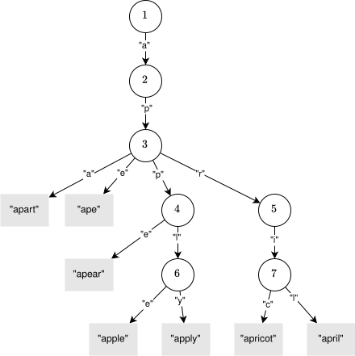

=======================
Prefix and Suffix Trees
=======================

:Lecture: Lecture 5.6 :download:`(slides)
          <https://studntnu-my.sharepoint.com/:p:/g/personal/franckc_ntnu_no/EVJ8rMN7JHdKgxTb2gWmKEwBwvMNLvO0i0k-495CCmBlJw?e=70ie5r>`
:Objectives: Understand what is a prefix and what is a suffix tree
:Concepts: Insertion, deletion and search into a Prefix-tree
:Implementation: Scala `PrefixTree.scala <https://github.com/fchauvel/aldast-examples/tree/main/trees/prefix-tree/scala>`_

.. margin::

   .. figure:: _static/images/completion.png
      :name: trees/tries/completion

      Auto-completion in a text editor based on the words already typed
      in.
           
As a last example of tree data structures, we shall look at *prefix*
and *suffix* trees. These are data structures used to speed up text
search. especially full-text search and auto completion in text
editors.

- *Auto-completion* means that editor suggests possible endings for what
  you have started to type. For instance,
  :numref:`trees/tries/completion` shows an example of "default
  completion", where the editor make suggestions based on words
  already in the document.

- *Full-text search*, is what happen for instance when you press
  ``Ctrl-F``, which prompt you for a some text, and highlights all the
  occurrences in the page. This is often available in text editors,
  web browser, or IDEs.

.. admonition:: Prefixes vs. Suffixes
   :class: note

   What are prefixes and suffixes?  Intuitively, we can say the are
   just "beginning" and "ending" of sequences. More formally, given a
   sequence of characters :math:`s = (c_1, c_2, \dots, c_n)` any
   shorted sequence :math:`s' = (c_1, \dots, c_k)` where :math:`0 \leq
   k \leq n` is a prefix of :math:`S`. For instance, the word
   "algorithm" has the following prefixes (ordered by length):

   .. math::
      P = \{ '',\, 'a',\, 'al',\, 'alg',\, 'algo',\, 'algor',\, 'algori',\,
      'algorit',\, 'algorith',\, 'algorithm' \}

   Note that the set of prefixes includes the empty sequence and the
   complete word itself. Formally, we denote that fact that a word
   :math:`w` admits a prefix :math:`p` by :math:`p \preceq w`.

   Similarly, suffixes are possible endings. Formally, and sequence
   :math:`s' = (c_k, \dots, c_n)` is a suffix of :math:`s`. The word
   algorithm therefore admits the following suffixes:

   .. math::
      S = \{ '',\, 'm',\, 'hm',\, 'thm',\, 'ithm',\, 'rithm',\,
      'orithm',\, 'gorithm',\, 'lgorithm', \, 'algorithm' \}
   
   

Prefix Trees
============

How can we implement such auto-completion mechanisms efficiently? What
we need is kind of :doc:`Map ADT </hashing/index>` that could give us
all the word that starts by the "prefix" the user has typed. For
instance, given a set of words already typed, one could index them by
prefix, using a hash table.

.. seealso::

   📖 Goodrich, M. T., Tamassia, R., & Goldwasser, M. H. (2014). Data
   structures and algorithms in Java. John Wiley & Sons. Chap. 13

The conventional solution is to use a **prefix tree**, also known as
*trie*. A prefix tree is not an ADT per se, but it extends the Set ADT
and generally exposes the following operations:

.. module:: tries

.. function:: contains(t: Trie, w: Word) -> Boolean

   Check whether the prefix tree :math:`t` contains the given word
   :math:`w`.

.. function:: prefix_search(t: Trie, p: Word) -> Set[Word]

   Returns the subset :math:`S` of all the words from :math:`t` that
   starts with the given prefix :math:`p`.

   Pre-conditions:
    - None

   Post-conditions:
    - (A1) :math:`S` is the very subset of words from the prefix tree
      that start with the given prefix :math:`p`. No other words in
      the tree starts with :math:`p` and S does not contain any other
      word than those from the tree.
         
      .. math::

         S = \mathit{prefix\_search}(t, p) \implies S = \{ w \in \mathcal{A}^* \:|\: contains(t, w) \land p \preceq w \}

.. function:: add(t: Trie, w: Word) -> Trie

   Add a new word in the prefix tree :math:`t`.

   Pre-conditions:
    - None

   Post-conditions:
    - (A2) The word is :math:`w` is necessary in the resulting prefix
      tree, that is:

      .. math::
         t' = add(t, w) \Longleftrightarrow contains(t', w)

.. function:: remove(t: Trie, w: word) -> Trie

   Remove the given word :math:`w` from the the prefix tree :math:`t`.

   Pre-conditions:
    - None

   Post-conditions:
    - (A3) The word that is removed is not anymore in the result
      prefix tree, that is:

      .. math::

         t' = remove(t, w) \Longleftrightarrow \neg \, contains(t', w)

   
Basic Structure
---------------

A prefix tree, is an :math:`n`-ary tree meant to contains a set of
words. Every node in the tree contains a symbol from the alphabet of
these words. The root contains a special symbol :math:`\varepsilon`,
which represents the empty symbol. The leaves carries another special
symbol, :math:`\bot`, which denotes the end of a word. This way every
path from the root to a leaf node represents a word starting from
:math:`\varepsilon` and ending with :math:`\bot`.

:numref:`trees/tries/prefix_tree` shows a prefix tree built over the
words: 'apart', 'apartment', 'ape', 'apear', 'apple', 'apply',
'apricot', 'april'.
      

   A prefix tree built on the set of eight words :math:`S = \{'apart',
   'apartment', 'ape', \, 'apear',\, 'apple', 'apply',\, 'apricot',\,
   'april' \}`
      

Each leaf is annotated with the word that can be read following the
path from the root to that leaf. Similarly, the path that leads to an
internal node represent a *prefix* and its descend leaves are all the
words that start with that prefix.

In a sense, a node somehow represents the characters that have been
typed so far by the user. On the root for instance, the user hasn't
typed anything yet and all the words are possible. As we move down
along a specific path, we start narrowing down the set of possible
worda. In :numref:`trees/tries/prefix_tree`, in Node 2, we know the
user has typed an "a", in Node 3, we know the suer has typed the
prefix "ap", in Node 4, the prefix "app", and so on and so forth.

.. admonition:: Why Use Special Characters?
   :class: note

   The special characters :math:`\varepsilon` and :math:`\bot` allow
   handling words that are also a prefix of another longer word, such
   as 'apart' which is a prefix of 'apartment'. Without the special
   :math:`\bot` character, we would have no way to know that apart is
   also a valid word in the set.

.. admonition:: Implementation in Scala
   :class: hint, dropdown

   Let see how we could implement this. Prefix tree is a data
   structure where recursion makes things easier.

   First we need to define the "facade" of our `PrefixTree` as
   follows. Here we are just declaring the operation we have listed in
   our ADT. I added an operation ``size`` for convenience: The size is
   simply the number of words that the prefix tree contains. We will
   see later how to implement these operations.

   .. code-block:: scala

      class PrefixTree:

        def add(word: String): Unit =
          throw new Error("Not implemented")

        def contains(word: String): Boolean =
          throw new Error("Not implemented")

        def prefixSearch(prefix: String): Set[String] =
          throw new Error("Not implemented")

        def remove(word: String): Unit =
          throw new Error("Not implemented")

        def words: Set[String] =
          throw new Error("Not implemented")

        def size: Int = words.size

   Now we define some more classes to represent the nodes of our
   prefix tree. I choose to use two separate classes for leaves and
   branches as follows.

   First I defined the interface for an node in general, regardless
   whether it is a leaf or a branch. Node simply expose the same
   operations as our ADT. I then add two subclasses that implements
   the leaves, and branches, respectively.

   .. code-block:: scala

      abstract class Node(val symbol: Char):

        def contains(word: String): Boolean

        def add(word: String): Node

        def words: Set[String]

        def prefixSearch(prefix: String): Set[String]

        def remove(word: String): Option[Node]

      class Leaf(symbol: Char) extends Node(symbol)

      class Branch(symbol: Char, children: Map[Char, Node]) extends Node(symbol)
        
   
Compressed Prefix Tree
----------------------

This default tree structure is not really efficient, because it
consumes a lot memory: There are many nodes that have only one
child. To reduce the memory overhead, prefix trees are compressed as
follows.

We place more than one symbol in each node, and merge those nodes
that have only one child,
consequently. :numref:`trees/tries/compressed` shows the compressed
version of the prefix tree initially shown on
:numref:`trees/tries/prefix_tree`. Now, all nodes but the leaves have
two or more children.

.. figure:: _static/images/compressed.svg
   :name: trees/tries/compressed

   A compressed prefix tree, equivalent to the one shown on
   :numref:`trees/tries/prefix_tree`

Membership
----------

To check whether a given word :math:`w=(c_1,\dots,c_k)` exists in our
prefix tree, we use the following procedure (assuming a *non-compressed*
prefix tree):

1. We start at the root of the tree, which becomes our "current node" :math:`n`.

2. If Node :math:`n` is a branch

   a. If the word :math:`w` is empty, we return true only if Node
      :math:`n` has a child whose symbol is :math:`\bot`. This child
      is a leaf, which marks the end of a word.

   b. Else, if Node :math:`n` has a child node :math:`c` whose symbol is
      :math:`c_1` (the first character)

      1. We remove that first character from Word :math:`w`

      2. Node :math:`c` becomes our current node and we continue at
         Step 2.

   c. Else, we return false.

3. Otherwise (Node :math:`n` is a leaf), we return true only if the given
   word :math:`w` is empty (i.e., :math:`w=''`).

Figure :numref:`trees/tries/contains` illustrates how this procedure
operates. It shows how the search for "ape" at the root node, reduces
to searching for "pe" on the child, which reduces to searching for "e"
on the grandchild, which reduces to searching for the empty word.

.. figure:: _static/images/contains.svg
   :name: trees/tries/contains

   Searching for the word "ape" in the prefix tree initially shown on
   :numref:`trees/tries/prefix_tree`, shortened for the sake
   conciseness.

.. admonition:: Implementation in Scala
   :class: hint, dropdown

   We implement the case where the node is a branch (see Step 2) in
   our ``Branch`` class as follows. In Scala (and some other languages)
   the first character of a string is named "head", and the rest is
   named "tail". The constant ``END`` stands for the symbol
   :math:`\bot`.

   .. code-block:: scala
      :linenos:

      class Branch(symbol: Char, val children: Map[Char, Node]) extends Node(symbol):

        def contains(word: String): Boolean =
          if word.isEmpty then
            children.contains(END)
          else
            children.get(word.head) match
              case None => false
              case Some(child) => child.contains(word.tail)

   The case where the node is a leaf (see Step 3) goes as follows:

   .. code-block:: scala
      :linenos:

      class Leaf extends Node(END):

        def contains(word: String): Boolean =
          word.isEmpty

   Finally, we complete our ``PrefixTree`` with the following
   implementation:

   .. code-block:: scala
      :linenos:

      class PrefixTree:

        private var root: Node = Branch(ROOT, Map())

        def contains(word: String): Boolean =
          root.contains(word)

Why Is This Correct?
   Every word stored in the tree is spelled by exactly one path, from
   the root down to a leaf :math:`\bot`. Besides, the children of a node
   all carry distinct symbols, so, at each step, there is at most one
   child to follow: The procedure follows the only path that may spell
   :math:`w`. It reaches the end of that path (i.e., the word is empty)
   and finds a :math:`\bot` leaf if and only if :math:`w` was added to
   the tree. In particular, a *prefix* of a stored word is not found
   (unless it was added too): There is a path for it, but it does not
   end with a :math:`\bot` leaf.

How Efficient Is This?

Let us consider searching for a word :math:`w=(c_1,\ldots,c_n)`. How
much time does it require? In the best case, we deduce straight in the
root node that the word :math:`w` is not in the tree, because the root
has no children whose symbol matches its character,
:math:`c_1`. Besides, if branch nodes are implemented using hashing,
that local search runs in :math:`O(1)`. If it were implemented with a
linear search, it would run in :math:`O(|\mathcal{A}|)` where
:math:`\mathcal{A}` represents the alphabet over which the words are built.

What is the worse case? The worst case occurs when we search for the
longest word that exists in the tree. This longest word is stored
along the longest branch of the tree, and, in that case, we have to
check every node along that long branch. The would give us a worst
case runtime that is linear to the length of the word :math:`w`, that
is :math:`O(n)`. Again if searching for specific child is implemented
using a local search, then, the search would run in :math:`O(n \cdot
|\mathcal{A}|)`

As for the memory, the recursive implementation I showed above would
require at :math:`O(n)` memory, as each node would place a new call to
progress further down the tree.
          

Prefix Search
-------------

To find all the words that start with a given prefix :math:`p=(c_1,
\dots, c_n)`, we navigate the tree from the root according to the
characters in the given prefix, and then we collect all the words
stored below the node we have reached. This is what makes
auto-completion possible.

1. We start at the root of the tree, which becomes our "current node" :math:`n`.

2. If the prefix :math:`p` is empty, then every word stored below Node
   :math:`n` starts with :math:`p`. We return all of them (see below how
   to collect them).

3. Otherwise, if Node :math:`n` has a child node :math:`c` whose symbol
   is :math:`c_1` (the first character of the prefix)

   a. We remove that first character from the prefix :math:`p`.

   b. We search below Node :math:`c`, which becomes our current node,
      and we continue at Step 2. Each word found is then preceded by the
      symbol of Node :math:`c`.

4. Else (there is no such child), no word starts with :math:`p`, and we
   return the empty set.

To collect all the words stored below a node, we go through all of its
children. Each path that leads to a leaf :math:`\bot` spells a word:
Every word below a node is the symbol of one of its children, followed
by one of the words stored below that child. A leaf has only one word
below it, the empty word.

For example, to find the words that start with "apa" in the prefix tree
shown on :numref:`trees/tries/prefix_tree`, we follow the nodes "a", "p"
and "a". Below that last node, there are two words, "rt" and "rtment", so
the words that start with "apa" are "apart" and "apartment".

.. admonition:: Implementation in Scala
   :class: hint, dropdown

   The search itself is a method of our ``Branch`` class. It follows the
   first character of the prefix, and prepends the symbol of the child to
   each word found below it. When the prefix is empty, we collect all the
   words stored below that node.

   .. code-block:: scala
      :linenos:

      class Branch(symbol: Char, val children: Map[Char, Node]) extends Node(symbol):

        def prefixSearch(prefix: String): Set[String] =
          if prefix.isEmpty then
            words
          else
            children.get(prefix.head) match
              case None => Set()
              case Some(child) =>
                child.prefixSearch(prefix.tail).map(rest => child.text + rest)

   Collecting the words is done as follows. The ``text`` of a branch is its
   symbol, whereas the ``text`` of a leaf is empty, because :math:`\bot`
   is not part of any word.

   .. code-block:: scala
      :linenos:

      class Branch(symbol: Char, val children: Map[Char, Node]) extends Node(symbol):

        def text: String = symbol.toString

        def words: Set[String] =
          val result = for
            child <- children.values
            rest <- child.words
          yield child.text + rest
          result.toSet

      class Leaf extends Node(END):

        def text: String = ""

        def words: Set[String] =
          Set("")

   A leaf can also be reached when the prefix is not empty yet, in which
   case, no word can start with that prefix:

   .. code-block:: scala
      :linenos:

      class Leaf extends Node(END):

        def prefixSearch(prefix: String): Set[String] =
          if prefix.isEmpty then Set("") else Set()

   The ``PrefixTree`` simply delegates to its root:

   .. code-block:: scala
      :linenos:

      class PrefixTree:

        def prefixSearch(prefix: String): Set[String] =
          root.prefixSearch(prefix)

How Efficient Is This?
   Finding the node that matches the prefix :math:`p` takes at most
   :math:`|p|` steps, one per character, as for the membership. Collecting
   the words requires visiting *all* the nodes below that node. Each of
   these nodes belongs to the path of at least one of the words that are
   returned, so the number of nodes visited is at most the total length
   of the words found. The search therefore runs in :math:`O(|p| + m)`,
   where :math:`m` is the total length of the words returned. It does
   not depend on how many other words are stored in the tree, which is
   what makes prefix trees efficient for auto-completion.

Insertion
---------

To add a word :math:`w=(c_1,\dots,c_k)` to a prefix tree, we follow the
path that spells :math:`w`, and we create the nodes that are missing.

1. We start at the root of the tree, which becomes our "current node" :math:`n`.

2. If the word :math:`w` is empty, we add a leaf :math:`\bot` to the
   children of Node :math:`n`, unless it already has one. We are done.

3. Otherwise

   a. If Node :math:`n` has no child whose symbol is :math:`c_1` (the
      first character), we create one: A new branch with the symbol
      :math:`c_1` and no children.

   b. We remove the first character from the word :math:`w`, the child
      whose symbol is :math:`c_1` becomes our current node, and we
      continue at Step 2.

For example, adding "apes" to a tree that contains only "ape" follows
the nodes "a", "p" and "e", which already exist. Node "e" has no child
"s", so we create it, and we then add a leaf :math:`\bot` below it. The
tree now contains both "ape" and "apes". Adding a word that is already
in the tree changes nothing, because all the nodes already exist.

.. admonition:: Implementation in Scala
   :class: hint, dropdown

   Our nodes are *immutable*: Instead of modifying a node, ``add``
   returns a new node, which is a copy of the previous one with the
   updated children. In Scala, ``children + (symbol -> node)`` is a copy
   of the ``children`` map, where ``symbol`` now leads to ``node``.

   .. code-block:: scala
      :linenos:

      class Branch(symbol: Char, val children: Map[Char, Node]) extends Node(symbol):

        def add(word: String): Node =
          if word.isEmpty then
            Branch(symbol, children + (END -> Leaf()))
          else
            val child = children.getOrElse(word.head, Branch(word.head, Map()))
            Branch(symbol, children + (word.head -> child.add(word.tail)))

   The ``PrefixTree`` replaces its root with the updated one:

   .. code-block:: scala
      :linenos:

      class PrefixTree:

        def add(word: String): Unit =
          root = root.add(word)

How Efficient Is This?
   Adding a word :math:`w` visits at most one node per character, plus
   the leaf. If branch nodes are implemented using hashing, each step
   runs in :math:`O(1)`, and the insertion runs in :math:`O(|w|)`. It
   does not depend on the number of words already in the tree. With a
   linear search among the children, we would get :math:`O(|w| \cdot
   |\mathcal{A}|)`.

Deletion
--------

To remove a word :math:`w=(c_1,\dots,c_k)` from a prefix tree, we follow
the path that spells :math:`w`, remove its leaf :math:`\bot`, and then
we *clean up* the nodes that are no longer useful.

1. We start at the root of the tree, which becomes our "current node" :math:`n`.

2. If the word :math:`w` is empty, we remove the leaf :math:`\bot` from
   the children of Node :math:`n` (if there is one).

3. Otherwise, if Node :math:`n` has a child :math:`c` whose symbol is
   :math:`c_1` (the first character)

   a. We remove the first character from the word :math:`w`, and we
      remove the remaining word from Node :math:`c` (we continue at
      Step 2, with :math:`c` as our current node).

   b. Once this is done, if Node :math:`c` has no children left, we
      remove it from the children of Node :math:`n`.

4. Else (there is no such child), the word is not in the tree, and
   nothing changes.

The clean-up of Step 3.b is important, because nodes are shared between
words. We can only remove a node if it is not on the path of another
word, that is, if it has no children left. For example, if the tree
contains "app" and "apple", removing "app" only removes its leaf
:math:`\bot`: The second "p" still has a child "l", which is needed by
"apple". By contrast, removing "apple" removes the leaf :math:`\bot`
and then the nodes "e" and "l", which have no children left. It stops
at the second "p", which still has a leaf :math:`\bot` for "app".

.. admonition:: Implementation in Scala
   :class: hint, dropdown

   Again, ``remove`` returns a new node, without the word. In Scala,
   ``children - symbol`` is a copy of the ``children`` map, without
   ``symbol``. A branch without children is a "dead end", which the
   parent removes (see Line 11).

   .. code-block:: scala
      :linenos:

      class Branch(symbol: Char, val children: Map[Char, Node]) extends Node(symbol):

        def remove(word: String): Node =
          if word.isEmpty then
            Branch(symbol, children - END)
          else
            children.get(word.head) match
              case None => this
              case Some(child) =>
                val updatedChild = child.remove(word.tail)
                if updatedChild.isDeadEnd then
                  Branch(symbol, children - word.head)
                else
                  Branch(symbol, children + (word.head -> updatedChild))

        def isDeadEnd: Boolean =
          children.isEmpty

   A leaf has nothing to remove, and it is never a dead end, because it
   marks the end of a word:

   .. code-block:: scala
      :linenos:

      class Leaf extends Node(END):

        def remove(word: String): Node =
          this

        def isDeadEnd: Boolean =
          false

   Finally, the ``PrefixTree`` replaces its root with the updated one:

   .. code-block:: scala
      :linenos:

      class PrefixTree:

        def remove(word: String): Unit =
          root = root.remove(word)

How Efficient Is This?
   As for the insertion, removing a word :math:`w` visits at most one
   node per character, and cleaning up happens along the same path. The
   deletion runs in :math:`O(|w|)`, if branch nodes are implemented using
   hashing.

Suffix Trees
============

A prefix tree is great when we know how a word *starts*, as in
auto-completion. But a full-text search, like ``Ctrl-F``, is different:
The text we look for may appear *anywhere*, in the middle of a word, or
across several words. How can a prefix tree help with that?

The Text Index ADT
------------------

Let us first state what we want. We have a text, which we will search
many times, for all sorts of *fragments* (a fragment is simply a short
:math:`Text`, such as a word, or part of a word). For each fragment, we want to
know where it occurs in the text. A *text index* is a structure that
answers this question. It has only two operations: One to build the
index of a given text, and one to find a fragment in that text.

.. module:: text_index

.. function:: create(t: Text) -> TextIndex

   Build an index for the given text :math:`t`.

   Preconditions:
      None

   Postconditions:
      - The resulting index answers questions about the text :math:`t`.

.. function:: find(i: TextIndex, f: Text) -> Sequence[Position]

   Return the positions where the given fragment :math:`f` occurs in the
   text of the index :math:`i`. The first character of the text has
   position 0. For instance, the fragment "ana" occurs twice in the text
   "banana", at positions 1 and 3, so the result is the sequence
   :math:`(1, 3)`. By contrast, the fragment "x" does not occur, so the
   result is the empty sequence.

   Preconditions:
      None

   Postconditions:
      - The result contains a position :math:`p` if, and only if, the
        fragment :math:`f` starts at position :math:`p` in the text.

      - The positions are sorted in increasing order.

      - The result is empty if, and only if, the fragment does not occur
        in the text.

Some details are worth noticing. Occurrences may overlap: In "banana",
the two occurrences of "ana" share the letter "a" at position 3. The
empty fragment occurs everywhere, even at the very end of the text, so
that, in "banana", it is found at positions 0 to 6.

How could we implement this? The simplest idea is to do nothing when we
create the index, and, every time we are asked to find a fragment, to
scan the whole text from the beginning, comparing the fragment with the
text at each position. This works, but it is slow if the text is long
and we search it many times. A *suffix tree* does a bit of work upfront,
to make every search fast.

Suffixes to the Rescue
----------------------

The trick is to notice that any occurrence of a fragment is the
*beginning* of some suffix of the text. Consider the text "banana". The
fragment "nan" occurs in it, and indeed, if we cut away the first two
letters ("ba"), what remains, "nana", starts with "nan". Whatever the
fragment, we can always cut the text just before it, and the fragment is
then a prefix of what remains.

A *suffix tree* is therefore nothing more than a prefix tree that stores
all the suffixes of a text. The suffixes of "banana" are:

.. math::
   S = \{ 'banana',\, 'anana',\, 'nana',\, 'ana',\, 'na',\, 'a',\, '' \}

Once we have inserted these seven words in a prefix tree, finding a
fragment in the text is just a prefix search: The fragment occurs in the
text if, and only if, there is at least one suffix that starts with it.

But where does it occur? We need to know where each suffix starts in the
text. This is easy: A suffix that is :math:`k` characters long, in a text
of :math:`n` characters, starts at position :math:`n - k`.

Let us look for "ana" in "banana". Two suffixes start with "ana":
"anana" and "ana". The text has 6 characters, so "anana" (5 characters)
starts at position :math:`6 - 5 = 1`, and "ana" (3 characters) starts at
position :math:`6 - 3 = 3`. We have found the two occurrences, at
positions 1 and 3.

.. admonition:: Implementation in Scala
   :class: hint, dropdown

   Our ``SuffixTree`` simply *uses* a ``PrefixTree``, which we fill
   with all the suffixes of the text, from the whole text down to the
   empty one. In Scala, ``text.drop(start)`` is what remains of the text
   when we skip the first ``start`` characters.

   .. code-block:: scala
      :linenos:

      class SuffixTree(text: String):

        private val suffixes = PrefixTree()

        for start <- 0 to text.length do
          suffixes.add(text.drop(start))

   To find a fragment, we search the suffixes that start with it, and we
   compute where each of them starts in the text, as explained above:

   .. code-block:: scala
      :linenos:

      class SuffixTree(text: String):

        def find(fragment: String): Seq[Int] =
          val matchingSuffixes = suffixes.prefixSearch(fragment)
          val positions = matchingSuffixes.map(suffix => text.length - suffix.length)
          positions.toSeq.sorted

How Efficient Is This?
   Once the tree is built, searching does not depend on how long the
   text is: We only walk down the tree, following the fragment, as we do
   in any prefix search. Our code is a bit wasteful, though. When we only
   want to know *whether* the fragment occurs, it still collects all the
   matching suffixes, whereas we could stop as soon as we have followed
   the whole fragment in the tree. That would take :math:`O(|f|)` steps
   for a fragment :math:`f`.

   Building the tree is the expensive part. A text of :math:`n`
   characters has :math:`n + 1` suffixes, which are, on average,
   :math:`n/2` characters long, so the tree stores about :math:`n^2/2`
   symbols, and takes about as long to build. This is fine for a short
   text, but hopeless for a book, or a genome with billions of
   characters.

   Fortunately, there are better ways. We can *compress* the tree, as we
   did for prefix trees, and store *positions in the text*, instead of
   copying the suffixes. There are even clever algorithms that build such
   a compressed suffix tree in time proportional to :math:`n` (Ukkonen's
   algorithm is the best known). They are beyond the scope of this
   course, but the idea is the one we have just seen: A suffix tree is a
   prefix tree of all the suffixes.
